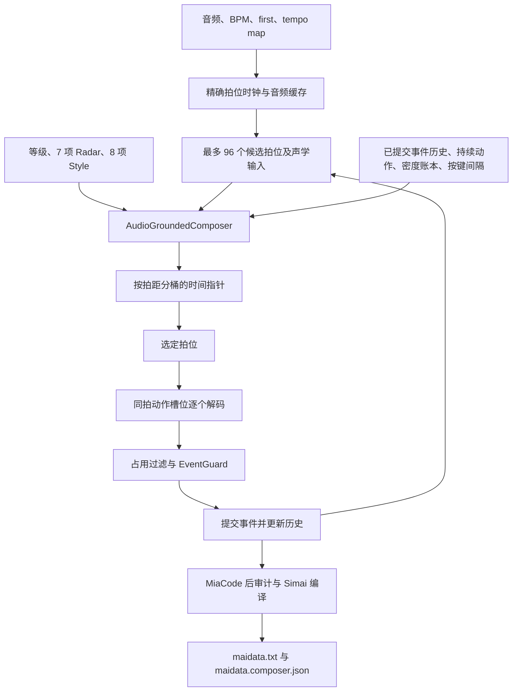

# ChartComposer 当前架构核实记录（2026-10-24）

> 2026-10-25 时效更新：架构主干和权重尺寸不变；Touch 采样改为保留各环区概率，恢复训练合同升至 `chart_composer_training_v10_touch_ring_recovery`。新目录 `Prism_composer_v9` 已 fresh 启动 20 轮，旧文件保留。下表为 10 月 24 日快照；最新运行与实测见 [10 月 25 日排查记录](COMPOSER_V9_FRESH_DIAGNOSIS_20261025_ZH.md)。

本记录对照当前工作区源码、实际检查点与本机任务状态编写。它补充同日的项目交接文档；历史实验结论仍保留在原文件中。文中的版本号分别表示模型族、架构、训练合同与本机实验目录，不能互相替代。

## 1. 当前依据与时效

| 对象 | 本次核实结果 |
| --- | --- |
| 工作分支 | `codex/composer-music-context-v2-20261023` |
| Git 最新提交 | `82984ca`，2026-10-22；当前架构的许多文件仍是未提交修改或未跟踪文件 |
| 当前模型族 | `chart_composer_v1` |
| 新训练默认架构 | `audio_grounded_v3`，不是旧 README 中的 `song_form_v2` |
| 当前训练合同 | `chart_composer_training_v9_active_slots_phrase_tail` |
| 已有最新 Composer 训练权重 | `checkpoints/Prism_composer_v7/composer_last.pt`，2026-10-24 08:23:56，旧 v8 合同 |
| 运行状态 | 核实时 7860、7861 端口各有一个 WebUI；任务列表中没有正在训练或生成的任务 |
| 新阶段目录 | 核实时尚不存在 `checkpoints/Prism_composer_v8` |

旧 README 最后修改于 2026-10-17，旧路线与旧使用流程需要更新。10 月 24 日的两份交接文档比它更接近当前实现，但有关训练进度、效果保证和提速倍数的表述仍需要以下限定。

## 2. 系统分层

这是一条离线、音频条件化的事件生成路线：先选下一事件的拍位，再组合该拍位的音符。它不逐字符续写 Simai 文本，也不是实时无前瞻音频系统。图中的历史状态只包含已提交的谱面事件；音频分支允许读取未来音频。

| 代码入口 | 职责 |
| --- | --- |
| `src/maichart/composer/grounded_model.py` | 当前音频锚定模型的前向、时间指针与同拍解码 |
| `src/maichart/composer/model.py` | 共享模型配置、基类、模型构建与负荷分支 |
| `src/maichart/composer/data.py`、`event_views.py` | 原谱到事件样本、可信监督、声学查询和缓存 |
| `src/maichart/composer/candidates.py` | 确定性候选网格与拍位特征 |
| `src/maichart/composer/audio_lens.py`、`planning.py`、`acoustics.py` | 局部听音、粗规划与声学上下文 |
| `src/maichart/composer/action_factors.py`、`events.py`、`workload.py` | 原子结构、事件元数据、按键间隔与负荷账本 |
| `src/maichart/composer/train.py`、`recovery.py`、`checkpoint.py` | 损失、训练、恢复监督和检查点合同 |
| `src/maichart/composer/generate.py`、`guard.py` | 全曲生成循环、采样与提交前检查 |
| `src/maichart/webui/composer_api.py`、`server.py`、`static/app.js` | 主工作台适配、任务调度及界面参数传递 |
| `src/maichart/generation/`、`form/`、`stream/` | 复用条件与编译审计、音频与原谱准备、增量持续动作状态；并保留历史模型路线 |

## 3. 模型的实际输入和输出

### 时间与音频

- `candidates.py` 使用 `absolute_recovery_v6_phase_safe`，在精确 `Fraction` 拍位上提出最多 96 个候选。原谱目标不会被额外塞进候选集合。
- 每个候选有 141 维特征：120 维音频特征和 21 维相对时间、节拍相位等特征。当前音频合同是 `native_dynamics_context_v3`。
- `AudioLens` 接收每个查询点附近的 `31 × 26` 特征，时间偏移为 `-0.20` 至 `+0.40` 秒、间隔 20 ms，使用非因果时序卷积。25 ms 是落音辅助目标的匹配容差，不是音频采样步长。
- `AudioPlanner` 在约四拍的计算跨度上预测事件率、头率、Hold、Slide、Touch 和休止六通道，再插值到候选时刻。这些计算跨度不等同于对真实小节或乐段的识别。
- 工作负荷预测使用 104 维声学上下文，预测局部事件率、头率和三种类型占比；另有区间音频和过去 1 秒、4 秒的负荷分支。

### 条件与因果谱面状态

- 条件向量为 16 维：归一化等级、7 项 Radar、8 项 Style。
- 历史保存最近 128 个事件；一个事件可含同拍多个音符，128 个事件不是固定秒数或固定拍数。
- 持续动作状态为 50 维；已提交负荷账本为 6 维。
- `head_timing` 是 33 个键区各 3 项，共 99 维，不是 33 维。
- 历史嵌入目前使用 `0.75 × 键位锚点嵌入 + 0.25 × 原始原子嵌入 + 结构因子嵌入`。同拍槽位的原子嵌入仍使用原始原子 ID。

### 两个决策步骤

1. 时间指针按 `0.5 / 1 / 2 / 4 / 8` 拍边界划分六档，先分配档位概率，再分配档内候选概率。最终历史残差受到幅度约束。
2. 在选定拍位逐槽生成动作，使用共享的原子分类头、10 组结构因子与相对键位关系。`0 = STOP` 结束本拍配置，曲终另由 EOS 和音频边界处理。

工作负荷、粗规划和落音辅助预测以 `detach` 方式进入决策表示。这使它们保留各自监督含义，但不能仅据此断言解码器已经有效使用这些信号。

## 4. 实际 v7 权重与入口默认值不同

| 项目 | `Prism_composer_v7/composer_last.pt` |
| --- | --- |
| 可训练参数 | 37,993,191 |
| 主干 | 384 维、6 层、8 头、前馈维度 1536 |
| 历史 / 候选 / 动作槽位 | 128 / 96 / 33 |
| 动作词表 | 18,453 个原子，加 STOP 共 18,454 类 |
| 共享动作头形状 | `[18454, 384]`，并非每个槽位一份完整分类头 |
| 保存进度 | `epoch=9`、`optimizer_steps=22000`、`epoch_complete=false`、`batch_in_epoch=8896` |
| 优化器实际学习率 | `5e-5`；保存的请求参数 `args.lr` 为 `2e-4` |
| 检查结果 | `valid / can_generate / can_init = true`；`can_resume = false` |

因此，不能把该权重称为“完成了 9 个 epoch”。同目录 `composer_inference.pt` 是第 8 轮、19,776 步的导出，并不是最新训练文件的同权重副本。

检查点记录的训练样本数为 949,015，候选目标总数为 952,710、漏召回 3,695，即参考历史上的候选召回率约 99.612%。这是检查点保存的统计，本轮没有重新扫描全部原谱；它也不代表自由生成时的可达率或经过生成端额外掩码后的召回率。

## 5. 训练链路

`ComposerDataset` 复用 `FormDataset` 的原始谱面、音频准备与质量记录，通过 `EventViews` 区分有效上下文、可信目标与未知区间。被排除的片段仍可保留为上下文，不会简单变成“应该休止”的负例。词表与同拍槽位容量由原谱构建；全量数据把请求的 8 个槽位扩展到 33。

当前训练包含时间指针、同拍动作、EOS、未来状态、工作负荷及变化量、过去负荷、落音辅助和粗规划等损失。v9 对 STOP 后填充槽位停止计损失，并加入纯音频动作辅助损失。全曲均匀秒级探针覆盖休止区；短程真实生成后的恢复训练只在可验证的条件下监督原谱后续时刻。

数据性能路径包括版本化磁盘音频 bank、mmap 视图缓存、受内存约束的驻留缓存、跨样本准备线程、歌曲局部采样和批次预取。监测时需要同时查看 `data_sec`、`compute_sec`、缓存与主机内存，不能只看显存占用。

## 6. 生成、约束与当前能力边界

- 主工作台先按检查点识别模型族，再转入 `composer_api.py`，以子进程运行 `maichart.composer.generate`。`/composer` 仍保留为独立入口。
- 同拍采样执行最多 2 个实际起点的保守生成策略；33 个槽位表示训练表示容量，不表示自由生成会复现全屏 33 Touch。
- 宏观类型概率在温度 1.0 下汇总，动作温度只调节类型内部采样；候选时间温度独立控制时间指针。
- 默认同键最短间隔为 50 ms。TapOnSlide 默认只报告；显式开启才在生成和后处理中拦截。
- 生成端优先保留分母为 `{1,2,3,4,6,8}` 的拍位与相邻偏移，但当这一集合为空时会回退到基础可用集合。因此“所测 A/B 未再出现微距爆发”不能扩大为“任何情况下绝不会生成这些细分”。
- 主工作台的手绘强度曲线、手工休止区与若干旧模型采样设置不在当前 Composer 生成 payload 中。`curve_strength` 调节的是模型学习的工作负荷、粗规划与负荷差引导，不是手绘曲线力度。
- 当前直接输出谱面 TXT 和 `.composer.json` 报告。旧模型的 `.chart.json` / `.quality.json` 不能当成所有模型族共有的输出承诺。

## 7. 下一阶段的具体起点

最初核实时，代码中的 v9 修复尚未经过新训练。同日接续已完成实际数据短程微调和固定音频对照，并启动新目录全量训练，原权重保留。结果及尚未完成的质量验收见 [v9 验证与训练接续](COMPOSER_V9_VALIDATION_AND_TRAINING_20261024_ZH.md)。

最初复现了微调默认尺寸错误：真实父模型为 384 维、6 层、8 头、前馈 1536、历史 128、候选 96、槽位 33，但 CLI/API 会误用新模型默认值。此路径已修复：未显式提供的主干参数继承父模型；显式提供的参数仍必须通过兼容校验。

旧交接提出的“有效学习速度提高约 25–40 倍”尚无本轮梯度实测或训练基准支持，不应作为已证实的训练吞吐、收敛速度或成谱质量收益。新旧损失的计分范围已经变化，loss 数值也不能直接横向比较。

## 8. 本次验证

- 当前工作区全部 Composer Python 测试：`170 passed`，26.96 秒。
- 前端生成控制：5 项通过；训练控制：9 项通过；强度曲线入口：2 项通过。
- 已实际加载 `composer_last.pt`，核对模型尺寸、参数量、训练状态、学习率和合同能力。
- 已只读检查两个本机 WebUI 的任务列表及最新训练日志；最新旧训练任务状态为 cancelled。

上述检查验证实现与兼容性，不替代完整谱面的对音、手法和试玩验收。
