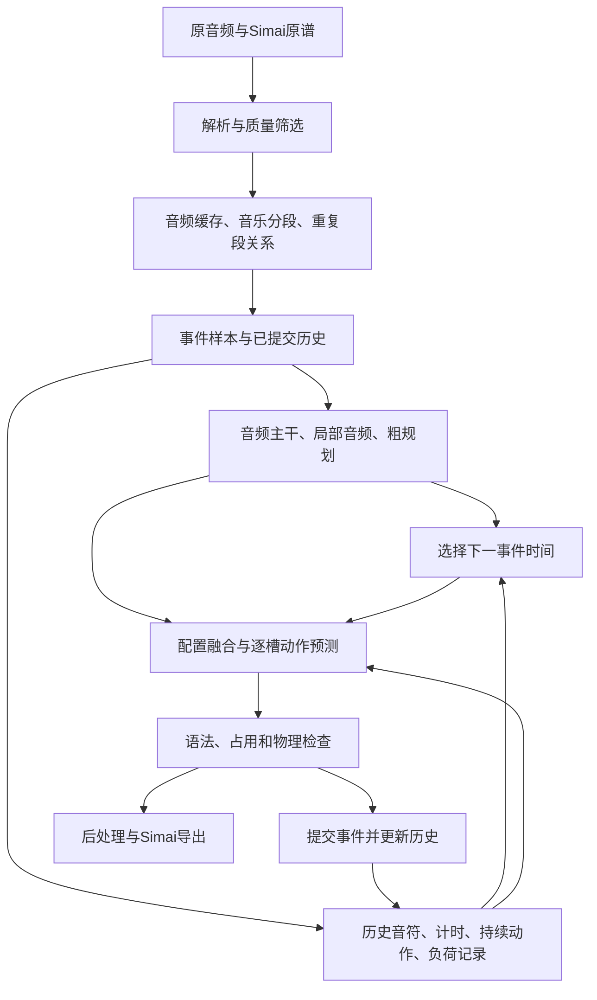

# 当前项目架构与全面排查交接

**核对日期：2026-10-27。用途：让独立协作者从实际链路重新审查整个项目。**

**最新默认值：** 已按用户要求落地[重训配方](COMPOSER_FRESH_DEFAULTS_20261027_ZH.md)，fresh启用动机档案，恢复间隔25，主界面提供“应用重训默认值”。本文服务/任务进度为旧快照。

**当日后续更新：** 本文已同步独立计时、首槽跨拍关系、持续恢复历史、区间动机和重试修复。交付范围、参数及验证详见[本轮结构修改](COMPOSER_RELATIONAL_REWORK_20261027_ZH.md)。下表原v13数据是旧进程快照；本轮末次只读检查时已到第12轮，仍在运行。新代码不会热替换它。

本文描述当前实现，并给出应当重新验证的接口。它不是“这些模块已经正确”的证明。既往文档中的“已排除”“正常”“已修复”，都只对当时的输入、检查点和测试范围成立；不要把这些措辞当作停止调查的理由。

阅读顺序建议：先看第1–3节掌握边界，再沿第4–9节逐层核查，最后使用第10节的审查清单。具体实验另见[本次独立审查复核](COMPOSER_INDEPENDENT_REVIEW_VALIDATION_20261027_ZH.md)，面向非开发协作者的原因说明见[配置学习问题说明](COMPOSER_CONFIGURATION_LEARNING_ROOT_CAUSE_20261027_ZH.md)。

## 1. 项目是什么，当前正在运行什么

项目接收音频、BPM/变速表、首拍偏移和目标等级/风格，输出Simai谱面。当前主线是 **ChartComposer**：先选下一组音符的时间，再逐颗选出同一时刻的配置。它不是逐字符续写Simai。

2026-10-27 **08:53，Asia/Shanghai** 只读快照：

| 项目 | 实际值 |
| --- | --- |
| 主模型族 / 架构 | `chart_composer_v1` / `audio_grounded_v3` |
| 正在训练的目录 | `checkpoints/prism_composer_v13` |
| 任务 | `c8fccaf268a1`，7860服务，running |
| 进度 | 第10轮，34,340次参数更新；会继续变化 |
| 数据 / 参数量 | 949,015个训练样本；40,976,103个参数 |
| 实际网络 | 宽384、6层、8头、前馈1536；词表18,454项含STOP；动作容量33 |
| 批量 / 学习率 / 精度 | batch64×累积4；0.0002；BF16 |
| CPU设置 | 算子线程16、样本准备线程2、预取4；这是运行值，不代表最优值 |
| 历史策略 | 完整几何v3、已提交因果状态v2、RMS上限8、Math历史注意力 |
| 动机 / 配置目标 | `audio_recurrence_archive_v1`；旧事件均值 `event_balanced_v1` |

这个目录的“v13”是实验目录名，**实际仍是v11训练合同**，与后文可选的v13配置恢复合同不是一回事。本轮没有停止或改写该训练。

当前开发分支为`codex/composer-causal-motif-touch-20261025`。最新结构修改以`331620e`为基准。不要覆盖既存的`tools/start_webui.ps1`改动和未跟踪的`docs/COMPOSER_ARCHITECTURE_ERGONOMICS_REVIEW_20261025_ZH.md`。

本机可用项目Python由`.webui-python`指向`.scratch/python312_runtime/Scripts/python.exe`，当前为Python3.12、PyTorch2.7.0+cu128。全局Python3.15不是这个训练环境。**`.scratch`内包含实际运行环境及保留检查点，不能当作可整体删除的临时目录。** 常规入口是`START_WEBUI.bat --port 端口`。新代码验证服务为7874；7860监控原训练，7871–7873是此前版本。

## 2. 仓库的层次与真正入口

| 区域 | 作用与审查边界 |
| --- | --- |
| `src/maichart/composer/` | 当前事件模型、样本、训练、采样、恢复和检查点 |
| `src/maichart/form/` | 原song-form模型，也提供当前Composer正在使用的音频、分段、重复段检索和准备缓存；不能视为无关旧代码 |
| `src/maichart/generation/` | 音频提取、Simai编译、条件、物理冲突检测和后处理；同样是当前主线依赖 |
| `src/maichart/stream/` | 原stream模型，以及Composer复用的增量状态等组件 |
| 根包的`event_timing.py`、`notes.py`、`duration.py`、`tempo_clock.py`等 | 谱面解析、时值、变BPM和时间转换的基础层 |
| `training/`、`models/`、`tokenization/` | 旧训练族及共享预处理。不能用旧模型的参数/日志解释Composer |
| `webui/` | 主界面、检查点识别、参数解析、子进程任务和进度展示 |
| `scripts/`、`tests/`、`docs/evidence/` | 诊断入口、局部验证和实验记录；通过测试不等于生成质量通过 |

主界面`/`的`index.html`、`app.js`通过`server.py`调用`composer_api.py`，后者启动独立进程：

- 训练：`python -m maichart.composer.train`。
- 生成：`python -m maichart.composer.generate`。
- `maichart-gui`由`pyproject.toml`注册到`maichart.webui.server:main`，只对安装了本项目的Python环境有效。

独立`/composer`页面仍留在源码中，但用户已弃用。新增控件必须检查主页面、请求payload、API实际参数、训练子进程和结果回填，不能只验证独立页面或CLI。启动中的WebUI不会因为磁盘源码变化就自动重载所有Python模块；主页面会检查后端能力版本。

## 3. 从文件到谱面的总链路

训练主要使用原谱历史；生成则把自己的输出写回历史。恢复训练只是一条稀疏的补充路径，不能把它的存在等同于已经充分训练了这个循环。

## 4. 数据、时间和输入：最需要逐项核对的接口

入口：[data.py](../src/maichart/composer/data.py)、[form/data.py](../src/maichart/form/data.py)、[event_views.py](../src/maichart/composer/event_views.py)。

`ComposerDataset`复用`FormDataset`。默认选等级12–15、难度槽4–6中的可用谱面；不代表manifest里的全部歌曲/全部难度都进入训练。未知或排除区间可保留为上下文，同时屏蔽相应监督。应核对这种筛选是否改变了类型、等级和配置分布。

用户此前明确暂不扩展`$`星形Tap、分段独立时值串联Slide等语法。全面审查仍应检查它们是否被正确识别、排除和报告；不要把“范围内不支持”直接改成静默近似解析。

每个样本预测下一组原谱事件。已有事件是上下文，候选时间由上一事件及时间网格产生。当前数据共952,710个候选目标，其中3,695个未进入可监督候选，最终949,015个样本。需要检查漏掉的是否集中于特定节奏、休止或变速位置，不能只看总体覆盖率。

同拍音符按atom字符串排序，再赋予槽位。ID 0是STOP；模型词表是完整音符类别，不是单独的键位表。当前容量33来自数据自动扩展，不是要求每拍生成33颗。

下表为grounded样本/批次的主要含义，`B`为batch、`H≤128`、`C=96`、`Q=C+16`、`P`随歌曲长度变化：

| 输入 | 常见批次形状 | 含义 |
| --- | --- | --- |
| `candidate_features` | B×C×141 | 120维声学加21维候选时间特征 |
| `candidate_target` / padding mask | B / B×C | 原谱目标候选、不可用候选 |
| `history` | B×H×S | 已提交事件的音符ID；S按batch裁到实际需要 |
| `history_features` | B×H×8 | 相邻事件的时间/内容摘要；没有逐历史事件配对的声学向量 |
| `action_target` | B×S′ | 当前同拍序列；保留首个STOP，满容量时由上限终止 |
| `head_timing` | 新策略B×C×123；旧策略99 | 41个位置的见过标记、秒龄、拍龄；按钮1–8与Touch分开。不是增加历史长度 |
| `action_state` | B×50或B×C×50 | 已提交持续动作的状态，取决于策略 |
| `ledger` | B×C×6 | 已提交事件/头数在过去1秒、4秒中的负荷，以及时间跨度 |
| `condition` | B×16 | 等级与Radar/Style条件 |
| `audio_lens` / mask | B×Q×31×26 / B×Q×31 | 每个时点附近31个有序音频帧 |
| `workload_audio` | B×Q×104 | 短、中、长窗口及全曲音频摘要 |
| `interval_audio` | B×C×16 | 最后已提交事件到候选之间的音频摘要，含端点音高变化摘要 |
| `trailing_audio` | B×Q×52 | 过去1秒、4秒的音频摘要 |
| `planner_audio` | B×P×104 | 四拍计算块的音频；四拍块不等于已确认的音乐乐句 |
| `motif_ids` / mask | B×M×S″ / B×M | 从当前历史窗口之前检索的已提交配置；M通常16 |

`collate_composer`对历史在右侧补零；对动作目标和历史槽位裁去无用尾列；对全曲规划长度补齐并产生mask。内部空洞、STOP之后的尾部、空历史、全空动机应分别检查，不能将“0”一概解释为同一语义。

需要特别复核一个现有表示选择：33个计时pad把按钮1–8映射到A1–A8，因此按钮1与Touch A1共用计时格；开放Touch布局的运行时约束却区分两类实际头。它是否丢掉了配置学习需要的信息，尚未完成干预验证，不能仅凭“有99维计时特征”就视为精确描述了全部状态。

音频是已知完整输入，可以读取前后窗口；谱面历史必须严格来自已提交前缀。复查泄漏时要分清这两者。所有`beat`、秒、音频帧、BPM、`first`以及包含/不包含边界的转换，都需要端到端对照，而不仅是函数单测。

## 5. 模型内部如何分工

主实现：[grounded_model.py](../src/maichart/composer/grounded_model.py)，公共结构：[model.py](../src/maichart/composer/model.py)。

1. **听音乐。** 候选声学和时间特征进入音频Transformer；局部音频由`AudioLens`编码；粗规划预测事件率、头数、Hold/Slide/Touch比例和休止。条件和音频摘要共同形成音频表示。
2. **读历史。** 音符嵌入、解析几何、因子嵌入、逆序位置和8维历史特征进入另一个Transformer。输出经可选RMS上限保护，再由当前音频查询历史。最后一条历史的表示还有直接加入融合的通路。
3. **读其他历史状态。** `head_timing`、`action_state`、`ledger`分别投影后加入历史侧。它们与音符历史有重叠信息，但用途并不完全相同。
4. **选时间。** 音频分支先按时间距离分组，再选组内位置；历史只提供有界的选时修正。因此选时和配置对历史的依赖机制不同。
5. **选配置。** 当前音频与上述历史项相加，再经过LayerNorm、Linear、GELU。当前已有音符的嵌入与槽位嵌入继续进入配置解码。输出为全词表分类器，加上类型、键位、时值、Slide等共享因子分数。
6. **读动机。** 动机分支在选定时间之后读取普通历史窗口以外的已提交事件，提供有界修正。它不保证存在匹配，也不保证恢复正确的音乐结构。

“组合因子”仍是给完整音符分类加分，不等于已把类型、键位和时值改成完全独立的预测任务。同拍相对因子仍只用于后续槽；新`relative_heads_v1`专门为首槽加入上一事件按钮头的相对关系，在Tap/Hold/Slide各自类别内保持概率总量。`previous_heads`与本次forward绑定，跟随历史遮挡，不能从另一批数据拿来解码。首槽仍承担很多判断，排序还会改变首槽分布。

历史音符没有直接配对的历史音频是代码事实；模型已有过去音频摘要和区间端点变化，因此不能把这一事实改写成“完全没有过去音频”。本轮已实际测试补音频和显式相对关系，均未在短训观察集胜过基线，详见实验报告。

## 6. 学习标准与训练步骤

实现：[train.py](../src/maichart/composer/train.py)、[objectives.py](../src/maichart/composer/objectives.py)。总loss包含：

| 项目 | 当前系数/口径 |
| --- | --- |
| 选时、配置 | 各1 |
| 整曲结束、未来意图 | 0.05、0.2 |
| 负荷曲线、变化斜率 | 0.4、0.05 |
| 音频独立选时与配置 | 二者共同乘`audio_pointer_weight`，默认0.15 |
| 过去负荷预测 | 0.2 |
| 局部占用、粗规划 | 默认0.15、0.2 |
| 恢复训练 | 单独触发、单独加权回传；不要当成已包含在普通batch均值里的同口径读数 |

不同目标有各自mask、样本权重和分母，必须检查实际参与监督的量。总loss约4不能自动解释成算法失效，也不能把它解释成“固有底噪”。检查梯度、固定样本、其他歌曲和实际输出，才能区分学会局部样本与学会可推广配置。

三种“配置学习目标”：

- `event_balanced_v1`：旧事件均值，STOP权重0.35，再按事件内部加权平均。已证实存在结束概率偏差，保留用于原训练兼容。
- `joint_event_nll_v2`：完整同拍序列的联合误差，不再按未来序列长度或STOP类别降权。总值不能直接和旧目标比。
- `joint_event_recovery_v3`：同一联合目标，并在恢复历史后学习经过合法性检查的原谱配置。现在是grounded fresh自动目标；尚未通过全量训练和整曲质量验收。此前旧短恢复实现减少重复但增加Touch，不能套用为新实现的结果。

普通训练流程是：CPU选样本、构造特征和collate → 传设备 → 前向与loss → 累积梯度 → 可选恢复采样与回传 → 梯度裁剪 → AdamW更新 → 有限值检查 → 日志/检查点。FP16有缩放器，BF16路径不等于拥有同样的缩放保护。有限值检查也不能发现“数值有限、表示已经退化”。

恢复训练默认每25次更新处理2条轨迹，各追加2步，可选2–4步。新`generation_matched_recovery_prefix_retry_v3`保留自产历史，继续推进到历史窗口上限（最多128，按步数向上对齐），并共用生成分组选时、Touch保护和前缀重试。检查点保存轨迹，梯度异常跳步时回退。只有合法原谱续接参与配置监督；类别接受率和自产长度有日志。每次计算仍是短展开，不能把它当成整曲训练或最佳续接标签。

## 7. 生成不是一次前向：每一步都可能改变分布

实现：[generate.py](../src/maichart/composer/generate.py)、[action_guidance.py](../src/maichart/composer/action_guidance.py)、[guard.py](../src/maichart/composer/guard.py)。

1. 加载检查点、实际条件、音频、BPM/变速和`first`；生成声学缓存、粗规划和音频段关系。
2. 从最后已提交事件构建候选；再应用边界、相位、持续动作和容量判断。
3. 选时采用分组概率；温度/截断主要作用于组内，不能当成普通全局softmax温度解释。
4. 动作逐槽生成。首槽禁止STOP，已有头、冷却时间、排序和按钮预算影响可选词表。
5. 动作类别/Touch区域先保留类别概率，再在组内温度采样和截断；Touch历史保护还可能先改概率。
6. 完整事件交给运行时物理检查。新策略定位并封禁最短失败前缀；旧策略直接封禁首个atom。实际重试策略与检查点训练策略分别记录，失败后仍可能换候选。
7. 只有通过的事件才提交到历史、负荷、持续状态和动机档案。搜索时钟与最后已提交时钟有区别。
8. 达到结束条件后，再经后处理、编译输出TXT与JSON报告。

所以“训练前向和生成首槽logits一致”只验证其中一个接口。它不验证同拍后续槽、约束后分布、拒绝路径、长历史状态、后处理、完整歌曲或听感。

应保留两份配置统计：后处理前与导出后。重复、Touch比例、物量、时间跨度、残留冲突必须一起看。报告中“可拦截冲突为0”不等于全部硬冲突为0，更不等于可玩。

## 8. 动机分支、缓存与本轮修复

音乐分段和复现关系来自`form/segmentation.py`、`form/recurrence.py`。`max_region_seconds=999`只放宽计算切片长度，不会强制把音乐关系变成一段；不能据此解释零命中。

当前V3复现关系把乐段分为24格，每格按20ms频谱和5ms动态采样后积分；门槛0.75，拍数比例0.75至4/3。频谱复用本段内缓存节点，动态使用波形前缀和，不新增FFT。旧V1/V2仍是每格单点。Composer再排除普通历史窗口内的事件，并按投影时间选最多16项。

按运行中v13的旧描述方法，本轮随机8192个训练样本只有19个动机命中，约0.23%；8171个没有先前音频关联，2个只在普通历史窗口内有可用内容。样本覆盖1754/1787份谱面。**该训练的动机分支训练机会很少，这是必须继续检查的事实，不能因模块存在就把“长程结构已解决”写入结论。** 修复后只另查了32首歌曲，尚无新版全量命中率。

前一修复先抑制平坦通道的数值噪声，32首关系仍为3条。本轮已落地区间积分，并修正跨段边界插值污染；同32首V2为3条、最终V3为9条，尚无全量命中率或误匹配验收。不能把关联数量当作质量结论。

输入身份校验包括`motif_relations_sha256`：覆盖区间、实际选用的关系顺序和相位；新版检查点记录`motif_input_policy=interval_integrated_temporal_v3`。只改变未使用的诊断文字，或相似度小幅变化但选用顺序不变，不会改变关系指纹。缓存另记录明确的分段、复现参数和组件语义版本，不按整文件AST哈希失效。

旧检查点生成保留各自V1/V2动机输入，新训练为V3；未识别的策略会被拒绝。本轮以fresh为主，旧训练接续按检查点检查结果处理，保留新目录，不手改标记。没有引入额外全局准备合同来拒绝全部旧点。运行中v13仍使用它已经加载的实现。

缓存也属于训练语义。**准备缓存虽然记录源码哈希，但`PreparationCache._normalized_identity`会剔除它，实际按显式语义字段判断复用。仅修改源码不会自动使旧缓存失效。** 本轮把动机描述策略加入缓存身份并验证旧、新缓存隔离，否则修复后仍可能读回旧关系图。其他缓存语义变化是否都有正确版本，是全面审查的优先项。

音频节点bank用mmap复用；歌曲表、状态、局部音频与规划还有内存缓存。复查内容身份、生命周期、线程安全、模型更新后是否失效，以及读取失败是否悄悄变成零输入。缓存命中不能证明内容正确。旧Form入口默认保留原动机描述；新版Composer动机训练显式选用修正版，避免无意切换其他模型族。

## 9. 检查点、环境与效率边界

| 名称 | 当前含义 |
| --- | --- |
| schema | `maichart-chart-composer-checkpoint-v2` |
| 输入合同 | 新计时/跨拍策略为`chart_composer_inputs_v3_separate_pads_relative_heads`；旧策略仍为v2，另有策略字段和数据指纹 |
| 主训练合同 | 按目标分别为v11旧目标、v12联合似然、v13配置恢复 |
| 动机训练标记 | `symbolic_masked_archive_v1`；另有本轮新增动机输入标记 |
| `composer_last.pt` | 含优化器、进度和随机状态的完整点 |
| `composer_inference.pt` | 推理权重，通常没有可直接resume的优化器状态 |

检查点元数据、UI回填、实际CLI参数、运行日志应互相核对。fresh、resume、finetune不能互换；尤其不能仅因为权重能加载，就认为可以恢复原数据游标和优化器。

另需检查外部/手工构造的检查点：训练代码目前只在旧点带有`dataset_fingerprint`时比较数据指纹；缺失字段的处理不能因为正常生产保存总会填写它而被忽略。本轮新增的动机标记也不等于所有检查点完整性条件已穷尽。

CPU负责准备、查询、状态与组批，GPU负责主要网络计算。DataLoader本身默认worker为0，另由`LayoutBatchPrefetch`做线程预取。CPU算子线程、样本准备线程、预取深度是三种不同参数。不能将更多线程、较大batch或更高GPU利用率直接等同于更快学习。

速度应同时记录：实际样本/秒、参数更新/秒、数据等待、计算时间、主机内存/提交量、GPU显存与实际利用率。异步CUDA会把等待计入后续主机区间；累计`data_sec/compute_sec`不是纯GPU内核计时。源码中的近似耗时或CPU短测不能代替本机GPU剖析。

用户特别指出v7/v8乃至v6以前学习更快。后续需建立按实际commit、模型尺寸、数据指纹、历史/候选/槽位长度、损失分项和有效batch对齐的版本对照表。不能从目录编号推断结构，也不能只比未经对齐的总loss或单轮耗时。这个跨版本根因比较仍未完整完成。

此前历史音频原型只在研究脚本中，未合入。本轮正式新增独立计时投影和按钮跨拍关系：384维时共50,304参数，正式层数不变，输入版本更新。旧研究权重仍是单独schema，不应改名当成正式检查点。

## 10. 全面排查清单：以前“正常”也要重新查

| 审查面 | 要回答的问题 / 有效证据 |
| --- | --- |
| 原谱解析与编译 | 解析再导出是否保留同拍组合、Tap/Slide头、等待期、时值、变BPM和边界？按音符事件比较，不只比字符串 |
| 数据筛选 | 不支持语法、质量标签和候选漏召回是否集中丢掉某类配置？哪些位置保留为历史却不被监督？ |
| 声学时间轴 | waveform、缓存帧、native动态、chroma、首拍和变速是否在同一时钟？音频不同入口是否给出相同位置的特征？ |
| 因果输入 | 原谱表可复用，但每个查询是否严格限制已提交事件？计时、持续状态、ledger、motif、恢复各自检查 |
| 监督定义 | 每项loss的目标、mask、权重、分母是否表达实际需求？不能用总loss大小替代这个检查 |
| 输出排序与类别 | 首槽偏斜、长Slide变体和同拍序列顺序是否拖慢学习？若试无序目标，须同时调整生成约束与评估 |
| 音频/历史融合 | 多路历史是否提供重复的捷径？不同分支幅度、梯度和长期更新是否协调？用受控干预而非只看模块图 |
| 训练与生成 | 同一实际前缀重建的全部输入是否一致？验证多槽、动机、选定状态和随机分支，不能只测首槽 |
| 长程反馈 | 单步校准正常时，长历史是否仍进入单调状态？同时检查产生坏前缀的概率和进入后能否离开 |
| 恢复训练 | 标签是否合法之外，是否仍是合理续接？短步数能否覆盖真实坏状态？是否只改善参与训练的小集合？ |
| 动机与规划 | 实际命中/激活/梯度是多少？粗规划被使用还是仅完成辅助任务？空分支的耗时和误导性指标如何处理？ |
| 采样和拒绝 | 类型概率经温度、截断、Touch保护、mask和重试如何变化？封禁首atom是否连带排除了很多合理组合？ |
| 物理判断 | 训练表状态、增量状态、guard和最终后处理是否用同一几何与时间语义？报告策略是否被误读为通过？ |
| 优化器与数值 | BF16/FP16/FP32、SDPA后端、梯度裁剪、Adam状态、评估缓存是否在真实硬件有效？有限不代表稳定 |
| 跳过异常批次 | 丢弃非有限batch或整段梯度累积后，日志分母、样本游标、保存点和优化器步数是否仍一致？ |
| 续训与并发 | 数据顺序、随机状态、轮中重分batch、锁、取消、文件替换及多服务是否一致？旧后端能否忽略新参数？ |
| 评估分母 | Touch是否被合并成“一个键”？重叠历史是否重复计数？等级/歌曲/种子是否匹配？样本是否曾被父模型训练？ |

历史上重要但仍需按范围复核的点：历史向量尺度失控、BF16融合注意力反向异常、fused Adam后的评估缓存、因果持续状态、同拍Touch预算、候选相位、窗口边界和UI参数被覆盖。相关修复并非全模型质量保证；重新复现时要记录当前代码、硬件、权重和输入。

## 11. 下一位协作者怎样开始

1. 查询当前任务、检查点、git状态和真实环境，记录时间。先保护原检查点，不要从本文旧快照推断任务已结束。
2. 固定至少一份完整检查点和一组同歌曲/条件/种子基线。分别记录原始模型概率、约束后的提议、提交后的历史与导出谱。
3. 为每个候选原因写最小反例或干预；原型与基线保持样本、随机状态、目标和训练预算一致。失败实验也保留。
4. 新架构先在有限数据上检查梯度、可学习性、观察样本、已有选时能力与成本，再扩大训练。新输入/目标使用新目录与明确迁移规则。
5. 验收不能只有单步loss：还需实际生成历史、完整歌曲、跨歌曲条件、物理检查及人工配置审阅。没有做的项目明确留空。

最新结构修改完成1,221项Python、80项前端回归，12项跳过；真实主界面fresh完成12次更新，新小模型完成16事件生成，冻结step29664完成双种子×两种重试策略的128事件对照。对照没有显示重复或Touch改善；第二种子仍有4个仅报告硬冲突。没有完成新结构全量训练、整曲人工配置验收或所有旧模型族质量验收。

本轮冻结step29664检查点、1536行探针配对音频、五组短训、动机统计与原型脚本位于`.scratch/composer_independent_review_20261027/`；主要结果收录在[证据JSON](evidence/COMPOSER_INDEPENDENT_REVIEW_VALIDATION_20261027.json)。原数据与研究权重未上传GitHub，跨机器接手时需单独取得它们。不要将“代码可运行”“权重可加载”“统计指标改善”和“谱面更好”合并为一个结论。

部分研究脚本使用实验时`dd8cbfb`的内部接口；复现应在隔离目录核对基准与接口，不要就地切换正在训练的工作树，也不要覆盖既有实验结果。
