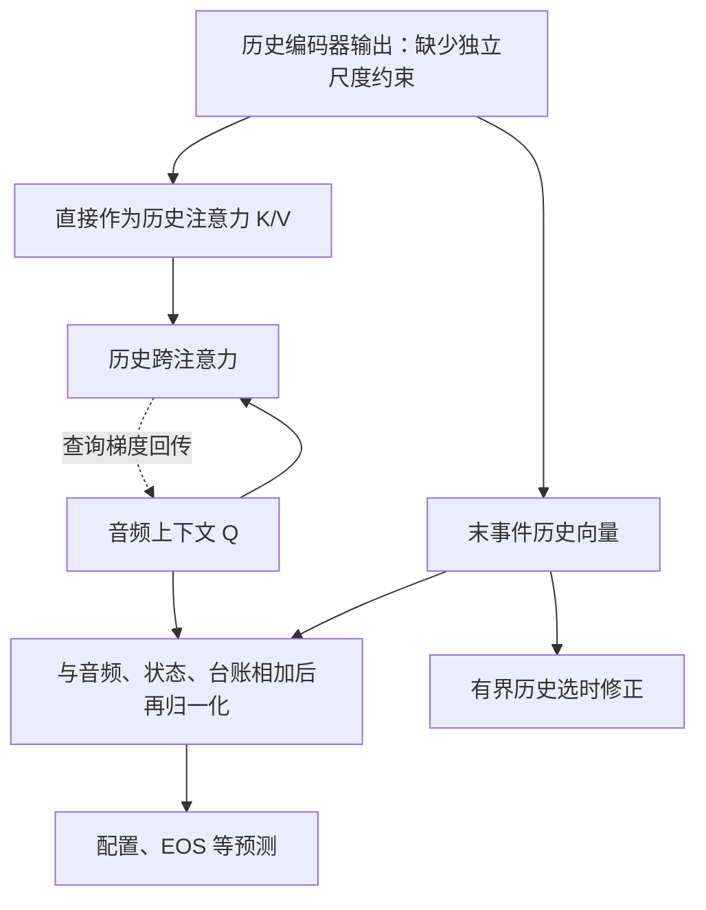

# Composer 第5轮退化：结构性失稳入口与因果验证

> **2026-10-26后续复核：** 新增最小反例确认本机BF16融合注意力带dropout时存在错误Q/K反向梯度；此前前向精度对照不能排除该问题。已落地局部Math保护和版本化历史RMS上限，旧检查点行为保留，需显式finetune启用。128次实际更新及双种子短生成已完成，长程仍停止。证据、控件、兼容边界见[数值稳定性修复](COMPOSER_SDPA_STABILITY_FIX_20261026_ZH.md)。下文“未进入生产路径”等描述保留为上轮实验时状态。

源码基准：`c25f1a7`，工作区`E:\simai_transformer`，日期2026-10-26。本文接续[上轮能力审查](COMPOSER_CAPABILITY_REVIEW_20261026_ZH.md)，专门回答“是什么导致了退化”，不把调小学习率当作完整的根因解释。

**已定位的主要结构性问题：历史编码器输出缺少独立的尺度约束，同一份记忆直接作为跨注意力的K/V，并把末事件向量加入配置融合。实际训练中，部分历史向量先出现异常放大，通过跨注意力的查询梯度牵动音频主干；随后历史表示发展成几乎相同的巨大公共方向，配置条件被压低，历史选时修正饱和。** 固定0.0002学习率推动了这一过程；只调整历史记忆接口的幅度、保留原学习率，也能在受控复跑中阻止本段配置塌缩。

这是对**本次16,000步附近退化**的主要因果链的定位。它有检查点追踪、模块替换、梯度路由干预和实际数据短训支持；尚不等于证明全部早期质量问题只有这一个原因，也不等于80轮稳定性或音乐质量验收。

正式任务`78f828eaac2a`保持停止。此次共完成6组隔离训练实验、1,800次优化器更新，合计460,800次样本呈现，其中包含各组重复使用的样本；没有更换生产架构、覆盖原检查点或启动新的长程训练。

## 1. 实验怎样确保可比较

- 当前模型是`audio_grounded_v3`，实际执行`AudioGroundedComposer.forward`。不能把基类`ChartComposer.forward`的变量或路径套用进来。
- 短训从第5轮16,000步完整点出发，恢复原模型、Adam一阶/二阶矩、CPU/CUDA随机状态和epoch loader RNG。
- 重建第5轮原Sampler，从已消费4,672个microbatch之后开始；保持batch64、梯度累积4、locality4、BF16、原loss/词表/遮挡设置。
- 保持恢复采样每100更新、2样本、滚动2步、权重0.1；其提案会随模型变化，不能宣称每组恢复目标逐个相同。
- 相同长度的实验有相同样本序列SHA-256：四组200步为`61e9db13a25896b710a372fa05189139c183467dcc47fe5f4bc63f741e188e6a`；两组500步为`ffb712c62dc5bc5b2868169f0a161659eb93f9814a8124378cd981b245aa3f5c`。
- 共同probe为384行、动作权重和404，采用相同的CUDA FP32前向与按真实分母汇总的CE。它来自32首阶段heldout歌曲，但父模型此前见过这些歌，不能当全局未见测试集。
- 该probe没有motif输入；另用8行、权重和9的真实非空motif fixture核验完整动机路径。
- CUDA归约存在微小非确定性。前三组首次训练loss相同，梯度norm存在约0.002%的差异；复跑能再现失稳，不能说每个参数逐位复现原历史轨迹。

全量数据指纹、精确词表均在每组准备后校验一致。每400个microbatch窗口涉及约48–53张谱面，没有发现采样器卡在单首歌或跳入另一个数据集的证据。

机器可读的[完整证据摘要](evidence/COMPOSER_INSTABILITY_20261026.json)和[实验曲线数据CSV](evidence/COMPOSER_INSTABILITY_REPLAYS_20261026.csv)与本文一起提交；本机权重、音频及大fixture不上传。

## 2. 结构中具体哪里缺少约束

### 历史残差流的输出没有独立归一化

[model.py](../src/maichart/composer/model.py#L151)使用`norm_first=True`构建Transformer层；`history_encoder`没有传入末端`norm`。层内部的LayerNorm作用于每个子层输入，不会自动约束最终残差流的幅度。

[grounded_model.py](../src/maichart/composer/grounded_model.py#L126)随后直接执行：

```python
memory = self.history_encoder(memory, src_key_padding_mask=attn_padding)
attended, _ = self.history_attention(audio_context, memory, memory, ...)
tail = memory[rows, last_index] * tail_valid[:, None]
symbolic = symbolic + tail[:, None] + history_gate.tanh() * attended
```

这里Q是融合后的音频上下文`audio_context`，K/V是`memory`。历史向量尺度过大且不均衡时，注意力的分数与值读取可以放大传回Q的梯度；标准的`1/sqrt(d)`只按维度缩放，不能保证实际K/V幅度有界。

这里Q/K/V指传给`MultiheadAttention`的查询、键和值输入，内部仍有可训练投影。本轮约束的是投影前的memory，没有证明投影后的每个注意力头永远有界；长期还需监控投影增益。

历史末事件向量还直接加入符号上下文。最后的`candidate_fusion`在**音频与符号分量相加后**做LayerNorm，并没有先平衡各分支：当一个大公共向量主导总和时，归一化后的方向仍主要由它决定，其他输入的变化被压低。



**症状分为两阶段：**早期不同位置的记忆幅度失衡，可以产生很大的查询梯度；后期大量表示趋于同一方向，信息区分度和历史修正作用下降。不能笼统地说“任意大范数一定造成大梯度”；相同公共偏移在softmax中可能抵消。本轮用真实batch的梯度干预验证了具体放大路径。

## 3. 从“幅度大”追到“实际信息塌缩”

以下测量的是模型**真正使用的最后一个有效历史事件向量**，不把padding查询输出的RMS混进来。前轮“整个history encoder输出RMS约24”与这个更精确的tail统计不是同一口径。

| 正式检查点 | tail RMS | tail公共均值向量RMS | 不同前缀平均余弦相似度 | 主动作CE |
| --- | ---: | ---: | ---: | ---: |
| 10,500 | 3.035 | 1.127 | 0.1395 | 2.3588 |
| 15,500 | 3.113 | 1.400 | 0.2120 | 2.2572 |
| 16,000 | 6.768 | 2.111 | 0.3446 | 2.3659 |
| 16,500 | 180.286 | 180.269 | 0.99983 | 3.1531 |
| 17,000 | 247.420 | 247.407 | 0.99991 | 3.1333 |

16,000步时tail中位RMS仍为3.44，但最大值已到54，出现少量异常样本。16,500步时，几乎全部tail的RMS都落在175–182，公共分量约180，去掉公共均值后的差异RMS仅约2.50。由此可以说发生了**放大与同向塌缩**，不能仅解释成正常分量幅度不同。

同时，`history_pointer(symbolic)`进入tanh前的绝对值均值由16,000步约10.25升至16,500步约183.95；在该probe上所有有效候选均超过5。到17,000步，主指针与纯音频指针的CE已近乎相同，历史选时修正失去实际区分作用。

这里涉及的是**历史选时修正的tanh**。报告曾讨论的`MotifMemoryAdapter`输出tanh是另一处，本轮没有证据要求移除其边界。正常模型也有部分tanh饱和；异常组合是表示同向化、候选修正趋同和历史信息价值明显丢失。

## 4. 反事实替换：坏在哪里

固定16,500步模型，只把指定模块换回16,000步权重，不训练、不改输入：

| 替换内容 | 主动作CE |
| --- | ---: |
| 不替换 | 3.1531 |
| 只恢复独立动作词表头 | 3.1567 |
| 只恢复结构因子 | 3.1577 |
| 只恢复历史编码器 | 2.6967 |
| 恢复音频与历史两个编码器 | 2.5068 |
| 再恢复音频输入投影与融合 | 2.4536 |

主要可恢复差距集中在编码器与输入表示，单独恢复分类头或因子没有救回。模块间有非线性交互，不能把这些差值换算成独立的“根因贡献百分比”。

另一个交叉检查：16,000步关闭token历史会把动作CE从2.3659恶化到2.7900；16,500步关闭token历史反而从3.1531降到3.0960。原先有用的历史通道，在退化后开始妨碍当前预测。

## 5. 具体梯度通路：音频主干怎样被牵动

使用同一个真实64行训练batch、16,000步权重、相同训练随机状态和BF16，只改梯度/记忆路径：

| 干预 | 当前前向loss | 音频编码器梯度norm | 全模型梯度norm |
| --- | ---: | ---: | ---: |
| 原路径 | 4.525694 | 12.3556 | 18.1067 |
| 仅将历史跨注意力的Q设为`Q.detach()` | 4.525694 | 0.9135 | 6.0087 |
| 仅限制送入跨注意力的K/V RMS≤8 | 4.539186 | 2.3844 | 5.8670 |
| 限制整个历史memory RMS≤8 | 4.539186 | 2.3844 | 5.8669 |

`Q.detach()`保持前向值不变，只切断`audio_context → 历史跨注意力查询`这一条反传路径；其他音频路径及音频辅助监督仍然有梯度。loss逐位相同而音频梯度明显下降，直接定位了该batch的大梯度来源。它是诊断干预，不是本轮采用的训练修复。

仅限制K/V与限制整个memory在这个batch上几乎一致，进一步将放大定位到历史读取接口。**不能说历史编码器参数自身占了全部大梯度。**实际原路径中audio encoder、audio projection、time projection合计占梯度平方和约89%；这正体现了历史读取通过Q回传影响音频主干。

## 6. 保留原学习率，结构干预是否仍有效

研究性干预仅在历史编码器输出处，对每个历史事件向量使用：

```text
h_out = h × min(1, 8 / RMS(h))
```

小幅度向量不变；每个历史事件向量单独计算RMS，不使用其他batch样本或未来谱面统计。该操作同时作用于后续K/V和tail。它没有添加新参数，保留原词表、loss、监督mask、batch和恢复采样。阈值8是本轮研究值，不能当作已验证的通用最优常数或现有WebUI参数。

### 同协议200更新

| 方案 | 学习率lr | 初始主动作CE | 200步主动作CE | 首槽精确率 | tail RMS |
| --- | ---: | ---: | ---: | ---: | ---: |
| 原结构 | 0.0002 | 2.3659 | 2.8341 | 18.32% | 65.36 |
| 原结构，仅降学习率 | 0.00005 | 2.3659 | 2.4487 | 26.73% | 17.15 |
| 原结构，仅降学习率 | 0.00002 | 2.3659 | 2.3023 | 29.70% | 3.52 |
| 历史memory限幅 | 0.0002 | 2.3583 | 2.2619 | 29.70% | 此时由限幅策略约束 |

结构干预的初始前向略有变化，表中如实列出。关键结果是**保留0.0002，处理历史记忆接口，也能使这段训练继续改善而非塌缩**。因此，较大固定LR是触发/放大条件，历史通路的尺度失控是有干预证据的结构性失稳入口。

原结构复跑前50更新已从2.3659恶化到2.8525；本段第一次新增recovery在第100更新。新增recovery并非这段退化发生所必需，不能据此又外推为历史所有recovery都无影响。

### 延长到500更新，覆盖原确认退化的区间

| 方案 | 主动作CE | 首槽精确率 | 主指针CE | 纯音频指针CE | 实际使用tail RMS / 平均余弦 |
| --- | ---: | ---: | ---: | ---: | --- |
| 正式原训练16,500点 | 3.1531 | 11.39% | 1.4283 | 1.4348 | 180.29 / 0.99983 |
| 原结构，lr0.00002复跑500步 | 2.2817 | 29.70% | 0.9341 | 1.0989 | 3.64 / 0.28395 |
| memory限幅，lr0.0002复跑500步 | 2.3169 | 29.70% | 1.0007 | 1.2154 | 4.02 / 0.24960 |

正式历史运行与复跑不是逐位等同轨迹；200步控制组提供了独立的同协议原结构重放。两组500步实验验证了更长区间内的抑制效果。

限幅模型关闭token历史后，主动作CE从2.3169恶化到2.7566，说明仍在使用有益的历史信息。限幅前原始tail RMS为6.06、最大约41.75，限幅后最大8；不能声称它让所有内部层的幅度都天然正常。

**仍有边界：**限幅+原LR在500步的纯音频选时CE比16,000起点略差，且主动作CE比其200步阶段略高。它阻止了本段严重配置塌缩，并未证明0.0002下所有分支都长期稳定。结构约束与合适的优化节奏应分别验证。

## 7. 为什么已有保护没拦住

训练会检查输出、loss、梯度、参数是否finite，并在AdamW前做全局gradient norm≤1的裁剪。这些检查按当前实现正确执行，但：

- 180或247的历史表示仍是有限值，不会触发NaN/Inf保护。
- 梯度裁剪不约束历史激活、注意力K/V尺度，也不直接限制AdamW归一化后的参数步长。
- 历史路径影响音频查询梯度，会改变全模型的裁剪比例；多任务间的有效更新比例也会随之变化。
- 当前没有固定验证probe、基于验证保留的best点或自动学习率调度，故有限数值的能力退化仍会保存为新的last。

原结构0.0002复跑200步的裁剪前梯度norm中位数约68.17、P95约317.31、最大697.63，所有更新都触发裁剪；memory限幅方案中位数约4.09、P95约7.40，同样全部触发裁剪。区别在裁剪前的放大程度和分支更新形态。**“已裁剪到1”不能代替稳定性验证。**

## 8. 已排查的其他解释与尚未证明的部分

| 检查 | 结果及限度 |
| --- | --- |
| CPU/GPU、FP32/BF16评估差异 | 坏点同样变差；固定probe的FP32/BF16动作CE差约0.0001–0.0006，远小于退化幅度。未做完整FP32长程训练，不能据此否定所有精度效应 |
| Adam状态损坏、非有限参数 | 原16,000/17,000点未见NaN/Inf或负二阶矩，LR没有意外跳变 |
| fused AdamW实现异常 | 用真实梯度与保存的Adam状态，对3个关键实际参数做CUDA fused/standard单步对照；最大参数差约1.2e-7，矩差为浮点误差量级。这是单步检查，不是所有长期内核行为的证明 |
| 梯度累积、恢复时序、模式切换 | 没发现漏清/错叠梯度、双step或模式未恢复；recovery仍只直接监督pointer |
| 因子eval缓存旧bug | 正常有grad forward与模式切换都会清缓存；本轮独立载入固定点，复跑仍能退化，不能用旧缓存问题解释本次结果 |
| 数据/词表/采样游标错误 | 每组校验数据指纹与词表，重建相同epoch游标/序列；没有单曲卡死。locality与长期梯度相关性的作用尚未单独排除 |
| 音频辅助损失必然冲突 | 未由本轮证实。发现的是历史cross-attention查询反传放大，不能偷换成“应删除音频辅助头” |
| motif上界导致一切 | 非空8行上，16,000→16,500的motif开启动作CE也从约2.362升到2.719，但开启档案仍优于关闭；motif在部分补偿，并非本轮应优先拆除的分支 |

非空motif小批次中，低LR500步约2.423，限幅500步约2.325，原16,000约2.362；前者在这一小批次略退、后者略升。不能根据384行probe单独宣布所有歌曲/档案都改善。

本轮没有单独分离每项历史损失在整段演化中的作用，也没有证明尺度约束缺失是所有训练任务中的唯一充分原因。**已经证实的是：明确的结构入口、该入口的异常梯度通路，以及保留原LR时针对该入口可阻止本段严重退化。**

## 9. 正式修复应落在什么位置

优先对**history encoder输出→跨注意力K/V及tail融合**建立独立的归一化/尺度合同，并增加表示与梯度健康监测。仅在最终混合后加LayerNorm、只补跨拍logits头、或移除motif的tanh，都没有处理本轮已定位的接口问题。

生产实现应版本化，旧检查点缺字段仍按原策略解释；训练、生成、recovery使用同一实现。变更不能当成无语义变化的性能优化直接resume。可比较末端RMSNorm/LayerNorm、受控增益、平滑幅度上限等方案，阈值8不应未经验收变成不可解释的硬编码。

新增可调策略须接入根路径主工作台的控件、保存/重置、检查点继承与有效参数回显；独立`/composer`页已经弃用。新字段还必须覆盖旧检查点缺字段及后端版本不匹配的诊断。

本轮实验为隔离变量保留了原Adam矩；现有`finetune`入口通常重置优化器，正式迁移必须分别核实这一差异。需要补的验收包括：多种子/更多歌曲、长于本轮窗口的稳定性、非空motif、稀有Hold/Slide/Touch覆盖、固定音频双seed生成与人工质量检查，以及实际吞吐。

根因调查期间没有把实验限幅结构接入正式WebUI，也没有悄悄更改生产checkpoint合同。限幅实验文件使用专门research schema，不能作为普通Composer模型加载；原结构低LR实验只导出了inference检查点，不能用它们恢复优化器。

## 10. 当前保留点、参数结论和复现入口

原v11、v12第10,500步保留点继续保留。本轮核实并另存更早、未出现同向塌缩的15,500完整点：

| 完整点 | 位置 | SHA-256 |
| --- | --- | --- |
| 15,500 | `checkpoints/Prism_composer_v12_preserved_20261026_step15500/composer_last.pt` | `b565f60eb70eb8daa5456252dd972c125ed4439e7cc273c8cf0f2903b16a3deb` |
| 16,000 | `checkpoints/Prism_composer_v12_preserved_20261026_step16000/composer_last.pt` | `8869edf8d4af0378b44c2127b538d93a871f814e6f0e13585a82a02e63fb8791` |
| 17,000 | `checkpoints/Prism_composer_v12_preserved_20261026_instability/composer_last.pt` | `d5497843df4b8de06b75b72b43f6c930bb1e20ee29abe750d6967f0a58a00293` |

15,500是稳定对照，不是已完成音乐验收的“最佳模型”。原目录的`composer_inference.pt`仍是第4轮14,832点；`composer_last.pt`是已退化阶段的第5轮17,000点，两者不要混为同一权重。

若后续先保持原结构做恢复验证，已实测的**学习率lr=0.00002、batch size=64、梯度累积=4、BF16**可作为从16,000完整点出发的短阶段基线；它是当前状态的抑制方案，不是fresh训练的通用最优设置，也没有根除未约束历史接口的结构风险。本轮没有恢复80轮长程任务。

本机完整实验目录：`.scratch/composer_instability_rootcause_20261026/`。

- `isolate.py`、`base.json`、`swap.json`：固定点、精度及模块替换。
- `representation.py`、`representation.json`：真实tail与公共方向、tanh饱和。
- `replay.py`、`replay_*.json`：完整数据准备、严格序列重建和六组训练轨迹。
- `gradient_path.py`、`gradient_routes.json`：同前向值的Q梯度隔离、K/V与memory限幅。
- `optimizer_check.py/json`：实际参数与Adam状态的单步实现对照。
- `final_representations.py/json`、`motif_validation.py/json`：500步后的历史信息利用和非空档案检查。

本机复现示例，需使用新的实验名以避免覆盖结果：

```powershell
python .scratch/composer_instability_rootcause_20261026/replay.py --name verify_low --steps 200 --lr 0.00002
python .scratch/composer_instability_rootcause_20261026/replay.py --name verify_bound --steps 200 --lr 0.0002 --history-cap 8
```

这些是研究脚本，明确使用CUDA且会读取本机完整数据；不要与正式训练竞争资源。原谱、音频、fixture和研究权重均留在本机。本文与证据摘要用于接手，不能将短训、精确原子CE或表示健康度直接写成音乐质量已经改善。
