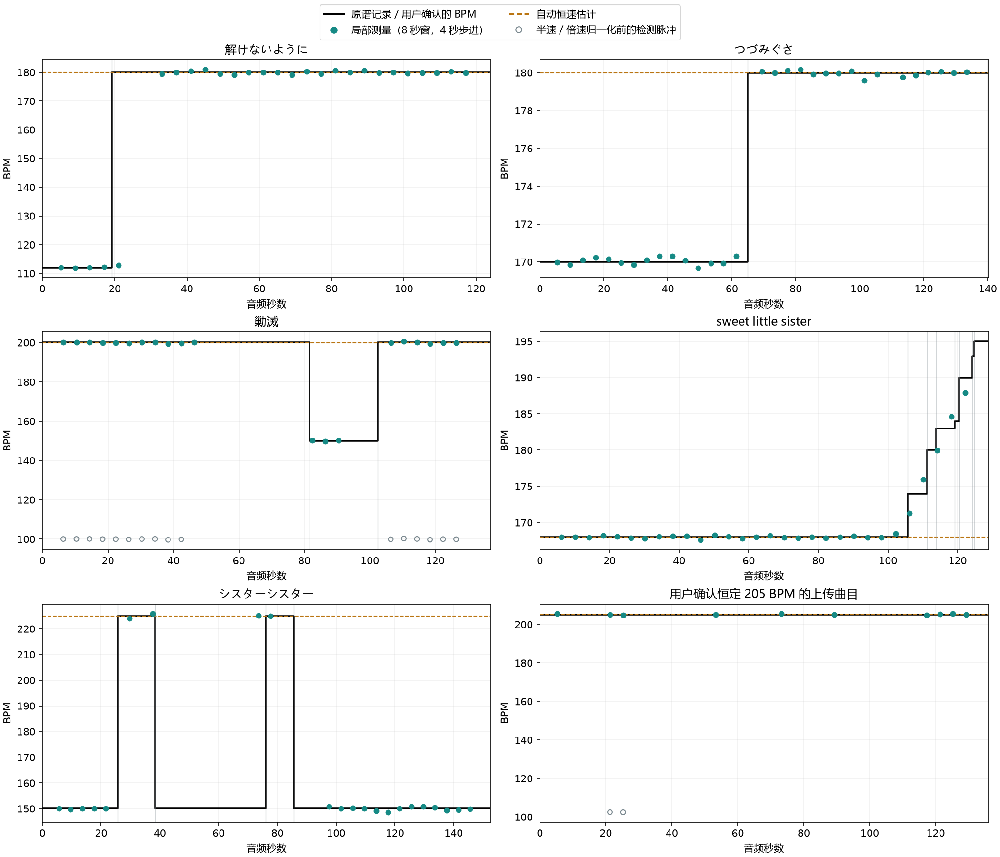

# Composer v2：BPM 与自动偏移修复及逐曲实测

日期：2026-11-05。仅修改生成前的音频时钟分析；没有停止训练，没有修改或替换任何检查点。

## 结论

用户确认恒定 205 BPM 的曲目，旧程序测出 205.33875，本轮修复后测为 **205.00000**。另一首恒速对照《my flow》由 157.00491 修正为 **157.00000**。这不是将所有 BPM 强制取整：只有整数与连续估计在整首检测跨度内的漂移差不超过 5 毫秒、拟合支持又几乎相同时，才选整数。真实小数 BPM 的回归测试保留了小数。

五首有原谱变速表的歌曲均给出了局部变速提示，但**没有一首因此被宣称完成了整张变速表的自动还原**。部分片段漏检、变速检测迟到、短加速段被合并的问题仍然存在。按用户“优先求稳”的要求，当前默认不把这些提示写进谱面。已知变速歌应填写“手动 tempo map JSON”。

## 问题和修复方式

1. **旧拟合容易跟着局部偏差跑。** 旧程序先找一小段稳定节拍，再把它推算出的拍号固定下来拟合全曲。205 案例只用了一个 32 拍的起点片段，未能从检测器的半拍切换中恢复。现在先寻找全曲共同支持的周期，再同时修正周期、相位和每个峰所属的拍号；每轮都重新分配拍号。
2. **首拍分析混入了不属于主要节拍的峰。** 现在用主要一致节拍估计相位，同时报告采用了多少峰、这些峰的误差和全部峰的误差。对手动 BPM，仅分析偏移，不再额外拟合一个用不上的全曲 BPM。
3. **变速不再静默当成恒速可靠结果。** 在 8 秒窗口、4 秒步进上观察持续速度变化，输出局部测量范围和中文警告。检测器的半速、倍速切换先做相应核对；这些仍是提示，不是已校准的变速点。
4. **不需要重建训练缓存。** 原节拍检测缓存继续复用，新的拟合策略单独记录为 `whole_song_pulse_consensus_v2`。分析在 CPU 上进行，默认 2 线程，不加载 Composer 检查点或 MERT，也没有改变训练架构。

## 测试方法和读数边界

自动 BPM 和局部速度测量只读音频，未输入原谱 BPM、变速位置或用户给定的 205。参考变速表单独从本地官谱 MASTER 读取。另做了“输入原谱变速表，只自动测偏移”的独立检查；它不能算作自动变速成功。

局部区间是检测窗口覆盖范围，**不是精确变速位置，也不是误差置信区间**。相邻窗口重叠；初步测量迟到或提前都可能发生。参考原谱的变速表是可核查依据，本轮未逐首人工听音确认原谱本身。



图中黑线为原谱记录，绿点为局部测量，虚线为自动恒速估计。灰圈为进行半速／倍速核对之前的检测脉冲。没有绿点不代表音乐恒速，可能是该窗口检测不可靠。

## 五首变速歌：逐首结果

| 歌曲 | 原谱 BPM 与变速时刻（秒） | 自动恒速估计 | 变速提示 |
| --- | --- | ---: | --- |
| 解けないように | 112（0.00s） → 180（19.29s） | 180.00000 | 有 |
| つづみぐさ | 170（0.00s） → 180（64.94s） | 180.00000 | 有 |
| 勦滅 | 200（0.00s） → 150（81.60s） → 200（102.40s） | 199.77926 | 有 |
| sweet little sister | 168（0.00s） → 174（105.71s） → 180（111.23s） → 183（113.90s） → 184（119.14s） → 190（120.45s） → 193（124.24s） → 195（124.86s） | 168.00000 | 有 |
| シスターシスター | 150（0.00s） → 225（25.60s） → 150（38.40s） → 225（76.00s） → 150（85.60s） | 225.01743 | 有 |

### 解けないように（11580）

音频：[track.mp3](<E:/后训练（官谱）/BUDDiES/11580/track.mp3>)。参考谱：[maidata.txt](<E:/后训练（官谱）/BUDDiES/11580/maidata.txt>)，MASTER，原谱 first 为 0 秒。

**局部测量：** 1.08–25.08s：112.22；29.08–121.08s：179.95。

识别出约 112 与 180 两段，但主要 180 段到 29.08 秒才出现于稳定窗口；原谱在 19.29 秒已经变速。窗口跨越了变化边界，不能把 29.08 秒直接当成真实变速点。单一 180 BPM 对开头也不适用。

**单独输入原谱变速表后测偏移：** 0.008295 秒（相对原谱 first 约 +8.3 毫秒）。这是节拍峰的一致性结果，未经人工试听校准。

可用于复核的原谱 tempo map（不能当作音频自动测量结果）：

```json
[{"beat": "0", "bpm": 112.0}, {"beat": "36", "bpm": 180.0}]
```

### つづみぐさ（11709）

音频：[track.mp3](<E:/后训练（官谱）/BUDDiES PLUS/11709/track.mp3>)。参考谱：[maidata.txt](<E:/后训练（官谱）/BUDDiES PLUS/11709/maidata.txt>)，MASTER，原谱 first 为 0 秒。

**局部测量：** 1.42–65.42s：170.05；65.42–109.42s：179.98；109.42–137.42s：179.96。

两种速度均识别出。两个主要窗口区间在 65.42 秒附近交接，原谱为 64.94 秒，相差约 +0.48 秒；这只是窗口汇总位置的差，不是声称获得了亚秒级变速精度。

**单独输入原谱变速表后测偏移：** 0.006590 秒（相对原谱 first 约 +6.6 毫秒）。这是节拍峰的一致性结果，未经人工试听校准。

可用于复核的原谱 tempo map（不能当作音频自动测量结果）：

```json
[{"beat": "0", "bpm": 170.0}, {"beat": "184", "bpm": 180.0}]
```

### 勦滅（11675）

音频：[track.mp3](<E:/后训练（官谱）/BUDDiES PLUS/11675/track.mp3>)。参考谱：[maidata.txt](<E:/后训练（官谱）/BUDDiES PLUS/11675/maidata.txt>)，MASTER，原谱 first 为 0 秒。

**局部测量：** 2.40–50.40s：199.92；78.40–94.40s：150.13；102.40–130.40s：199.93。

能提示 200 → 150 → 200，第二段只稳定覆盖约 78.40–94.40 秒。原谱 150 BPM 段为 81.60–102.40 秒；两端覆盖均不完整。部分检测峰还是 100 BPM 的半速脉冲，报告保留了归一化记录。

**单独输入原谱变速表后测偏移：** 0.009075 秒（相对原谱 first 约 +9.1 毫秒）。这是节拍峰的一致性结果，未经人工试听校准。

可用于复核的原谱 tempo map（不能当作音频自动测量结果）：

```json
[{"beat": "0", "bpm": 200.0}, {"beat": "272", "bpm": 150.0}, {"beat": "324", "bpm": 200.0}]
```

### sweet little sister（10225）

音频：[track.mp3](<E:/后训练（官谱）/BUDDiES PLUS/10225/track.mp3>)。参考谱：[maidata.txt](<E:/后训练（官谱）/BUDDiES PLUS/10225/maidata.txt>)，MASTER，原谱 first 为 0 秒。

**局部测量：** 2.18–110.18s：168.13；114.18–126.18s：186.28。

识别到末段持续加速，但多个很短的速度平台被合并为约 186.28 BPM 的粗略段。174、180、183、184、190、193、195 的具体变速表没有被逐个恢复。

**单独输入原谱变速表后测偏移：** 0.009803 秒（相对原谱 first 约 +9.8 毫秒）。这是节拍峰的一致性结果，未经人工试听校准。

可用于复核的原谱 tempo map（不能当作音频自动测量结果）：

```json
[{"beat": "0", "bpm": 168.0}, {"beat": "296", "bpm": 174.0}, {"beat": "312", "bpm": 180.0}, {"beat": "320", "bpm": 183.0}, {"beat": "336", "bpm": 184.0}, {"beat": "340", "bpm": 190.0}, {"beat": "352", "bpm": 193.0}, {"beat": "354", "bpm": 195.0}]
```

### シスターシスター（11748）

音频：[track.mp3](<E:/后训练（官谱）/PRiSM/11748/track.mp3>)。参考谱：[maidata.txt](<E:/后训练（官谱）/PRiSM/11748/maidata.txt>)，MASTER，原谱 first 为 0 秒。

**局部测量：** 1.62–25.62s：150.02；69.62–81.62s：225.01；93.62–149.62s：149.99。

只稳定捕获了后一次 225 BPM 的部分片段，第一段 25.60–38.40 秒的 225 BPM 没有形成稳定测量段；全曲估计还选到了 225.01743，不能代表主要的 150 BPM 段。这是保留手动变速表的重要反例。

**单独输入原谱变速表后测偏移：** 0.015280 秒（相对原谱 first 约 +15.3 毫秒）。这是节拍峰的一致性结果，未经人工试听校准。

可用于复核的原谱 tempo map（不能当作音频自动测量结果）：

```json
[{"beat": "0", "bpm": 150.0}, {"beat": "64", "bpm": 225.0}, {"beat": "112", "bpm": 150.0}, {"beat": "206", "bpm": 225.0}, {"beat": "242", "bpm": 150.0}]
```

## 恒速与偏移对照

| 曲目 | 旧 BPM | 新 BPM | 自动相位偏移 | 变速提示 |
| --- | ---: | ---: | ---: | --- |
| my flow | 157.00491 | 157.00000 | 0.011787s | 无 |
| 用户确认恒定 205 BPM 的上传曲目 | 205.33875 | 205.00000 | 0.185590s | 无 |

205 案例同一批 522 个检测峰：旧拟合采纳 261 个峰，新拟合采纳 292 个。两者各自采纳峰的 P90 误差为约 41.9 / 23.6 毫秒，样本集合并不完全相同。全部峰包含细分拍，不能要求它们全部落到四分音符节拍上。用户确认的 205 BPM 是这次回归的重要参考。

205 曲目的自动偏移约 0.185590 秒，但没有原谱 first 可作真值；它只代表主要节拍相位。`my flow` 原谱 first 为 0，自动偏移约 0.011787 秒。检测帧间隔是 20 毫秒，拟合可给出更多小数，但不代表拥有微秒精度。

## 在主界面如何使用

- 已知这首歌恒定 205：将 **BPM（可选）** 填 `205`。也可留空使用本轮修复后的自动估计。
- 需要自动偏移：勾选 **自动识别首拍偏移**；关闭时仍使用 **首拍偏移 / 秒** 的手动值，显式 `0` 不会被覆盖。自动偏移不是“第一声出现的时刻”，也无法仅靠声音决定第 0 拍应放在哪一个整拍或小节。
- 已知是变速歌：在 **变速与节拍高级设置 → 手动 tempo map JSON（可选）** 填完整变速表。其 `beat` 是四分音符拍位，不能把本报告的音频秒数直接填进去；变速表优先于单个 BPM。可在已提供正确表后，单独开启自动偏移。
- 识别结果、警告、局部速度和最终采用的时钟写在生成日志与 `.composer_v2.json` 的 `timing` 中。旧后台启动的新生成子进程也会读取本轮时钟代码；刷新网页可看到更新后的说明，无需为此中断训练。

只测量、不生成谱面，也不加载检查点：

```powershell
.\.scratch\python312_runtime\Scripts\python.exe -m maichart.composer_v2.tempo --audio "E:\simai_transformer\webui_workspace\uploads\705db626a3fb_track.mp3" --output ".scratch\timing_measurement.json"
```

上述命令省略 BPM / first 时自动测量；增加 `--bpm 205` 可以固定速度、只测偏移。输出 JSON 中的 `effective_bpm` / `effective_first` 是实际时钟，`local_tempo_windows` / `local_tempo_regions` 仅供核查。

## 验证与限制

- Composer v2 的 153 项 Python 回归测试通过，包含真实 205 检测峰、真实小数 BPM、半拍峰干扰、手动变速表与自动偏移、CLI 和 WebUI 到生成器的参数传递。12 项界面测试通过，包含生成完成提示的变速警告。
- 实测五首变速歌和两首恒速曲目，均保存原始检测峰及完整报告。检测器运行在 CPU；已缓存节拍后的重拟合通常不到 1 秒，初次导入或检测未缓存音频会更久。
- 本轮没有重新生成整张谱面或宣称音乐性改善；检查点和训练目标没有变化。
- 自动变速表尚不可靠，不能替代已知原谱表。半速／倍速、短加速、检测延迟与整拍起点仍需人工核对。未对所有音乐风格做覆盖测试。

完整证据：[COMPOSER_V2_TIMING_20261105.json](evidence/COMPOSER_V2_TIMING_20261105.json)。其中保留原始峰、参考谱路径、参考变速表、旧拟合结果和新报告。

主要实现：`src/maichart/composer_v2/tempo_fit.py`、`tempo.py`、`generate.py`；主界面说明位于 `src/maichart/webui/static/app.js`。
