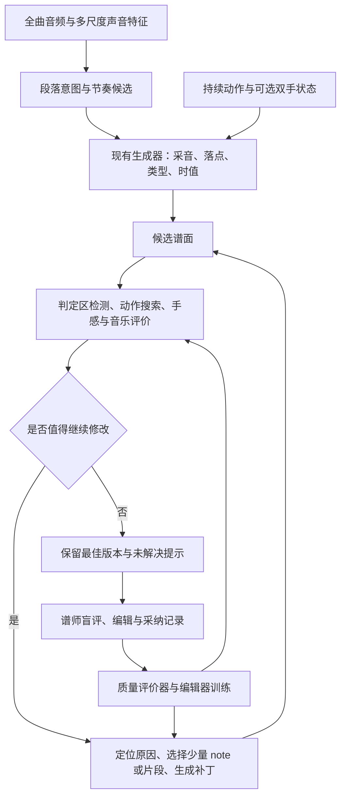

# 更稳定的高质量谱面：架构拓展思路

日期：2026-10-12。代码基线：`fab2258`。本文是研究与后续规划，尚未实施其中的新训练或新模块。

本轮已经交付的改动见 [INPUT_CONSISTENCY_CHANGELOG.md](INPUT_CONSISTENCY_CHANGELOG.md) 和 [SUSTAINED_ACTION_MEMORY.md](SUSTAINED_ACTION_MEMORY.md)。旧 checkpoint 保持可用。

## 判断与证据边界

我的建议是围绕“理解声音—安排动作—评估与改稿”形成闭环。单个生成器可以继续作为核心，但应获得更明确的音乐输入、动作状态和修改反馈。

以下判断来自当前代码：

- 音频输入是 50 Hz、112 维，由 log-mel、chroma、起音/能量/变化及节拍时钟构成。它保留了一些细节，但未明确提供多声部各自的起音候选，也不能直接等同于音乐情绪理解。见 `generation/event_audio.py`。
- `fine_rhythm` 是短起音间隔的比例。它不能完整表达三连音/附点的局部组织，更不能说明哪些细碎声音值得采。见 `training/music_plan_targets.py`。
- planner 的窗口目标以起音统计为主；本轮新增持续动作输入，但尚无双手轨迹、人体姿态与手感标签。
- 事件解码包含 `AT:` 拍位和 `CHAR:` 字符。模型要同时处理音乐选择、落点、时值和记谱语法。现有 grammar 可以限制输出语法，但未把这些决策在表示层完全拆开。
- 已有 Python MiaCode 检测、前置长音归因、跨窗口回溯、单 note 修改、质量权重和修正版偏好训练，可作为下一步的基础。

下文引用的论文为相关领域原始研究。把其方法移植到 maimai 是工程假设；论文成绩不能直接当作本项目预期收益。实际机制以项目固定的 MiaCode 参考和专业玩家验证为边界，不能将模拟器输出称为 SEGA 官方判定。

## 推荐的统一结构

全曲音频在谱面生成前已知，分析后面的音乐合法；训练时未生成的谱面则属于目标，不能通过状态或标签预处理泄漏。

## 1. 把双手动作作为可搜索的隐变量

建议先做屏幕平面上的双手动作搜索。给定一段谱面，保留多种合理走法，求出衔接较好的路线。不要给每个按键固定一只手，也不要给每张官谱强行指定唯一标准解。

候选状态可以包括两手位置、移动方向、当前持续动作、下一次必须触及的判定区、交叉关系和可用时间。Slide 按有序判定区与可判定时间处理；星头、等待、起滑、轨迹经过和收尾分别建模。Touch 按接触区域与实际分组联动处理，不把每个 Touch 都计成一只独立的手。

圆周布局直接引用当前固定几何数据，避免重新手写方向规则。求解从多个初始手位和多种换手策略开始；允许合适的交叉、扫动、同手覆盖与接力候选，具体候选必须由判定逻辑检验。

输出至少包括：一条或多条候选路线、最紧张的时间余量、换手/回转位置、对输入误差的敏感度、是否搜索覆盖不足。

必须区分两种结果：找到合格轨迹，是当前模拟假设下的可行性证据；没有找到，只说明当前搜索未找到。后者默认作为不确定报告，不升级为硬无理。这可降低复杂正当配置被误删的风险。

进一步可增加肩肘腕、臂展和身体转动，再考虑肌肉与疲劳模型。MyoSuite 提供接触丰富的肌骨仿真环境 [3]；RoboPianist 研究以仿真人形手执行精确音乐动作 [4]。它们说明相关技术路径已有研究基础，maimai 的双臂大范围动作、传感器联动和玩家技巧仍需专门建模。

接入顺序：先用于离线分析和候选排序，再作为可选动作条件输入；有可信校准后，才考虑作为训练奖励。现有生成器权重可继续使用，完整动作条件需要新的训练阶段。

## 2. 手感量化为多个指标，并用人类偏好校准

建议保留多个指标，而不是立即压成一个“手感分”：

| 维度 | 想观察的问题 | 必须保留的例外 |
|---|---|---|
| 时间余量 | 换手、释放、到达判定区是否过紧 | 高难谱允许明确且可练习的紧张段落 |
| 运动连贯 | 方向反复、突然停止、收尾接起手是否别扭 | 交互、交叉、技巧配置可能有意使用这些动作 |
| 持续占用 | 某只手是否被长音过早锁住 | 可换手、可联动、可提早完成的动作需单独处理 |
| 双手负担 | 是否长期单侧消耗，是否需要不自然抢手 | 单侧练习与特定风格允许偏置 |
| 阅读与识别 | 图案是否拥挤、难区分、视觉节奏是否混乱 | 读谱难度本身可以是设计意图 |
| 音乐表达 | 采音是否有依据、主次是否清楚、高潮是否有组织 | 不能将所有能检测到的声音都变成 note |
| 全曲编排 | 相似段落有无呼应、变奏与强弱铺垫 | 合理主题重复应得到保留 |

目标定数与风格应改变各项可接受范围。“轻松”不等于“好”，14.9 谱面也不应该被优化成 12。人体指标只描述部分体验，真实判定余裕与玩家偏好都需校准。

WebUI 可提供 A/B 播放与三类操作：更贴歌、更顺手、更符合目标难度；允许无明显差异、两者都不好和简短原因。谱师可以圈选问题片段、修改少量 note 后保存。后台自动记录音频时钟、条件、前置状态、前后差异和反馈，不要求手写 manifest。

用这些配对训练一个条件化评价器，评价“在相同音乐与目标下更好的改法”。保留分项和不确定度，避免少量用户偏好被包装成普适规则。其分数先用于候选排序，稳定后才进入生成器偏好训练。

## 3. 更积极地发现细碎节拍，同时学习选择依据

建议把“音乐中有什么声音”与“这张谱面选择了哪些声音”设为不同目标，避免把谱师没采的声音统一标成音频起音不存在。

第一步是离线对照：在几首典型的复杂节奏歌曲上查看当前 50 Hz 特征、池化后特征、音频参考起音及生成拍位。只有确认分辨率或表征损失，才增加更密特征。稀疏输出也可能来自目标分布或生成策略，不能预先把原因全归给采样率。

可组合两条音频输入：较高时间分辨率的瞬态分支，负责弱鼓点/钢琴起音；较慢的音乐表征分支，负责音色、旋律和段落。MERT 是音乐自监督表征的一种研究参考 [2]；MT3 研究多乐器联合转录 [5]。可将冻结特征、分离声部或转录作为带置信度的辅助证据，保留原始音频特征以容纳辅助模型的错误。

planner 可以输出局部节奏候选、主次声部选择和允许变化的范围。一个小节内可以同时存在鼓点规律与不同的旋律节奏，不必让整个窗口只有一个 rhythm_type，更不必把全曲指定为三连音。

Dance Dance Convolution 已将节奏游戏生成区分为“何时放置”和“选择何种动作” [1]。本项目可以借鉴该分解，但为阶段间保留可回传的候选与软约束：落点阶段发现动作不可行时，能够请求节奏层修改少量位置，而不是无条件服从一个写死的骨架。

这条路线需要修改音频合同或增加辅助分支，并训练其适配层。旧特征和旧 checkpoint 保留独立生成路径。

## 4. 将局部修改发展为真正的神经编辑器

当前已有可验证的单 note 编辑与回溯。可先扩大候选生成与排序：对问题 note 生成少量落点、时值、类型或连接方式的变体，在共享上下文中重新检测。优先保留原来的音乐起音与有表现力的配置。

随后训练一个能够看见前后文的编辑模型：输入音频、原谱片段、两侧边界、持续动作和结构化问题；输出有限范围的修改。训练样本来自真实修改记录，加上经确认的局部破坏/恢复样本。InCoder 的双向上下文填空训练可作为方法参考 [6]；其代码编辑成绩并不直接证明谱面编辑有效。

例如，问题发生在第 32 拍，但源头是第 8 拍的过长 Hold。编辑器可提出缩短源 Hold 或改变少量后续落点。系统应同时评估原问题、新连接处和后续依赖；没有更好的候选就保留原版及报告。

“让模型思考”的可操作形式，是多轮、有工具反馈的改稿：草案、检查结果、修改建议、重新验证、保留最佳版本。中间表示可以是原因标签和补丁记录，未必需要很长的自然语言说明。

普通自我批评并不构成可靠纠错。SCoRe 的研究表明，自我修正需要专门处理模型自己的错误分布和多轮训练 [7]。在这里应让判定区检查、局部反事实和人类偏好提供反馈，不能完全由生成器自己宣称修改正确。

早期的搜索和排序可以直接使用现有 checkpoint；神经编辑器需要新增训练任务。它可以是独立小模型，也可以共享生成器编码器后增加编辑任务，选型以真实 A/B 效果决定。

## 5. 让训练覆盖模型生成过程中真正遇到的状态

当前普通训练主要看到人工谱面的正确前缀；实际生成会遇到自己的长 Hold、偶然重复、局部修复和不理想边界。建议专门积累这些状态下的人类修正版或经验证的可接受续写，训练恢复能力。

DAgger 研究了序列决策中前序动作改变后续输入分布的问题 [8]，可作为此方向的方法依据。不能把已改变的前缀和原官谱后续直接拼接成“正确答案”：原后续可能已与新的前缀冲突。

可在 WebUI 自动收集用户采纳的修复记录，用已有偏好训练承接。合成反例可以用于具体可验证错误；审美质量标签应来自专业反馈或经过校准的评价器。

每轮都混入足量优质原始谱面，观察是否发生表达退化。奖励或排序需要同时约束空白、采音保留、定数/曲线符合程度和配置多样性，防止靠删掉复杂音符得到更高的“无理通过率”。

## 6. 改善全曲记忆与结构化表示

可以把历史分成三个尺度：本轮已加入的持续动作；最近几拍的精确事件；段落级的主题与配置记忆。后者记录此前同旋律段如何编排、当前需要呼应还是变化、刚刚已连续用了哪些配置。

Music Transformer 探索相对注意力与音乐长程结构 [9]；Transformer-XL 提供跨段记忆机制的参考 [10]。本项目更适合同时编码拍差、实际秒差和段落关系，再通过实验选择注意力或压缩记忆方案。

特别要区分有意义的主题重复与机械重复。可以要求同一副歌保留一部分配置动机，同时让段落内局部落点有变化；无差别重复惩罚可能把这种组织也破坏掉。

另一个更长期方向是从记谱字符转向类型化事件：节奏位置、同刻动作集合、键位、轨迹、时值分别表示，由编译器输出 simai。它可能让上下文更紧凑、单 note 编辑更自然，并减少有限拍位词表的限制。这涉及词表和输出头迁移，应建立新的模型版本，继续支持旧模型导出；本轮仍按用户要求丢弃词表不支持或超预算窗口。

扩散/去噪也可作为片段编辑的备选：在保留外部片段的条件下多轮调整内部配置。EDGE 使用扩散模型研究音乐条件下的可编辑舞蹈 [11]，属于相邻领域启发。离散拍位、有序判定区和 exact-time 编译仍需本项目自己的方案。

## 建议实施顺序

| 顺序 | 阶段产物 | 是否必须改现有生成器权重 | 可核验的收益 |
|---|---|---|---|
| 1 | 固定歌曲/种子 A/B、分项质量报告、WebUI 反馈记录 | 否 | 能定位改善来自采音、修复还是保守化 |
| 2 | 多路线双手搜索原型、少量 note 候选排序 | 否，可作为外挂评价 | 减少明确坏衔接，保留表达与目标难度 |
| 3 | 前后文编辑器、恢复数据与质量评价器 | 新增训练任务，可保留原生成器 | 同一处问题用更少改动解决，回滚安全 |
| 4 | 多声部/多尺度音频与局部节奏候选 | 是，需要新分支或输入迁移 | 复杂节奏的有效采音提高，虚假加音不增加 |
| 5 | 段落记忆、动作条件规划 | 是 | 改善全曲组织及跨段衔接 |
| 6 | 经过校准的身体仿真、类型化事件或去噪编辑 | 较大的研究阶段 | 以玩家评价验证其额外价值 |

这些阶段不强制从现有小训练集划出 gold。故障复现和人工 A/B 可以先使用用户选定的歌曲池；若曲目属于训练资料，只能解释为回归检查，不能作为泛化结论。

建议最先实现“可解释的动作评价 + 有音乐保留约束的局部改稿”。这能沿用现有成果，又能积累后续架构真正需要的监督数据。完整肌骨仿真和更大模型可以后续展开，是否采用取决于其对实际谱面质量的增益。

## 原始资料

资料于 2026-10-12 在线核对；这里只引用方法依据，不宣称这些方案已经在 maimai 验证。短注释中的编号对应以下来源。

1. Donahue et al., *Dance Dance Convolution*, ICML 2017. `https://proceedings.mlr.press/v70/donahue17a.html`
2. Li et al., *MERT: Acoustic Music Understanding Model with Large-Scale Self-supervised Training*, ICLR 2024. `https://arxiv.org/abs/2306.00107`
3. Caggiano et al., *MyoSuite — A contact-rich simulation suite for musculoskeletal motor control*, 2022；以及项目官方文档。`https://arxiv.org/abs/2205.13600`；`https://myosuite.readthedocs.io/en/latest/`
4. Zakka et al., *RoboPianist: Dexterous Piano Playing with Deep Reinforcement Learning*, CoRL 2023. `https://arxiv.org/abs/2304.04150`
5. Gardner et al., *MT3: Multi-Task Multitrack Music Transcription*, ICLR 2022. `https://arxiv.org/abs/2111.03017`
6. Fried et al., *InCoder: A Generative Model for Code Infilling and Synthesis*, ICLR 2023. `https://arxiv.org/abs/2204.05999`
7. Kumar et al., *Training Language Models to Self-Correct via Reinforcement Learning*, 2024. `https://arxiv.org/abs/2409.12917`
8. Ross et al., *A Reduction of Imitation Learning and Structured Prediction to No-Regret Online Learning*, AISTATS 2011. `https://proceedings.mlr.press/v15/ross11a.html`
9. Huang et al., *Music Transformer: Generating Music with Long-Term Structure*, ICLR 2019. `https://research.google/pubs/music-transformer-generating-music-with-long-term-structure/`
10. Dai et al., *Transformer-XL: Attentive Language Models Beyond a Fixed-Length Context*, 2019. `https://arxiv.org/abs/1901.02860`
11. Tseng et al., *EDGE: Editable Dance Generation From Music*, 2022/2023. `https://arxiv.org/abs/2211.10658`
