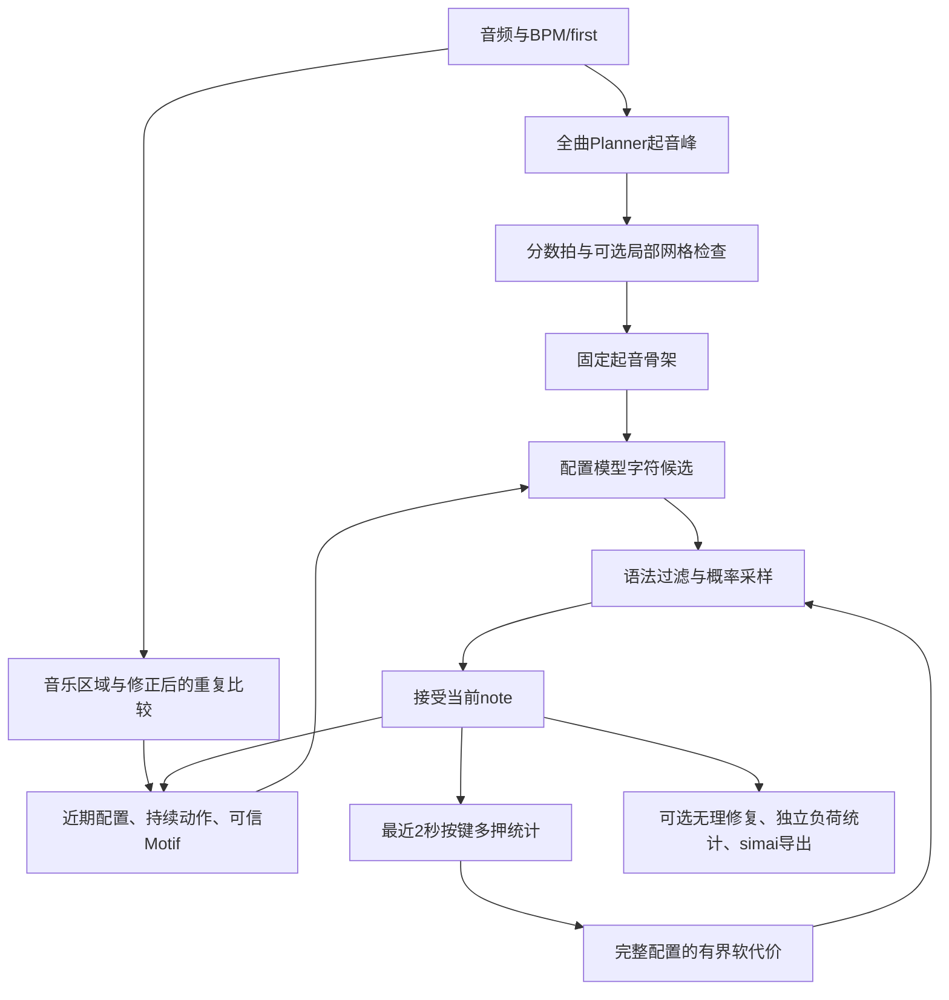

# 段落衔接、节奏规整与局部多押修复

日期：2026-10-14。基线：`02d7803`。主体备份：`backups/form_coherence_rhythm_20261014/source_before_fix.zip`。

本轮对应用户的四条批注：前后段关联、空的重复段落参考、16/24/32 分落点偏差，以及多押在短段集中爆发。保留已有 checkpoint 和旧事件模型生成入口，正式训练继续运行。工作区原有 CLI/预处理/服务器预处理 hunk 与测试修改独立保留。

## 已确认的证据

最新取证样例为任务 `bae30e28186d`，输出 `webui_workspace/generated/.task-mv7gk04a-8akuhqln/maidata.txt`。该任务使用完成第10轮、处于第11轮的 song_form 模型；BPM190、first=0、起音阈值0.521、邻近合并39ms、节奏近似40ms、候选4/8/12/16/24/32、曲线强度/幅度0.65/0.65。

- beat147～163.5、约46.42～51.63秒内，41个起音有77个音符头、34个多押事件；约82.9%的事件为多押，一秒内最多20个音符头。全曲多押事件比例约11.2%，会掩盖局部集中。
- 大部分异常段位于同一计算段100～163内部，并非全部发生在段界。无理修复接受的两项改动位于beat185/191，未制造这段多押。
- 生成在beat163边界实际保留51个历史事件、504 tokens、约6.24秒的历史；此前仍在持续的动作另行编码。不是完全没有前文，但远处的具体配置会被截断。
- 重复段落关联原为0。按实际生成流程重建后有33个音乐区域、34个计算段；496个可比较区域对的最高相似度约0.40024，仍低于0.75。没有把“未找到可信匹配”解释成歌曲一定没有重复。
- 正常50Hz帧取样的半帧误差不足以单独解释整个32分的偏移；已经偏移的模型峰经量化后可能落在错误但合法的网格上。整串等间隔八分偏移一个32分时，时间序列本身不能区分模型错误与故意切分。

## 第一阶段：重复段落匹配与上下文可见性

### 匹配错误的修复

`_describe` 的504维描述依次存储24×12的chroma块、24×1的onset块、24×8的timbre块。原匹配器直接把这个向量reshape成24×21，再移动时间轴，实际会把不同特征通道混在一起移位。

修复先按原块边界拆开，在每个块自己的24个时间位置上做相同移位，再相加计算相似度。描述向量的排列、维度、模型权重均未改变，旧 checkpoint 仍读同一种输入。没有额外改变余弦归一化尺度。

这修复了带小相位偏移的真正重复片段被漏认的问题。针对真实样例，修复后仍无足够强的关联，不能降低阈值强行给模型塞入不相关配置。新增候选数、最大相似度和空关联原因，后续报告能够分清没有候选、平坦特征与相似度不足。

初步滑窗探索发现局部相似片段，但重叠窗口及更长窗口没有给出足够一致的证据。本轮没有将这些候选自动注入谱面记忆；更稳健的乐句级检索仍需独立验证。

### 历史如何进入下一段

每次配置解码都从已接受的前文重新构建历史、持续动作和可用的重复段落模板。近期历史按完整事件保留在checkpoint的token预算内；持续中的Hold/Slide等另走动作状态分支；Motif强度仅控制重复模板。

生成报告新增每个计算段/续写批次的实际历史事件数、token数、时间覆盖、模板事件数/来源和持续动作截断数。用户可据此核对模型到底看到了什么，而不把512 tokens误认为512颗note或整首歌记忆。

不在推理时擅自扩大训练合同中的记忆预算。训练使用官谱前文、生成使用自身前文的差异，以及远期乐句意图缺乏显式监督，仍属于模型学习与后续架构研究问题。

重复段落修复提交：`6147260`。15项段落匹配/记忆检查通过，其中包括相位方向和不相关音频的反例。

## 第二阶段：节奏网格推断

### 原有流程与局限

全曲Planner每20ms输出一个起音分数。提取局部峰后，`exact_candidate` 用BPM/first把音频秒数换成精确分数拍。可选的“近似到常见分音”再做逐点近似和局部序列检查。配置解码阶段强制使用选好的时间位置，只决定note配置。

原局部检查只认可相邻间隔全部相等的音列。实际采音可能省略其中一格，或出现八分与十六分混用，这时同一底层网格上的可靠证据会被丢弃。错误落点若已是24或32分，逐点近似还会因它“已在常见网格”而保留。

### 新的局部检查

1. 保留原逐点结果作为参考，读取每颗音符的原始模型帧时间 `source_second`。
2. 在4～8个相邻起音里尝试用户勾选的分音网格；保留原来可靠的等间隔检查，并允许非等间隔音列由单格和双格间隔组成。双格表示中间没有采音，不会自动补音。
3. 新增的非等间隔路径要求：大多数间隔为单格、至少两个内部落点相互印证、两端与已有近似位置一致、均方根时间偏差不超过15ms，并且比逐点结果更接近原始帧时间。
4. 每个候选仍受用户位移上限、最多20ms的原始帧偏移和与BPM相关的保护范围共同约束；不越过BPM边界、休止区或相邻音符，不改变起音数量。
5. 整串等间隔但相位偏离的音列只记录为 `ambiguous_phase_runs`。这可能是模型偏移，也可能是有意切分，不能凭“整齐”断定错误。该诊断不自动移动音符。

真实样例回放保留923个起音，与原保存结果有少量拍位差异。用户指出的段落内，47.3158s的 `899/6` 调到47.2895s的 `599/4`，47.6316s的 `905/6` 调到47.6053s的 `603/4`，均落在16分网格。前后两个输出时间可相差约26.3ms，而距原始帧时间仍小于20ms，因为原先量化已把位置移向另一侧。没有音频人工标注证明这些就是谱师希望的位置，因此这里只确认网格推断和边界行为，不宣称已彻底校准采音。

最终独立回放确认6个位置与原输出不同，音符数量923不变；完整差异保存在 `backups/form_coherence_rhythm_20261014/rhythm_replay.json`。稀疏的等间隔长音列继续支持原来的纠偏，不会被新“单格/双格”条件误排除。节奏阶段提交：`86c0f39`。

## 第三阶段：局部多押软抑制

### 作用位置

新增“局部多押抑制强度”，默认1，范围0～3；0完全关闭该项。它作用于现有配置解码器的候选概率，不增加网络参数，不改变起音数，也不先生成整段再反复重写。Tap、Hold、Slide头计为按键头；Touch/TouchHold不计入这里的按键多押压力，避免把整片Touch误当作手指数量。

模型开始写每颗note时，控制器读取此前已接受的2秒内容，计算平滑后的按键多押比例。令目标Style多押倾向为q、近期事件数为n、多押事件数为c，则观察比例为 `(c+4q)/(n+4)`；4个目标先验事件让短段开头不会因一两个双押立即受罚。

本地参考比例为 `min(1, q×相对曲线因子+0.2)`，其中曲线因子限制在0.5～1.5。这里的曲线因子是相对调节量，不被解释成绝对NPS。只有观察比例高于参考时产生压力，过去多押少不会得到“赶紧补多押”的奖励。

额外按键头越多，负偏置越大；总惩罚上限为4，所有符合语法的候选仍然可选。近期事件移出2秒范围后，压力随之消退。这个比例和余量是可关闭的推理启发式，不是学出的局部谱师意图，也不是合法双押上限。

### 为什么要在 `/` 处分配惩罚

字符解码生成 `1` 后，可以结束当前配置，也可以生成 `/` 继续写第二个音符。如果等 `/` 已经生成，才对所有第二音符候选扣同样分数，softmax会消去这个共同偏移，实际阻止不了多押。

现在会向前看一步：对 `1/` 计算完成下一个合法原子后至少需要的按键数量，并在选择 `/` 与结束符时加入相应代价。之后使用“子前缀势能减父前缀势能”的差值，保证完整配置只承担一次惩罚；长Slide写法不会因为字符多而额外受罚。语法合法性仍由原有grammar控制。

### 样例验证及边界

- 固定epoch10、同音频/曲线/条件/前文/41个起音，CPU两线程对照0与1：两组均为58个音符头、17个按键多押事件。指导确实参与，但这次普通前文续写没有表现出总多押量改善。
- 将原谱高多押前文一直提供到beat157前，前2秒有18个事件中的16个按键多押。对同样13个后续起音，0产生16个音符头/3个按键多押，1产生14个音符头/1个按键多押。压力起始约1.3095，并在后续逐步归零。
- 两组短段检查均通过语法检查、无需字符回退；这证明控制器能影响热点之后的续写，不能证明减少多押就一定更好玩。测试改了续写起点，不能把58头与原整段77头的差值当成修复收益。

对照记录在 `backups/form_coherence_rhythm_20261014/local_chord_ab_147_163_5.json` 与 `hot_prefix_ab.json`，包含固定模型/输入身份和输出配置。

## 生成报告与主界面

新统计独立计算一秒音符头峰值、按键头峰值与起音事件峰值，并扫描2秒内的按键多押集中段。显示的是三个独立最大值，它们可能发生在不同时间；原有 `peak_nps` 及旧模型条件归一化不被重新解释。

集中段统计至少要求8个起音，多押比例超过 `max(0.6, 全曲目标+0.25)` 才列入。重叠窗口合并为一次集中现象，保留其中最强的固定2秒窗口；最多展示16处并记录截断标志。它只是定位入口，不作为无理或错误配置的判定。

原谱重新统计得到音符头峰值20、起音峰值14，并定位到包括用户片段在内的3处按键多押集中现象。Touch相关负荷仍可从总音符头统计观察。

CLI参数为 `--local-chord-strength`。主界面在生成配置区域提供同名中文控件、用途和关闭方法；三项“规划类型/类型比例/局部多押”指导均设为0可回到原字符采样。报告保存实际参数，日志新增 `form_local_load`，前端可直接从该日志恢复统计。

正在运行的旧WebUI后端尚不认识新增顶层参数，因此前端还通过已存在的condition JSON携带这一生成选项。新CLI读取它，显式CLI参数优先；这个元数据不会进入16维模型条件，也不改变保存曲线的等级/Radar/Style身份。用户不必为启用/关闭该项中断训练父进程。

## 整条链路

## 仍需训练或独立研究的部分

1. 当前曲线监督把8头/秒以上的密度截到1，无法充分区分高密度等级。更换归一化需要版本化监督与迁移训练；本轮保持旧权重含义，不在既有模型上静默更换目标单位。
2. Planner仍以20ms帧峰为基础。整串偏移、混合声部选错、长距离乐句意图不足，不能靠规则可靠推断为某种分音。后续需要更强的局部节奏/相位学习与可校准的时间目标，而不是强制全曲16分。
3. 相似度修复解决了确定的排列错误，当前音乐的重复匹配仍偏弱。新检索器需要对非重复音乐、局部相似和不同段落边界做验证，不能为了让links非空而降低门槛。
4. 草稿配置训练第10轮loss约0.611、首字符准确率约55%，仍有学习空间；修订准确率和混合loss无法证明自由生成成熟。本轮没有改变训练目标、网络规模或中断正式训练。

以上不是所有问题都已解决的声明。已确认的实现缺陷完成修复，生成侧增强提供可控缓解和可观察证据；剩余质量边界按原因保留。

## 验证与运行状态

- 最终定向回归：140项Python通过，34项Node通过。覆盖旧song_form checkpoint加载、CPU小模型fresh/finetune/resume链路、局部历史与持续动作、曲线、生成参数和前端日志恢复。
- 真实固定epoch10模型做了两组CPU短段对照，结果及范围见前文；没有占用训练GPU或开启新的正式训练。
- 隔离Edge会话检查当前7860主界面：song_form显示新控件，设置0后顶层参数与旧服务器兼容传递字段均为0；旧event请求不携带该项。界面能从结构化结果及旧服务器日志两种来源显示独立峰值与集中段数。桌面1440px无横向溢出，截图为备份目录的 `local-chord-control-desktop.png`；本轮未新增移动端验收。
- 正式训练PID20044及其父WebUI进程持续运行，未重启、未替换内存中的训练函数。前端刷新、新生成子进程即可采用本轮生成侧修复；需要后端导入新函数的检查/分析服务在下一次正常重启后完整采用新实现。
- 主体备份与对照文件保存在本轮备份目录。未修改原有检查点；模型参数量、词表和16维条件合同不变。

局部多押、上下文诊断、负荷统计与主界面提交：`2923ce2`。本轮实施目标已完成；重复检索证据不足、不可判定的整体相位和训练目标表达能力限制保留为后续研究项，不冒称已修复。
