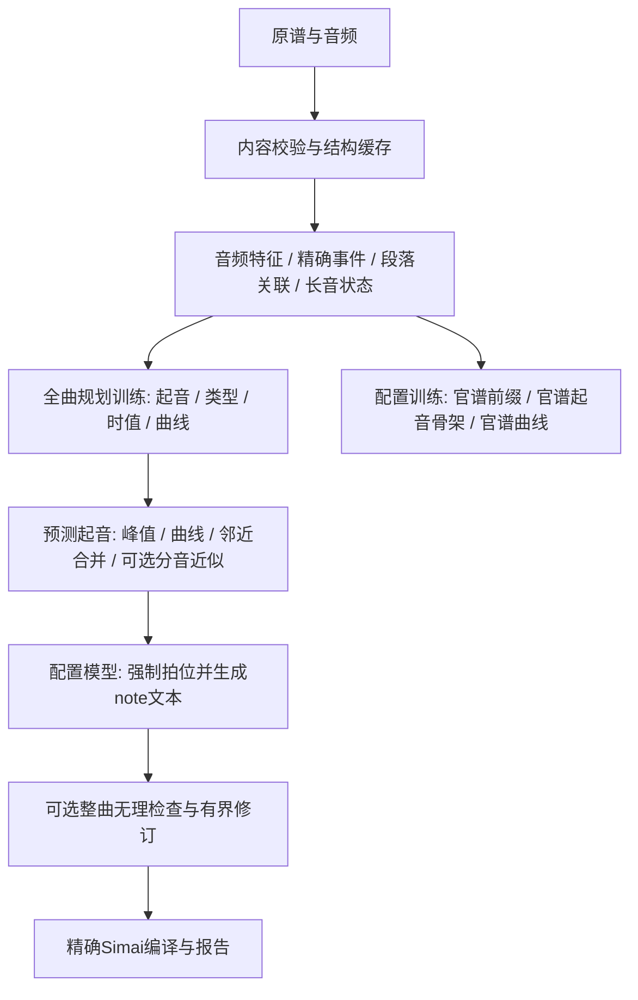

# song_form_v1 从训练到生成的全链路审计

日期：2026-10-13。审查基线：`90a7400`，工作分支 `codex/song-form-rebuild`。

本轮审查当前主模型族的数据准备、训练、规划、配置生成、修订、导出与 WebUI 接口。旧事件模型重点检查分流与本轮改动的隔离，不宣称重新逐行审完旧模型全部实现。清单记录本轮能识别的缺陷、风险与优化方向，不构成“所有未知问题已排除”的保证。

**代码可运行与模型质量达标是两个不同结论。当前仍有需要专门微调、评估或调整架构的设计缺口。** 本轮实现可选分音近似，保留正在运行的训练，没有修改其训练目标或模型形状。下面的未修复条目是后续工程清单。

## 1. 覆盖范围与数据流

| 环节 | 实际阅读的主要文件 |
| --- | --- |
| 数据及缓存 | `form/data.py`、`preparation_cache.py`、`audio_residency.py`；共享 `event_audio.py`、`quality_annotations.py` 与源文件解析 |
| 时间与段落 | `form/timing.py`、`segmentation.py`、`recurrence.py`、`codec.py`；共享 `timeline.py` |
| 训练与模型 | `form/train.py`、`training_runtime.py`、`blueprint.py`、`model.py`、`checkpoint.py` |
| 控制与生成 | `form/curve.py`、`generate.py`、`onset_selection.py`、新增 `rhythm_snap.py`、`cli.py` |
| 修订与导出 | `form/revision.py`、`repair.py`；共享 `sustain_state.py`、note grammar、`event_compile.py` |
| 前后端 | `webui/form_api.py`、主 `app.js/index.html`、`form_lab.js/html`、任务日志与取消进程路径 |



模型类型及时值预测当前没有直接传到 G；它们不是对最终配置的承诺。上述“官谱”包含实际选入的其他训练素材，表示可信目标谱而不是只限官方来源。

## 2. 分类规则

- **已确认缺陷**：代码能构造明确失败或同一参数未传到实现；不等于已证明它造成了所有实际坏谱。
- **已确认设计限制**：当前表示或目标不能表达某种行为；仍需实际数据确定影响大小。
- **条件性风险**：有明确触发条件，但未做全面现场复现。
- **优化潜力**：目前正确运行，存在可衡量的性能或质量提升途径。

优先级 P0 为训练与生成输入/控制一致性，P1 为可玩性和时序/参数可靠性，P2 为性能、诊断及维护。下述位置按函数与当前代码行号列出，后续修改时以函数为准。

## 3. 高优先级问题

### A01 / P0 / 已确认设计限制：训练输入过于理想

位置：`data.py:246 input_example`、`data.py:624` 附近未来 skeleton；`train.py:357` 配置前向；`generate.py:91 plan_onsets`。

训练配置模型使用官谱准确起音、官谱前段和由官谱生成的四通道负荷曲线。生成则使用预测起音、生成的前段，以及预测/用户编辑曲线或没有曲线。模型可以在理想输入下获得较低 CE，而在稍有偏移、密度错误的计划下写出不稳定配置。

建议：固定歌曲比较“原谱起音骨架/预测骨架”和“原谱曲线/预测曲线/无曲线”。确认影响后引入受控起音扰动、预测曲线或渐进替换监督。不得直接把有错误的前段拼接不兼容的原后续作为正确答案。改变样本分布和监督策略需记录新的训练语义，采用独立 finetune 实验，不静默改变严格 resume。

### A02 / P0 / 已确认设计限制：两个模型没有形成完整联合规划

位置：`generate.py:105` 类型/时值输出、`generate.py:229` 起音集合、`generate.py:159 arrange_span`。

Planner 预测起音、单类类型、持续时长与曲线；配置解码实际只接收起音集合及已有条件。类型/时值仅存报告，因此不能根据它们的预测解释 Hold 或 Slide 数量。

证据：固定快照 e0d07ff7de58 的 945 个类型最高项为 Tap 927、Slide 18，最终输出却有 Hold 360、TouchHold 28、Slide 7。此事实支持接口脱节，不证明哪个子模型单独“没听懂”。

建议：先记录逐段计划/实际类型和时值差异，再评估可选软引导或学习型融合。不要直接硬套 argmax：单类目标本来无法表达混合多押。可靠融合涉及训练/生成共同定义，不是增加一个推理开关便等同完成。

### A03 / P0 / 已确认代码参照混用：曲线时钟需要统一

位置：`curve.py:49 build_load_curve` 使用 `seconds_at_beat-first`；`train.py:123 _blueprint_input` 重采样也减 first；`curve.py:153` 预测帧时钟减 first；`generate.py:63 _curve_condition` 减 first，但起音门控用音频绝对秒访问 profile。

first=0 时两种参照相同；非零 first 时不能假定编辑器点、起音门控和配置曲线指向同一段声音。代码参照差异已确认，实际错位量和影响应通过正/负 first 合成曲线测试量化，不能仅凭命名断言全部偏移。

本轮小型函数复核：first=1、同一 profile 在首拍绝对秒 1 的门控因子为 1.0，在首拍相对秒 0 的因子为 0.5，证实两条参照能取到不同值；尚未做带音频的完整偏移质量评估。

建议：明确“编辑器音频绝对秒”“训练相对首拍秒”的边界，统一一次转换，并补 first=±0.5/±2、变 BPM 及休止区域测试。若需要重新解释已训练曲线值的时间语义，必须注明迁移，避免旧权重默默变义。

### A04 / P1 / 已确认设计限制：没有可玩性学习目标或质量验收

位置：`train.py:88 layout_loss`、`blueprint.py:275 compute_blueprint_loss`；`generate.py:269` 语法门控。

优化项为 token CE、弱关联 BCE、起音/类型/时值/曲线损失。没有真实双手调度或 MiaCode 无理训练损失；生成默认也只强制语法通过。`playable_verified=false` 是必要边界。

建议：先建立歌曲隔离的固定生成集，记录采音、密度、空白、类型、多押、长音、重复、曲线贴合和规则检测，并结合谱师实际反馈。可玩性奖励需要可信标签及反事实示范；不可把任意自动检测的偏差直接当强监督。

### A05 / P1 / 已确认限制：单类类型与最长时值压缩了多押信息

位置：`blueprint.py:219` 类型优先级、`blueprint.py:253` 同帧选择、`blueprint.py:327` 单类 CE。

同拍 Slide > Hold > Touch > Tap 选一个类别；持续时长取最大值。Tap+Hold、Tap+Slide、整片 Touch 等无法完整表达。单类损失没有类别平衡，少见类的实际偏差需按类评估。

建议：先做类别统计与校准，再考虑多标签、动作集合或更细颗粒规划。改变 head 形状或标签语义需要新合同和训练。当前不要把 softmax 的最高项当做唯一允许配置。

### A06 / P1 / 已确认行为与语义缺口：局部排除并非精确时间裁剪

位置：`data.py:405` 过滤点、`data.py:421` 相交 span 跳过；`train.py:126` 帧权重。

weight=0 区域与 span 相交会丢弃整个配置训练片段，而规划训练只屏蔽该时间内的帧。点过滤仅按起音；在排除区之前开始、持续进入区内的 Hold/Slide 仍可能留在状态和曲线里。

建议：明确“排除起音”还是“排除时间内所有动作”。若精确排除，需要局部 token/frame 监督或分割 span，不能通过删掉局部目标将该区误教成休止。测试跨排除边界的长音、空白目标和两阶段权重一致性。

### A07 / P1 / 已确认缺口：完整曲线编辑与组件值不完全同步

位置：`generate.py:72 _curve_condition`；编辑器保存的 points 与 components；`curve.py:165` 标量曲线归一化。

有 components 时先取四通道预测值，再乘标量 intensity 形成的 factor；只有标量时仅密度通道可见。strength=0 令乘数回到 1，但仍传入基值，并非“完全不读取曲线”。标量拉动、通道比例与绝对负荷之间不是直观的一比一映射。

函数复核 strength=0 时曲线密度基值仍为 `[0.25,0.75,0.75]` 且可见 mask 全 true。完全关闭曲线应使用启用开关；若界面将指导强度 0 解释成关闭，需调整该语义或实现。

此外训练只选择片段内部曲线 bins，生成会额外保留两侧 bins；`load_curve_times_sec` 存在 batch，但 `model.encode` 未直接编码这些时间，只用序列位置，因此不规则间隔、边界 bin 和不同时间对齐的效果存在不确定性。

建议：统一基值、编辑值、指导幅度的公式，记录修改前后各通道。需要时间特征时单独训练迁移，不能给旧模型随机新增投影后称已支持。补强度 0、仅标量、完整组件、负 first 和非整 bin 边界用例。

## 4. 其他缺陷、条件性风险与性能清单

| ID / 级别 | 位置与触发 | 可能影响、建议和验证 |
| --- | --- | --- |
| A08 / P1 / 已确认限制 | `blueprint.py:192`、`generate.py:25`：50 Hz、20 ms 高斯与有限分数候选 | 非候选节奏与近邻音可能偏移/合并。分音近似是可选规则，不代替更精确的音频/事件表示；若改帧率需新训练评估 |
| A09 / P1 / 已确认限制 | `model.py:110 relation_head`、`data.py:325 relation_target` | 关联 BCE 不直接约束解码出的配置；能重建关联提示不等于生成了副歌呼应。需实际 motif/跨段 A/B，必要时增加输出层面的关联学习 |
| A10 / P1 / 已确认有界截断 | `recurrence.py:235 reference`、`data.py:271` | 默认只投影参考段前 256 事件，再按当前计算块裁剪；长段后半可能没有参考。建议按当前片段查询/分层摘要，并报告截断覆盖 |
| A11 / P1 / 已确认限制 | `blueprint.py:61`：四个 dilation 1/2/4/8 的卷积块 | 局部感受野约 31 帧，约 0.62 秒；另有全曲池化/段落摘要，但不能等同完整全曲时间交互。改进可加入多尺度时序或显式段落级节奏计划，需训练 |
| A12 / P1 / 已确认条件 | `generate.py:159 arrange_span` 使用训练 atom_catalog | 只能组合目录内原子前缀；新路径/新时值表达被目录限制。长字符序列决策更易误差累积，256 步 fallback 会转成普通合法原子。需记录 fallback 和目录覆盖，考虑结构化语法而非只靠历史原子 |
| A13 / P1 / 已确认配置风险 | `train.py:168 output`、`cli.py:output.write_text` | fresh 同目录或多个生成任务同文件会覆盖历史产物；现场旧 256 模型被同路径新训练替代。新 run 目录、固定 epoch checkpoint 和唯一输出名是首选；建议后续加入覆盖检查，不影响当前运行任务 |
| A14 / P1 / 条件性风险 | `generate.py:290 revise_chart` | 编辑区跨多个音乐区域仍以起点所属区域作输入上下文；长编辑区也可能超过音频/token 上限。建议入口限制或分块，保留整体复检，补跨区域编辑测试 |
| A15 / P1 / 已确认限制 | `form_api.py`、`cli.py`、`generate.py:290` 修订参数 | API/CLI 的 repair_checks/edits/seconds 与神经修订的 max_checks/max_edits=8/deadline=10 并非同一链路；部分曲线/起音参数接受但修订路径不使用。需区分神经改稿与生成后确定性修复，拒绝无效参数 |
| A16 / P1 / 已确认限制 | `repair.py:116 _assessment`、`revision.py:181` | 当前 repair 的质量分数为 None，接受标准主要是硬冲突下降、覆盖和 note 数保持；合法但普通的改动可能被接受。审美改善需可靠偏好/修正版，不能靠增加重试次数保证 |
| A17 / P1 / 已确认有界状态 | `sustain_state.py:150` | 活动状态超过 MAX_STATES=32 会截断较远截止的动作；复杂旧长音可能遗漏。应把 truncated_count 纳入报警/评估，不以近邻起音合并替代持续动作处理 |
| A18 / P2 / 已确认性能 | `model.py:317`、`data.py:collate_form` | 多路记忆拼接与 padding 引起较大注意力开销；同 batch 最长样本决定张量尺寸。暂无激活检查点，建议长度分桶、共享/压缩 memory、激活检查点。分桶会改变批次顺序，续训必须明确语义 |
| A19 / P2 / 已确认性能 | `preparation_cache.py:83 identity` 与 `data.py:59 disk_cache_path` | 一个进程准备身份与音频路径解析各自可能完整读一次原音频；建议共享 digest/已解析路径。已修复的是每次淘汰后重复算哈希，并非启动绝对零读盘 |
| A20 / P2 / 已确认性能 | `preparation_cache.py:115 load` | NPZ 哈希校验与解压各读一次；可从同一读取缓冲校验再解析，比较 CPU/IO 与 RAM，不取消完整性校验 |
| A21 / P2 / 条件性风险 | `preparation_cache.py:71 file_digest` | 进程内只比 size+mtime；同长度替换并恢复 mtime 可能漏变。可补 ctime/inode，并做同 stat 替换测试；跨运行仍重新哈希 |
| A22 / P2 / 已确认维护缺口 | `preparation_cache.py:133 save` | 旧代码/标注版本的索引和数组不自动清理；缓存会增长。需安全清理无引用代，避开并发 reader，不能直接删整个训练数据目录 |
| A23 / P2 / 已确认语义 | `checkpoint.py:56`、`form_api.py:plan_ready` | capability/更新计数证明路径训练过，不证明条件或曲线控制已校准；UI 可训练/可生成与严格 load 的异常合同检查也非完全同一判定。建议统一可用性检查并独立记录效果评估 |
| A24 / P2 / 已确认语义 | `training_runtime.py:Progress`、`train.py:397 metrics` | overall_fraction 按任务数而非耗时，ETA 仅当前阶段；恢复本轮均值是部分统计。已显式标注，不要将平均 loss/accuracy 当歌级验证成绩 |
| A25 / P2 / 条件性风险 | `segmentation.py:194 _computational_chunks` | 极慢 BPM 或上限小于一拍时，分数近似/兜底可能留下略超时长的块。建议极端 BPM 属性测试；不能仅看默认 14 秒推断硬上限绝不超出 |
| A26 / P2 / 已确认限制 | `blueprint.py:316` 自动正类加权 | weighted BCE 分数不是校准的选点概率，统一 0.5 阈值未必跨歌曲密度通用。建议可靠分割数据的起音 PR 曲线/阈值校准，不把 score>1 的曲线增益分数当概率 |
| A27 / P2 / 验证缺口 | `pyproject.toml` 与 `training_runtime.py` | 声明 torch>=2.0，但运行使用较新的 torch.amp API；本轮未在最低版本环境验证。后续锁定/测试支持版本矩阵，不能把本机 2.7 成功等同所有声明版本都可用 |
| A28 / P1 / 已确认指标限制 | `codec.py:cell`、`train.py:layout_loss` | 位置、时值数字、标点和 note 字符都计入 token accuracy；大量容易预测的格式 token 能提高分数。建议额外统计起音、类型、键位、时值与配置组合指标，不把总 accuracy 当谱面掌握程度 |
| A29 / P1 / 已确认设计限制 | `generate.py:182 arrange_span` | 每个指定起音必须生成非空合法 note，没有“此点不采”的解码通道；训练有空目标 BOS/EOS，但生成候选不能被配置模型否决。规划过采会直接传到谱面。若增加否决，应有明确监督及密度/音乐对齐评估，不能只让 EOS 自由删音 |
| A30 / P2 / 优化潜力 | `data.py:286 hist_origin`、`codec.py:bounded_memory` | 留最新历史但位置仍相对整曲历史首点，长曲数字会变长并占 token；可研究局部锚点、相对时钟或分层记忆。但这是位置语义变化，不能只改生成端让旧模型误读 |
| A31 / P1 / 已确认界面合同缺口 | `form/cli.py` 的曲线 method 检查、主曲线来源选择 | song_form CLI 只接受 learned_song_form_v1，但主界面仍可显式选通用音频参考曲线，最终被 CLI 拒绝。需按族限制选项并清楚说明，或实现合法转换；不能显示可选却到子进程才报错 |
| A32 / P2 / 已确认入口差异 | `/form-lab` generation payload | 研究入口没有曲线字段，虽然同一 API 支持；该页不能等同主页面完整功能。继续以主工作台为准，并注明研究入口边界 |

## 5. 已修复或未发现异常的部分

- 梯度累积按实际样本数归一化，尾 batch/尾累积组处理正确；旧的每 batch 清空错误已经修复。
- FP16 范数溢出不污染 Adam；BF16/FP32 保持有限性检查。混合精度损失归约使用 FP32。
- 行/通道曲线遮罩、曲线 sigmoid 训练/生成尺度及质量权重的遗漏已修复。
- resume 恢复精度、每轮步数、数据合同、随机状态与安全 batch 游标；已有定向等价测试。不能用“旧文档说严格”替代这些实际检查。
- revision mask **不是每轮固定不变**：训练循环每轮更新 `dataset.seed=args.seed+epoch*100003`，加载 worker 每轮重建。`seed+index` 的局部取样在当前循环中会随 epoch 变化；此前只看 `__getitem__` 的疑点已排除。
- 草稿输入拒绝完整 draft/right 泄漏；未来 skeleton 只有位置与 mask。它是理想条件问题，不是直接偷看未来 note 配置。
- SustainState 只读取边界前已发生的头，并且 release 关联不借用未来头；这不等于证明真实身体动作可完成。
- 新旧模型族按实际合同分流；本轮分音选项只进入 song_form 自动生成，不修改 event 兼容路径。
- 峰值曲线错误、近邻抑制、导出末尾巨分母、预算/修订返回合同与生成 checkpoint 身份记录已修复，详见前一轮报告。
- 驻留预算及可用 RAM 预检、缓存损坏回退、取消任务的进程树清理已实现；读取内存不代表 OS 不会换页。

## 6. 本轮新增：可自定义的分音近似

主生成页“全曲规划与段落参考”增加：

1. **近似到常见分音**：默认关闭。
2. **最大采音偏移（毫秒）**：默认 15，允许 0～50。
3. **近似候选分音**：逐项勾选 4、8、12、16、24、32、48、64；前六项默认选中，48/64 可显式启用。
4. **其他分音（逗号分隔）**：可自行填入，例如 20,40。允许整数 1～768，最多 32 种，去重后处理。

低 BPM 的 48/64 分可以是合理采音。算法计算实际 BPM/变 BPM 下的毫秒误差，不以“大数字”判定错误。选择 48/64 只扩大可用候选，不能恢复在之前“相邻起音合并”中已删除的峰；高密度采音需要减小或关闭合并范围。

处理顺序：原始峰 → 曲线/休止门控 → 原有有理数拍位量化 → 邻近合并 → **可选分音近似** → 更新起音骨架 → 配置解码 → 修复 → 精确编译。

近似仅移动附近的起音，保持数量、顺序和同刻配置表达；不会平均/强行合并两个不同起音。检查音频范围、BPM 边界、休止区、已占用拍位及合并要求的最小间隔；有原始帧时间时，也检查它与新拍位的误差。不能安全移动或不在容差内的起音保留原位置。

这不会直接修改 Hold/Slide 的等待、路径或持续时值，也不改训练数据。原谱修订与显式传入的人工 blueprint 不进行自动近似，避免未经说明地改原谱时钟。需要 standalone 整谱重定时、长音尾近似或强制全部落网格时，应另设工具与整体可玩性复检。

CLI 示例：

```powershell
--rhythm-snap --rhythm-snap-ms 15 --rhythm-snap-divisions 4,8,12,16,24,32,48,64
```

日志 `form_rhythm_snap` 和 blueprint.selection 保存候选列表、容差、修改/原本规则/超容差/被保护数量、最大实际偏移。关闭时保持原路径。

### 用户片段的实际转换

以用户给出的片段补充 BPM=180、15 ms 容差、允许 4～64 的常用候选，5 个起音中 4 个移动，最大移动约 6.94 ms；数量和 `2/4`、`4/5` 文本保持一致：

```text
(180){8}2/4,4/5,{64}2,{8},{64}4/5,{32},{16},{48}4/5,{12},E
```

这里只是该片段在给定 BPM 下的示例，不是所有 BPM 下相同的替换结果。

`{96}`、`{192}` 不一定是错误音符：不同常见网格混用时，相邻差值仍可能需要这种精确表达。为了让所有文字指令都属于同一小集合而强行替换，会破坏时间或删掉合法混合节奏。本功能近似真实事件，随后让原精确编译器决定文本，不承诺完全消除每个大分音数字。

## 7. 下一步优先顺序

1. **先验证坐标与控制公式**：nonzero first、组件/标量编辑、指导强度 0、曲线边界及变 BPM；明确模型输出与界面含义是否一致。
2. **建立固定质量比较集**：准确起音骨架/预测骨架、曲线开关、温度、合并和近似分别单变量 A/B；不依赖训练 loss 选最好模型。
3. **再做训练语义迁移**：受控误差骨架/曲线、跨段错误恢复；保留旧检查点并给新训练语义版本，单独 finetune。
4. **随后升级规划/配置连接**：多标签或动作计划、时值指导、时间感知曲线 token；先定义目标与效果指标。
5. **并行改善性能与维护**：长度分桶、激活检查点、哈希/缓存路径共享、缓存清理、唯一 run/output、修订预算与入口验证。

对于需改变结构的方向，不应把当前正式训练中的权重就地变成新结构；对于无需改变结构的修复，则应提供固定输入回归与明确的推理语义记录。

## 8. 本轮验证、记录与边界

新增功能验证覆盖默认关闭、零容差、常见/三连稳定、低 BPM 48/64、自定义分音、变 BPM、起音碰撞、休止、音频结束和原始帧误差。对用户片段及固定 945 事件快照进行了离线近似/精确编译回验，未覆盖实际输出文件。

固定快照只做分音近似：默认候选/15 ms 移动 104 个，加入 48/64 后移动 16 个；两种处理均保留 945 个事件。后一种修改较少，是因为原来多数拍位本已落在 48/64 网格，不等于效果一定更好。原生成模型已被后续训练覆盖，未声称完整回放旧模型质量。

本轮备份：`backups/full_audit_rhythm_snap_20261013/source_before_changes.zip`。工作区原有 CLI/预处理/server/test_webui 改动保留。当前正式训练没有停止、重启或改参数。

定向回归：69 项 Python、23 项 Node 通过。Edge 在 7860 确认开关默认关闭、容差 15、48/64 可选、自定义输入可用；390px 移动视口无横向溢出。没有提交生成请求；页面初始化读取素材目录会调用既有 catalog API。

文档中的未修复条目仍保持未修复，不能把本轮测试通过作为它们已消失的证据。
