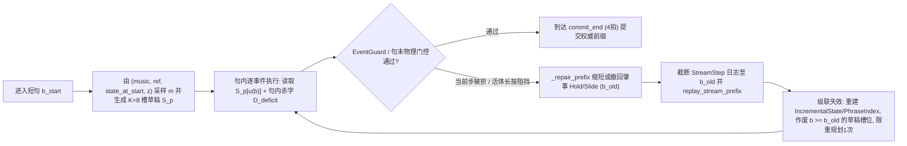

# Antigravity 两轮方案咨询原文（2026-11-03）

本文件保存通过 Antigravity 会话的 Copy 功能取得的完整回复，供维护人员复核。两轮均明确要求只读、不得修改代码、不得停止训练或运行实验。以下内容是独立建议，不代表已经实现、已经测试，或所有论断均被采纳。

最终采纳与修订以 `docs/COMPOSER_BLOCK_DRAFT_AND_UNIFIED_TIMING_PLAN_20261103_ZH.md` 为准。尤其注意：第一轮的强制赤字补音、四格节奏表示、默认镜像、固定一次重规划、毫秒级耗时承诺，以及“2 bit 不可能泄漏答案”的说法未作为最终方案。

## 第一轮
Analyzed COMPOSER_V48_TRAINING_AUDIT_20261103_ZH.md:L1-132
Analyzed COMPOSER_V48_TRAINING_AUDIT_20261103.json:L1-800
Analyzed stream_model.py:L1-800
Analyzed stream_model.py:L801-1600
Analyzed stream_model.py:L1601-2400
Analyzed stream_arrangement.py:L1-63
Analyzed stream_phrase_model.py:L1-460
Analyzed stream_phrase_execution.py:L1-304
Analyzed stream_model.py:L2180-2561
Analyzed stream_phrase_runtime.py:L1-74
Analyzed stream_generate.py:L1-450
Analyzed stream_proposal.py:L1-85
Analyzed stream_search.py:L1-490
Analyzed stream_phrase_training.py:L1-243
Analyzed stream_data.py:L450-900
Analyzed stream_data.py:L901-1350
Analyzed stream_recovery.py:L1-350
Analyzed stream_phrase.py:L1-350
Analyzed stream_phrase.py:L351-616
Analyzed stream_recovery.py:L351-812
Analyzed stream_augmentation.py:L1-800
Analyzed stream_target_correspondence.py:L1-59
Analyzed stream_quality.py:L1-200

### 一、开放架构方案对比：为什么推荐「拍位锚定槽位草稿（Beat-Anchored Slot Sketch）」而非自由长度事件序列草稿？

要实现“先想好下面整块配置怎么写，再逐事件流式写出，且遇音乐变化/占手冲突可局部重规划”，我们先横向对比四种整块构思表示：

| 方案 | 核心表示 | 优势 | 致命短板 / 工程风险 |
| --- | --- | --- | --- |
| **A. 自由长度有序稀疏事件表** （你的候选方向：逐颗预测 `(落点, 族, 几何, 释手)`） | 句首自回归生成 $N \le 32$ 个草稿事件序列 | 直观，与流式事件一一对应 | **指针失步（Pointer Desync）**：一旦执行器因 `EventGuard` 拒绝、拆单双押或恢复增删 1 颗音，草稿下标 $k$ 与实际事件步 $t$ 立即错位；且引入第二套自回归解码循环 |
| **B. 离散 VQ 码本 / 模板 ID** | 每句映射为 $1\sim 2$ 个离散 code | 极轻量 | 跨句长（$2/3/4/6/8$ 拍）难以对齐，码本易坍缩，且冲突时无法只重规划后半句 |
| **C. 掩码块双向补全（MaskGIT）** | 16 步块内多轮双向迭代采样 | 全局完形强 | 推理需多次重跑主干或块解码器，破坏流式单遍预算与严格因果滚回 |
| **D. 拍位锚定槽位草稿（首选开放方案）** `Beat-Anchored Slot Sketch` $\mathcal{S}_p$ | 将当前短句 $[b_{\text{start}}, b_{\text{end}}]$ 按拍位划分为固定 $K=8$（或按半拍 $K \le 16$）个**拍位锚定槽位**，一次并行生成 | **零指针失步、零自回归草稿开销、天然支持局部重规划与主动留白** | 槽位内极细微时值/滑条路径需留给流式执行器补齐（恰符合分工） |

#### 首选开放方案：拍位锚定槽位草稿（`PhraseSketch`）+ 因果赤字执行器
现有 [`stream_phrase.py:237`](file:///e:/simai_transformer/src/maichart/composer/stream_phrase.py#L237) 的音乐短句边界长度恒为 $\{2, 3, 4, 6, 8\}$ 拍。与其把草稿建成“第 $k$ 颗事件是什么”，不如建成**绑定在拍位坐标上的 $K=8$ 个锚定槽位 $\mathcal{S}_p = \{s_{p,0}, \dots, s_{p,K-1}\}$**，每个槽位携带 4 项轻量结构目标：
1. **节奏与留白编制 $o_u \in \{0:\text{主动留白 REST}, 1:\text{单拍点}, 2:\text{八分双点}, 3:\text{十六分连打/密集}, 4:\text{反拍/切分}\}$** + 4 bit 亚拍落点掩码；
2. **主导动作族 $f_u \in \{\text{NONE}, \text{TAP}, \text{CHORD}, \text{HOLD}, \text{SLIDE}, \text{TOUCH}\}$**；
3. **持续占手与释手窗口 $r_u \in \{0,1\}^2$**：`(本槽是否有长按/滑条释放, 本槽是否需留出单手空档配合另一侧 Hold/Slide)`；
4. **粗几何走势锚点 $g_u \in \mathbb{R}^4$**：圆环重心方向 $(\cos\bar{\theta}, \sin\bar{\theta})$ 与运动角速度 $(\cos\Delta\theta, \sin\Delta\theta)$（`REST` 或纯 `TOUCH` 槽位掩码清零）。

**为什么这个设计比“自由长度事件草稿”更好，同时完全兼容你的方向？**
- **天然抗失步**：执行器在任意时刻 $b$（无论前文是否发生过拒绝重试、漏写恢复或局部回滚），都按**归一化拍位坐标** $\tau(b) = \frac{b - b_{\text{start}}}{b_{\text{end}} - b_{\text{start}}}$ 读取当前槽位 $s_{p, u(b)}$ 与下一槽位 $s_{p, u(b)+1}$（直接复用 [`OrderedPhraseContext.aligned_read`](file:///e:/simai_transformer/src/maichart/composer/stream_phrase_model.py#L88-L130) 的坐标插值机制！），绝不会因为少写或多写一颗音导致整句草稿下标错乱。
- **一次并行出稿**：句首只需一次 `Linear + 2层轻量1D卷积/MLP`（$<0.15\text{ms}$）即可同时产出 $M=4$ 个模式下的全部 $K=8$ 个槽位草稿 $\hat{\mathcal{S}}_p(m)$，无需每步重跑编码器。
- **若保留你的“有序事件草稿”作为备选**：也必须通过拍位核平滑（类似 [`aligned_read`](file:///e:/simai_transformer/src/maichart/composer/stream_phrase_model.py#L106-L124) 的 `proximity` 软对齐）投影到拍位轴上供执行器读取，切勿用事件步序号 $k$ 硬对齐。

---

### 二、`λ × gain` 压死入口的根因解剖与统一概率/损失合同（问题 2）

#### 1. `v48` 压掉正确入口（`step 1000/1168` 连续 16 拍 `WAIT`）的两个真实代码根因
1. **数据侧权重失衡（[`_augment_authored_rest_row`](file:///e:/simai_transformer/src/maichart/composer/stream_augmentation.py#L621-L642) + [`_inherit_counterfactual_budget`](file:///e:/simai_transformer/src/maichart/composer/stream_augmentation.py#L491-L494)）**：
   `authored_rest` 增强按高音频能量（`weights = energy + mean`）抽样内部单个 `WAIT` 步（`at` 到 `at+1`），然后调用 `_inherit_counterfactual_budget`（[`L638`](file:///e:/simai_transformer/src/maichart/composer/stream_augmentation.py#L638)）把**原窗口整整 16 个事件步的 `sample_weight` 总和全部堆在这一步 `WAIT` 上**！这迫使 [`PhraseArrangementRate.music`](file:///e:/simai_transformer/src/maichart/composer/stream_arrangement.py#L20) 在高能量乐句上预测低倍率（`0.33~0.45`）以逃避 $16\times$ 的单步 `WAIT` 惩罚。
2. **模型侧双通路失配与句内盲区（[`PhraseArrangementRate`](file:///e:/simai_transformer/src/maichart/composer/stream_arrangement.py#L47-L61) + [`_plan_at_cursor`](file:///e:/simai_transformer/src/maichart/composer/stream_model.py#L923-L934)）**：
   `plan_head`（$\lambda_{\text{base}}$）受 `plan_loss` 独立监督，已拟合了包含真实休止在内的事件率；而 `gain` 只乘在 `kind_logits` 和 `timing_logits` 上，**完全不受 `plan_loss` 约束**。更致命的是：当句首漏写（`has_notes = False`）时，`closing = 0`（[`stream_arrangement.py:58`](file:///e:/simai_transformer/src/maichart/composer/stream_arrangement.py#L58)），`gain` 仅由句级静态 `intent` 与三次 Bernstein 基函数决定——只要 `intent` 对该句给出负值，**整句 8 拍内无论过多少个 `WAIT`，`gain` 始终卡在 `0.34~0.45`**，把原本 `75.32%` 的 `native NOTE` 连续压到 `46.65% < 50%` 直至出句！

#### 2. 根本修复：单一最终发生率定律 $\lambda_{\text{final}}(t)$ 与三项硬合同
- **应删除的旧通路**：删除独立的 [`PhraseArrangementRate`](file:///e:/simai_transformer/src/maichart/composer/stream_arrangement.py)（`occurrence_arrangement`）及 [`stream_model.py:923-930`](file:///e:/simai_transformer/src/maichart/composer/stream_model.py#L923-L930)、[`L1322-L1332`](file:///e:/simai_transformer/src/maichart/composer/stream_model.py#L1322-L1332) 中的 `(gain - 1) * local` 乘法旁路；取消 [`_augment_authored_rest_row`](file:///e:/simai_transformer/src/maichart/composer/stream_augmentation.py#L638) 将整窗权重堆给单步 `WAIT` 的做法（改为监督包含“休止前入拍—内部休止—休止后重入”的完整短句窗口）。
- **复用的唯一发生率合同**：
  定义全模型唯一的最终事件强度 $\lambda_{\text{final}}(t)$：
  $$\lambda_{\text{final}}(t) = \mathrm{softplus}\!\Big(\ell_{\text{audio}}(t, c) + \Delta\ell_{\text{sketch}}\big(u(t), D_{\text{deficit}}(t)\big)\Big)$$
  1. **损失统一合同**：[`plan_rate_loss`](file:///e:/simai_transformer/src/maichart/composer/stream_model.py#L2369)（Poisson 计数）、[`plan_blank_loss`](file:///e:/simai_transformer/src/maichart/composer/stream_model.py#L2360)（空白窗 BCE）、[`kind_logits`](file:///e:/simai_transformer/src/maichart/composer/stream_model.py#L931-L934)（$P(\text{WAIT}) = \exp(-\int_t^{t+2}\lambda_{\text{final}}(s)\,ds)$）与 [`timing_logits`](file:///e:/simai_transformer/src/maichart/composer/stream_model.py#L1317-L1321)（首达密度）**全部读写同一个 $\lambda_{\text{final}}(t)$**。任何压低 $\lambda_{\text{final}}$ 的动作若违背该句真实音符总数，立刻在 `plan_rate_loss` 上受到惩罚。
  2. **局部槽位留白合同（保住真实主动留白）**：$\Delta\ell_{\text{sketch}}$ 按槽位 $u(t)$ 作用，仅当草稿槽位显式预测 $o_{u(t)} = \text{REST}$ 时在该槽位（$1\sim 2$ 拍局部区间）给出负偏置，**绝不跨槽位封锁整句**。
  3. **无 WAIT 计数的“音乐赤字（Musical Deficit）”重入合同（根治空白锁死）**：
     不输入 `WAIT` 历史次数，而是输入**句内累积音乐期望与已写音符数之差**：
     $$D_{\text{deficit}}(t) = \left(\int_{b_{\text{start}}}^{t} \lambda_{\text{audio}}(s)\,ds - N_{\text{written}}(b_{\text{start}}, t)\right)_{+}$$
     - 真实留白处：音频期望本就低或仅占 1 个 `REST` 槽位，出槽后立即恢复；
     - 漏写入口处：一旦走过 2 拍 `WAIT` 而 $N_{\text{written}}=0$，$D_{\text{deficit}}(t)$ 单调递增并强制将 $\Delta\ell_{\text{sketch}}$ 的负压制归零，使第 25 拍直接恢复到 `native NOTE = 75.32%`，不可能连卡 16 拍。

---

### 三、增强整句 $m$ 证据且不退回 Raw Sum、不泄漏答案（问题 3）

为什么 `W * softmin(mean_event_nll)`（[`stream_phrase_execution.py:223-225`](file:///e:/simai_transformer/src/maichart/composer/stream_phrase_execution.py#L223-L225)）让 $m$ 对细节的控制偏弱？因为一句 20 颗音里约 80% 是普通四分/八分单点，4 个模式在这些普通步上似然几乎相同，除以 $W_p$ 求平均后，真正体现手法差异的 $3\sim 4$ 个关键结构点（Hold 支点、对称转折、尾拍释手）被稀释了 $5$ 倍；而若退回 `raw_sum`，长句又会把后验熵压死到 0。

**数学自洽的「草稿+事件」双层有界证据目标**：
1. **将模式 $m$ 的整句能量分解为「草稿构思能量 + 固定有效步数 $K_{\text{eff}}$ 的执行能量」**：
   在 [`unified_profile_response_loss`](file:///e:/simai_transformer/src/maichart/composer/stream_phrase_execution.py#L223-L225) 中，令模式 $m$ 在短句 $p$ 上的内层对数后验得分为：
   $$S_{p,z,m} = \log P(m \mid z, \text{music}_p) - \Big(\overline{\text{NLL}}_{\text{sketch}}(p, m) + \tau_{\text{eff}}(W_p)\,\overline{\text{NLL}}_{\text{event}}(p, m)\Big)$$
   其中 $\tau_{\text{eff}}(W_p) = \min(W_p, K_{\text{eff}})$（取固定有效证据容量 $K_{\text{eff}} = 4.0$，而非 `mean_nll` 的 $1.0$ 或 `raw_sum` 的 $64$），外层自由能保持总预算 $W_p$：
   $$\mathcal{L}_{\text{phrase}}(p,z) = -\frac{W_p}{\tau_{\text{eff}}(W_p)} \log \sum_{m=1}^M \exp(S_{p,z,m})$$
   - **为什么有效**：$\overline{\text{NLL}}_{\text{sketch}}(p, m)$ 直接在 8 槽草稿（动作族/节奏型/几何走势/释手）上评估模式 $m$，信噪比远高于 7898 维细节词表；$\tau_{\text{eff}}=4$ 则相当于每句按 4 个关键结构决策的尺度与先验 $\log P(m\mid z)$ 竞争，长短句温度恒定且预算守恒。
2. **离散瓶颈后验指导（防泄漏、防模板复制）**：
   复用训练时已计算的 [`OrderedPhraseContext.encode_sequences(..., 'target_phrase_sequence_')`](file:///e:/simai_transformer/src/maichart/composer/stream_phrase_model.py#L424) 输出一个仅含 4 维 logits 的辅助识别分布 $q_\phi(m \mid \text{target\_seq}_p)$，仅用 $\mathrm{KL}(\mathrm{sg}(r_{p,m}) \,\|\, q_\phi(m))$ 辅助破除初期 4 模式对称。因为 $m \in \{0,1,2,3\}$ 只有 $\le 2\text{ bits}$ 容量，且连续 `target_seq` 向量绝不进入解码器，**数学上不可能泄漏单步答案或死记硬背整句模板**。

---

### 四、错误前文后“合理但不同”续写的可信监督合同（问题 4）

当前 [`stream_target_correspondence.py`](file:///e:/simai_transformer/src/maichart/composer/stream_target_correspondence.py) 只在“整段修改前缀呈严格全局 $C_8$ 旋转”时才给 `configuration_trusted = True`，其余增强样本（`same_key`, `abab`, `missed_entry` 等）全部设 `configuration_mask = False`（只学时间，配置梯度为 0）。这导致模型一旦在推理时偏离全局完美旋转，配置头就进入“无监督盲区”。

建议建立**不依赖左右手标注、严格基于原谱与物理守卫的三级可信监督合同**：

1. **一级：释手边界后的局部 $D_8$（8 旋转 × 2 镜像）重锚定（整段可信）**
   - 将 [`corresponding_shift`](file:///e:/simai_transformer/src/maichart/composer/stream_target_correspondence.py#L14) 扩展到完整二面体群 $D_8$（复用 [`PhraseExecution.transforms`](file:///e:/simai_transformer/src/maichart/composer/stream_phrase_execution.py#L43-L45) 的 16 个变换，含镜像可编码检查）。
   - **关键扩展**：当错误前文与目标短句之间满足 [`rotation_boundary_clear`](file:///e:/simai_transformer/src/maichart/composer/stream_target_correspondence.py#L42)（旧长按已释放），不必强求错误前文自身也是原谱的同构旋转！只需枚举原谱剩余短句在 $g \in D_8$ 下的 16 个同构变体 $g \cdot T_{\text{authored}}$：
     - 筛出全部通过 `_validate_window(guard, ...)`（硬物理冲突为 0）且词表可编码的变体集合 $\mathcal{G}_{\text{legal}} \subset D_8$；
     - 用现有的无标签双手轨迹束搜索 [`_trajectory_comfort`](file:///e:/simai_transformer/src/maichart/composer/stream_quality.py#L136-L200) 计算边界衔接代价 $C_{\text{hand}}(\text{prefix}, g \cdot T_{\text{authored}})$，选取代价最低且不超过原谱代价 $+\epsilon$ 的最优 $g^*$（或对所有舒适 $g \in \mathcal{G}_{\text{legal}}$ 赋软权重）作为目标续写。这保证每一个正例都是**真实官谱手法在当前前文手位下的合法同构落位**，绝不凭空捏造配置。
2. **二级：动作族/时值保留 + 合法舒适相位集边缘化（复用 `target_phase_mask`！）**
   - 若前文残留未释放的 Hold 锁死了部分按键，使全局 $D_8$ 无解，但当前目标步的原作 `shape` 仍存在至少一个相位 $\phi \in \{0,\dots,7\}$ 满足 `guard.accepts` 且双手衔接代价舒适：
   - **直接复用 [`stream_model.py:2235, 2300`](file:///e:/simai_transformer/src/maichart/composer/stream_model.py#L2235) 已有的 `target_phase_mask`（`[B, T, 8]`）边缘化机制**！无需新增任何训练头：保持原作的 `event_family`、`shape` 和 `target_details`（时值/路径类型由音乐决定），将 `target_phase_mask` 替换为当前前文下通过 `EventGuard` 且满足软手顺阈值的相位子集 $\Phi_{\text{legal}} \subset \{0,\dots,7\}$。模型天然学会“遇到占手冲突时保持同规格手法、转向空闲按键位”。
3. **三级：硬冲突死锁前文（仅监督时间/休止）**
   - 若 $\Phi_{\text{legal}} = \emptyset$（前文把双手全锁死，原作规格在任何相位都物理非法），严格设 `configuration_mask = False`，绝不强训非法配置。

---

### 五、草稿提交/撤回与 Hold/Slide 回滚的级联状态机（问题 5）

直接嵌入现有 [`search_stream`](file:///e:/simai_transformer/src/maichart/composer/stream_search.py#L223-L490)（写 8 拍、提交 4 拍）与 [`StreamInferenceContext`](file:///e:/simai_transformer/src/maichart/composer/stream_data.py#L1093-L1295) 的事务日志架构：

1. **草稿绑定签名**：在 [`stream_phrase_runtime.py:27-44`](file:///e:/simai_transformer/src/maichart/composer/stream_phrase_runtime.py#L27-L44) 的 `_execution_runtime` 中，将 `(mode, sketch_slots)` 绑定到 `(phrase_start_beat, prefix_signature_at_phrase_start, replan_count)`。
2. **Hold/Slide 撤回的完整级联链条**：
   当 [`_repair_prefix`](file:///e:/simai_transformer/src/maichart/composer/stream_search.py#L130-L221) 缩短或撤回 $b_{\text{old}}$ 处的 Hold/Slide 时：
   - **物理状态**：`replay_stream_prefix` 重放截断后的 `StreamStep` 日志，`IncrementalState` 自动释放被占轨道，`curve.counts` 自动回退 head 计数；
   - **短句记忆与进度**：`PhraseIndex` 仅保留 $< b_{\text{old}}$ 的事件，`phrase_progress` 和后续短句的 `phrase_memory_features` / `phrase_sequence_events` 自动回退；
   - **草稿槽位**：所有 `phrase_start_beat > b_{\text{old}}` 的未提交草稿直接清空；包含 $b_{\text{old}}$ 的当前短句保留 `< u(b_{\text{old}})` 的已提交槽位，对 $\ge u(b_{\text{old}})$ 的剩余槽位基于新释放的 `IncrementalState` 重新计算一次草稿。
3. **防死循环三道硬锁**：
   - 保持 [`_repair_prefix:156`](file:///e:/simai_transformer/src/maichart/composer/stream_search.py#L156) 的冲突集严格单调缩减条件（`after_keys < before_keys`）；
   - 保持 `attempted_historical_edits` 指纹禁忌表（[`L317`](file:///e:/simai_transformer/src/maichart/composer/stream_search.py#L317)）；
   - 每个短句窗口最多允许 `max_sketch_replans = 1` 次句内草稿重算，步内普通采样重试不触发重算草稿。

---

### 六、具体代码接入点、算力/缓存预算、分阶段顺序与最小可证伪验收（问题 6）

#### 1. 具体代码接入点
- [`src/maichart/composer/stream_model.py`](file:///e:/simai_transformer/src/maichart/composer/stream_model.py)：
  - 在 [`_plan_at_cursor`](file:///e:/simai_transformer/src/maichart/composer/stream_model.py#L899-L940) 与 [`L1322-L1332`](file:///e:/simai_transformer/src/maichart/composer/stream_model.py#L1322-L1332) 移除 `occurrence_arrangement` 的乘法 `gain`，改为将 `PhraseSketch` 的槽位留白/赤字残差 $\Delta\ell_{\text{sketch}}$ 直接加到 `plan_logits` 上，使 `plan_loss`、`kind_logits`、`timing_logits` 共用同一份 `plan_state`；
  -顺手修复上次指出的 [`L1189`](file:///e:/simai_transformer/src/maichart/composer/stream_model.py#L1189) 与 [`L1246`](file:///e:/simai_transformer/src/maichart/composer/stream_model.py#L1246) 主干 `batch['condition']` 未替换为 `causal_condition` 的训推错位，并在 [`detail_context`](file:///e:/simai_transformer/src/maichart/composer/stream_model.py#L1942) 加入 `dropout`、对 [`SharedDetailEmbedding`](file:///e:/simai_transformer/src/maichart/composer/stream_shared_details.py) 候选向量做 `LayerNorm` 遏制 `regular_detail` 过拟合。
- [`src/maichart/composer/stream_phrase.py`](file:///e:/simai_transformer/src/maichart/composer/stream_phrase.py) & [`stream_phrase_model.py`](file:///e:/simai_transformer/src/maichart/composer/stream_phrase_model.py)：
  - 在 `PhraseIndex` 中提取 $K=8$ 槽位的 CPU 标签 `target_phrase_sketch`（替换或升级原 96 维四分箱直方图）；
  - 在 `OrderedPhraseContext` 中新增 `PhraseSketchHead`（输入 `anchor + retrieved + style + boundary_state + mode_choice`，输出 $[M, K, D_{\text{sketch}}]$），并在 `actor_residual` 中按当前拍位插值读取当前槽位与下一槽位加上 `D_deficit`。
- [`src/maichart/composer/stream_phrase_execution.py`](file:///e:/simai_transformer/src/maichart/composer/stream_phrase_execution.py)：
  - 在 [`unified_profile_response_loss`](file:///e:/simai_transformer/src/maichart/composer/stream_phrase_execution.py#L223-L225) 引入 $\tau_{\text{eff}} = \min(W_p, 4.0)$ 与 $\overline{\text{NLL}}_{\text{sketch}}(p, m)$。
- [`src/maichart/composer/stream_augmentation.py`](file:///e:/simai_transformer/src/maichart/composer/stream_augmentation.py) & [`stream_target_correspondence.py`](file:///e:/simai_transformer/src/maichart/composer/stream_target_correspondence.py)：
  - 修复 [`_augment_authored_rest_row`](file:///e:/simai_transformer/src/maichart/composer/stream_augmentation.py#L621-L642) 单步权重堆叠；
  - 扩展 `corresponding_shift` 支持 $D_8$ 与释手后重锚定，并在单步冲突恢复中写入合法相位掩码 `target_phase_mask`。

#### 2. 算力与缓存代价预算
- **CPU 缓存预算**：每短句新增 $K=8$ 槽位紧凑标签（每槽 8 字节，每句 64 字节，单谱约 $4\text{ KB}$），复用现有 `_phrase_budget = 64 MiB`，额外内存增长 $< 2\text{ MiB}$。
- **GPU 训练与推理算力预算**：`PhraseSketchHead` 在每个短句锚点仅执行一次 $128\text{D} \to 8\times 32\text{D}$ 映射，同时省去了 `PhraseArrangementRate` 的多分支前向；训练吞吐预算保持在 `v47` 基线的 $\pm 3\%$ 以内（不重跑音频或主干解码器），推理每短句仅增加 1 次毫秒级草稿生成。

#### 3. 分阶段实施顺序与最小可证伪验收
1. **阶段 1（止血与统一率定律，最小改动可独立验证）**：
   - 修复 `_augment_authored_rest_row` 权重堆叠 + 移除独立乘法 `gain`，将留白/赤字残差并入 `plan_logits` 统一接受 `plan_loss` 监督 + 修复 `causal_condition` 泄漏与 `SharedDetailEmbedding` 归一化。
   - **最小可证伪验收**：在完全相同的 48 首开发谱探针（171 个内部休止、114 个真实入口、50 个漏写入口）上，**50/50 漏写入口必须在观察窗口内全部恢复出音（消除第 21–35 拍连续压制案例），且内部休止负对数似然不得劣于 step 0（`1.9311`），开发集 `regular_detail_loss` 在第 2–3 轮不再单调恶化**。
2. **阶段 2（接入 $K=8$ 拍位锚定槽位草稿与 $\tau_{\text{eff}}$ 整句证据）**：
   - 上线 `PhraseSketchHead` 与双层模式证据 $S_{p,z,m}$。
   - **最小可证伪验收**：对比固定 `m=0..3` 生成同一音频，4 个模式的草稿槽位分布（动作族占比、留白槽位置、几何重心）互信息显著大于 0，且开发集 `unified_balanced_variational_objective` 低于阶段 1。
3. **阶段 3（上线三级可信恢复监督与句内局部重规划）**：
   - 启用 $D_8$ 重锚定、`target_phase_mask` 合法相位集边缘化与回滚级联重算草稿。
   - **最小可证伪验收**：在 `phrase_v1` 搜索生成下，触发历史 Hold/Slide 缩短或撤回时，重规划后的后续短句零硬物理冲突，且 `forced_waits` 与重复拒绝率低于阶段 2。

## 第二轮

Analyzed stream_song_profile.py:L1-237
Analyzed stream_timing.py:L1-256
Analyzed stream_shared_details.py:L1-187

以下是严格对齐你提出的 **7 项边界约束** 的收敛版架构合同，并在最后补充 1 个能把“首句原创起承转合”与“跨句呼应/变奏”真正合二为一的补充视角（零工具调用、只读收敛）。

---

### 1. 粗拍位锚点 + 局部有序微锚点：保住三连音/24分与精确物理集合（拒绝 4-bit 网格与圆心坍缩）

现有 [`stream_timing.py:18`](file:///e:/simai_transformer/src/maichart/composer/stream_timing.py#L18) 的 [`GRID_DENOMINATORS`](file:///e:/simai_transformer/src/maichart/composer/stream_timing.py#L18) 已定义完整的 **11 类细分节拍族** [`GRID_FAMILIES = ('other', '1', '2', '4', '8', '16', '32', '3', '6', '12', '24')`](file:///e:/simai_transformer/src/maichart/composer/stream_timing.py#L19)，且 [`stream_model.py:468-484`](file:///e:/simai_transformer/src/maichart/composer/stream_model.py#L468-L484) 已预计算精确的 8 键集合 `atom_lanes` `[V_a, 8]` 与 33 个 Touch 传感器集合 `atom_touch` `[V_a, 33]`。草稿不应重造粗陋的二进制掩码或圆心坐标，而应直接复用这套物理基元：

* **粗锚点网格（Coarse Beat Anchors）**：
  * 对跨度 $L_b \in [2, 8]$ 拍的短句，以 **半拍（`0.5 beat`）** 为粗锚点步长（上限 $A_{\max}=16$ 个粗锚点；若跨度 $>8$ 拍则按 1 拍粗锚点或截断在 $A_{\max}=16$，并带 `anchor_valid_mask [A_max]`）。
  * 每个粗锚点 $a \in \{0, \dots, A-1\}$ 覆盖绝对拍区间 $[b_a, b_a + \Delta_a)$，由句首轻量双向层（`2层 Conv1d / 2头 Self-Attention`，隐藏维 $D_{\text{draft}}=96$）为每个模式 $m \in \{0..3\}$ 输出**有序粗锚点潜向量** $d_a^{(m)} \in \mathbb{R}^{96}$。
* **局部有序微锚点（Local Ordered Micro-Anchors，$M_{\text{sub}} = 2$）**：
  * 为避免半拍内的先后顺序（如 `1 -> 5` 与 `5 -> 1`）坍缩为无序直方图，每个粗锚点 $a$ 展开为 **$M_{\text{sub}} = 2$ 个严格按时间先后排序的微锚点槽** $(d_{a,0}^{(m)}, d_{a,1}^{(m)})$：
    * 若该半拍无音符：微锚点 `0, 1` 的 `active_flag` 均为 `0`（显式编码句内主动留白 `REST`）；
    * 若该半拍有 $1$ 个事件：槽 `0` 对应唯一事件，槽 `1` 为 `0`；
    * 若该半拍有 $2$ 个事件（如 8 分双连或 12 分切分）：槽 `0` 为先发事件，槽 `1` 为后发事件；
    * 若该半拍有 $\ge 3$ 个高速事件（如 16/24/32 分爆发）：槽 `0` 严格监督**该半拍入口事件（First Event）**，槽 `1` 严格监督**该半拍出口/收尾事件（Last Event）**，中间过渡由粗锚点的 `burst_count_class` 与 `grid_family` 决定！
* **精确物理与节拍监督目标（无圆心退化、不抹除 Touch）**：
  1. **粗锚点级目标（每半拍 1 组）**：
     * `event_count_class` $\in \{0, 1, 2, 3, \ge 4\}$（`5-way CE`，`0` 即明确留白）；
     * `dominant_grid_family` $\in \{0, \dots, 10\}$（`11-way CE`，直接复用 [`GRID_FAMILIES`](file:///e:/simai_transformer/src/maichart/composer/stream_timing.py#L19)，天然保留 `3/6/12/24` 三连音族与 `1/2/4/8/16/32` 二分族）；
     * `anchor_log_rate_residual` $\delta_a^{(m)} \in [-2.5, +2.5]$（供第 2、3 节统一率调制使用，不单加重复计数 Loss）。
  2. **微锚点级有序目标（每粗锚点 $M_{\text{sub}}=2$ 槽，仅在真实事件存在时监督）**：
     * `sub_offset_phase`：槽 $\nu \in \{0, 1\}$ 在当前半拍内的相对位置 $u_{a,\nu} \in [0, 1)$（或映射到 [`AbsoluteTimingHead`](file:///e:/simai_transformer/src/maichart/composer/stream_timing.py#L96) 现有的 24/32 局部相位槽 `CE`）；
     * `button_head_mask` $\in \{0, 1\}^8$（`8D BCE`）：精确 8 键落点集合——`1/5` 双押是 `[1,0,0,0,1,0,0,0]`，`2/6` 双押是 `[0,1,0,0,0,1,0,0]`，单押 `1` 是 `[1,0,0,0,0,0,0,0]`，绝不因圆心为 0 而混淆；
     * `touch_sensor_mask` $\in \{0, 1\}^{33}$（`33D BCE`，直接取自 `atom_touch`）：精确监督 `A1..E8, C` 共 33 个 Touch 传感器集合 + `is_touch_hold` `[1]`，Touch 谱面与烟花/中心押获得与外圈按键完全同等的几何表达；
     * `sustain_endpoint_and_occupancy` $\in \{0, 1\}^{16}$（`16D BCE`）：前 `8` 维为该事件发起的 Slide 终点 / Hold 锁键集合（可由 [`stream_shared_details.py:32`](file:///e:/simai_transformer/src/maichart/composer/stream_shared_details.py#L32) 的 `_TRAILING_NUMBER_RE` 与 Hold lane 直接提取），后 `8` 维为**该微锚点结束时刻仍处于按压/滑行占用的键位集合**（直接对齐 [`IncrementalState`](file:///e:/simai_transformer/src/maichart/composer/stream_Search.py) 的物理双手占用）。
* **解码端对齐读取（`O(1)` 局部窗口）**：
  * 当流式游标处于 `step_beat` $t$（落入粗锚点 $a(t)$）时，解码器同时读取 `(d_{a(t),0}, d_{a(t),1}, d_{a(t)+1,0})`，既知道当前半拍的入口/出口几何规划，又知道下半拍的衔接落点。

---

### 2. 用“过锚即焚的局部前向风险（Expiring Per-Anchor Forward Hazard）”替代“累计赤字追债”

完全同意你的判断：单调累积 $\text{Deficit}(t) = \int_{b_0}^t \lambda - N_{\text{written}}$ 会在“音乐很响但编排意図就是留白（如 break / 停顿）”时积攒巨额正赤字，迫使后续拍位疯狂补音，直接违反用户“禁止补音追债/禁止强制最大休止”的红线。

正确机制应当是**过去拍位无记忆过期（Memoryless Expiration of Past Anchors）+ 当前/未来锚点前向导引**：

1. **每个粗锚点独立预测对数率残差，无跨锚点债务传递**：
   * 粗锚点 $a \in \{0, \dots, A-1\}$ 仅预测其自身半拍区间 $[b_a, b_{a+1})$ 上的对数率偏置：
     $$\delta_a^{(m)} = 2.5 \tanh\!\big(w_\lambda^\top d_a^{(m)}\big) \in [-2.5, +2.5]$$
     不使用 `if REST: only negative` 之类的硬门控，正负双向均可由统一到达似然自然学习。
2. **游标推进即自动核销历史（Past Mass Expires Automatically）**：
   * 在任意事件步 $i$（游标时刻为 $t_i$），第一到达分布**只积分未来窗口** $s \in [t_i, \min(t_i + 2, b_{\text{end}})]$：
     $$\Lambda_i(t_i, t \mid m) = \int_{t_i}^{t} \lambda_{\text{audio}}(s)\,\exp\!\big(\delta_{a(s)}^{(m)}\big)\,ds, \quad t \in (t_i, t_i + 2]$$
   * **为什么这同时解决了“留白不追债”与“漏音不锁死”？**
     * **真留白不追债**：若锚点 $a=0,1$ 音乐很响但真实是留白（或模型输出了 `WAIT`），一旦游标从 $t_0=b_0$ 推进到 $t_1 = b_0 + 2 = b_4$，区间 $[b_0, b_4)$ 已经完全处于积分下限 $t_1$ **之前**！锚点 $0..3$ 上未转化为音符的 $\lambda_{\text{audio}}$ 质量随着游标跨过 $b_4$ **当场过期清零**，绝不会背负到 $b_4$ 之后去催生补音爆发。
     * **漏入不锁死全句**：与 [`v48`](file:///e:/simai_transformer/src/maichart/composer/stream_arrangement.py#L46) 用单一标量 `gain` 乘死整句不同，$\delta_a^{(m)}$ 是**分锚点（per-anchor）**的。即便模型在 $a=0$ 意外漏写了一个音符并走出 `WAIT` 到达 $a=4$，只要草稿在 $a=4$ 规划了重入（$\delta_4^{(m)} \ge 0$），游标到达 $b_4$ 时读取的就是全新的 $\delta_4^{(m)}$，不会被 $a=0$ 的失误锁死后续整句！
     * **同锚点内的瞬时重入（Intra-Anchor Local Hazard）**：若需要在半拍内部微调重入，只需将 $\delta_a^{(m)}$ 写为当前粗锚点内已写出事件数 $k_{\text{in\_anchor}} \in \{0, 1, \ge 2\}$ 的小表函数 $\delta_a^{(m)}[k_{\text{in\_anchor}}]$（3 个标量输出）：当 $k_{\text{in\_anchor}}=0$（该半拍尚未出音）时采用入口偏置 $\delta_{a,\text{entry}}^{(m)}$；一旦已出音则切到续写偏置 $\delta_{a,\text{cont}}^{(m)}$。它只看当前半拍内的局部状态，不看半拍之前的历史欠账。
3. **重规划与回滚缓存（按状态指纹去重，不设硬性 `max_sketch_replans = 1` 音乐规则）**：
   * 由于粗锚点草稿只依赖句首状态 `(phrase_start_hidden, phrase_audio_slice, z, m)`，在句内流式推进或局部回滚时，**同一短句的未来粗锚点 $d_a^{(m)}$ 天然保持冻结缓存**，零重复计算。
   * 在 [`stream_search.py`](file:///e:/simai_transformer/src/maichart/composer/stream_search.py) 的事务回滚中，以 `(phrase_idx, quantized_step_beat, action_state_fingerprint, rejected_first_token_set)` 作为尝试键去重，避免对同一死胡同前缀重复回滚，而不把回滚次数硬编码成音乐规则。

---

### 3. 统一第一到达似然与前缀缓存积分合同（不展开 $O(T \times L)$ 全曲轨迹、不三重计费）

你指出的计算量与预算边界非常关键：如果让 $\lambda_{\text{final}}$ 依赖随步变化的因果状态，绝不能对每个历史步 $i$ 重算整首曲子的 10ms 帧网格。利用**分片常数锚点调制 + 现有 [`plan_state['prefix']`](file:///e:/simai_transformer/src/maichart/composer/stream_model.py#L1312) 缓存**，可以做到 **零 10ms 循环、严格单次第一到达似然计费**：

1. **全曲基础音频率 $\lambda_{\text{audio}}(s)$（每曲仅算 1 次，保持 `O(frames)`）**：
   * [`plan_head`](file:///e:/simai_transformer/src/maichart/composer/stream_model.py#L1294) 仍在全曲音频帧 `cache['local']` 上一次性算出基础强度 $\lambda_{\text{audio}}(s)$ 及其累积前缀积分表 $P_{\text{audio}}(t) = \int_0^t \lambda_{\text{audio}}(s)\,ds$（即现有的 `plan_state['prefix']`）。
   * 全曲级 `plan_loss`（`Poisson count + blank BCE`，权重 `0.1`）**仅监督这个全曲基础 $\lambda_{\text{audio}}(s)$**，为其校准物理密度基线；推理时的 [`_Curve`](file:///e:/simai_transformer/src/maichart/composer/stream_generate.py#L462) 也只按 2 秒窗平滑缩放 $\lambda_{\text{audio}}(s)$。
2. **步级条件强度 $\lambda_i(s \mid m)$ 的闭式前缀差积分（`O(1)` 查表，无 `O(T × L)` 展开）**：
   * 在事件步 $i$（游标 $t_i$），候选落点 $t_{i,k} \in (t_i, t_i + 2\text{ beats}]$ 最多跨越 **4 个半拍粗锚点** $a \in \{a(t_i), \dots, a(t_i)+3\}$。
   * 因为每个粗锚点区间 $[b_a, b_{a+1})$ 内的调制因子 $\gamma_a^{(m)} = \exp(\delta_a^{(m)})$ 是常数，步 $i$ 从 $t_i$ 到任意候选时刻 $t$ 的条件累积风险 $\Lambda_i(t_i, t \mid m)$ **无需在 10ms 帧上重新积分**，而是直接由已缓存的 $P_{\text{audio}}$ 在半拍边界上的差值给出：
     $$\Lambda_i(t_i, t \mid m) = \sum_{a = a(t_i)}^{a(t)} \exp\!\big(\delta_a^{(m)}\big) \cdot \Big(P_{\text{audio}}\big(\min(t, b_{a+1})\big) - P_{\text{audio}}\big(\max(t_i, b_a)\big)\Big)$$
   * 这只需最多 4 项已缓存前缀和的加权相加，计算复杂度严格是 $O(1)$！
3. **单一截断第一到达负对数似然（Single Censored First-Arrival NLL，无重复 Poisson/BCE 惩罚）**：
   * 在局部区间 $[t_i, t_i + 2\text{ beats}]$ 上，全部时间相关头共享同一个 $\Lambda_i(\cdot \mid m)$：
     * **2 拍无事件（`WAIT`）生存概率**：$P(\text{WAIT} \mid h_i, m) = \exp\!\big(-\Lambda_i(t_i, t_i + 2 \mid m)\big)$；
     * **2 拍内出音（`NOTE`）到达概率**：$P(\text{NOTE} \mid h_i, m) = 1 - \exp\!\big(-\Lambda_i(t_i, t_i + 2 \mid m)\big)$；
     * **条件候选时刻 $t_{i,k}$ 得分**：在结构节拍网格 logit `grid_logit(t_{i,k})` 上加上局部条件到达修正 $\delta_{a(t_{i,k})}^{(m)} - \Lambda_i(t_i, t_{i,k} \mid m)$。
   * **预算唯一性**：训练时对 $\delta_a^{(m)}$ **不额外施加任何独立的 Poisson 计数 Loss 或 BCE 留白 Loss**。它完全由现有的步级第一到达 NLL（`mode_kind + note * mode_delta`，按 $1/D$ 归一）直接驱动，彻底杜绝同一时间信号的三重计费。

---

### 4. 反事实增强权重账目修正与“双侧休止片段”配对消融合同

完全接受你对 [`v48`](file:///e:/simai_transformer/docs/COMPOSER_V48_TRAINING_AUDIT_20261103_ZH.md) 实测账目的精确核查：在 `rollout_steps = 32`、`max_phrase_events = 64` 下，[`_inherit_counterfactual_budget`](file:///e:/simai_transformer/src/maichart/composer/stream_augmentation.py#L491) 将原窗口有效步权重和 $K \le 64$ 赋给单步目标，在宏观 epoch 均值上确被 `0.15 / 12 = 1.25%` 采样率与分母 $D$ 稀释，但在微观单样本反传行上形成了 $K:1$ 的单点 `WAIT` 梯度集中。

为严格区分“单步权重集中”与“[`PhraseArrangementRate`](file:///e:/simai_transformer/src/maichart/composer/stream_arrangement.py#L14) 参数化缺陷”各自的因果贡献，设计如下**配对消融与双侧片段合同**：

1. **双侧休止片段监督（Two-Sided Rest Snippet Supervision）**：
   * 淘汰“截断在单步 `WAIT` 并把整窗权重 $K$ 塞给这一步”的做法。
   * 对含句内留白或走偏前缀的窗口，保留包含 **`[休止前出音 (2~4步) -> 句内 WAIT (1~2步) -> 休止后重入 NOTE (2~4步)]`** 的连续局部片段（或保持原短句窗口的逐事件 mask），**每一步保留其原始 `sample_weight = 1.0`**，绝不把整窗权重和折叠到单颗 `WAIT` 上。
2. **分母与监控指标解耦（保持与 `v47/v48` 可比）**：
   * 在训练/验证日志中，将 `authored_history_loss`（纯官谱前缀行）与 `counterfactual_history_loss`（扰动前缀行）分开记录；主验证指标 `dev/loss` 与 `dev/regular_detail_loss` 保持在纯官谱前缀上评估，确保与 `v47/v48` 历史基线严格同口径可比。
3. **两步最小配对消融**：
   * **Ablation A**：仅将单步权重集中改为逐事件 `sample_weight = 1.0` 的双侧片段；
   * **Ablation B**：同时用第 2、3 节的逐粗锚点 $\delta_a^{(m)}$ 替换整句标量 [`PhraseArrangementRate`](file:///e:/simai_transformer/src/maichart/composer/stream_arrangement.py#L14)，直接对比两者的 `blank_rate` 与 `regular_detail_loss`。

---

### 5. 保守合法续写合同：严禁默认开启 $D_8$ 镜像，坚持 `$C_8$ 旋转 + 真实占用优先`

完全遵照你的边界：**严禁默认引入 $D_8$ 镜像反射**（maimai 谱面存在显著的左右手主导手与顺逆时针滑键习惯，镜像会破坏人体工学与手序语义），几何等价类严格限制在现有 [`stream_target_correspondence.py`](file:///e:/simai_transformer/src/maichart/composer/stream_target_correspondence.py) 的 **$C_8$ 旋转群（8 个旋转位移）**。

当历史前缀发生偏移或处于恢复窗口时，严格执行以下两级监督与状态合同（不拿启发式舒适度伪造金标准标签）：

1. **一级：已证明等价前缀（`configuration_trusted = True`）——保留完整配置监督**：
   * 仅当满足以下任一严格条件，且当前时刻 [`IncrementalState`](file:///e:/simai_transformer/src/maichart/composer/stream_search.py) 的物理长按/滑键占用完全清空（`rotation_boundary_clear == True`）且通过 [`EventGuard.accepts`](file:///e:/simai_transformer/src/maichart/composer/stream_guard.py) 时，才对 `shape / shared_detail / literal` 施加交叉熵监督：
     * 历史偏移在释放边界后已重同步回原谱（`shift == 0`）；
     * 或由 [`corresponding_shift`](file:///e:/simai_transformer/src/maichart/composer/stream_target_correspondence.py#L84) 证明历史后缀与目标后缀存在唯一、无长按冲突的 **$C_8$ 整句旋转等价位移** `shift in {0..7}`。
2. **二级：未证明等价前缀（`configuration_trusted = False`）——物理占用硬约束 + 仅监督时间/句法结构**：
   * 绝不用 `EventGuard + _trajectory_comfort` 搜索伪造的 token 作为交叉熵 target；直接令 `configuration_mask = False`（屏蔽 token/detail CE），仅保留时间到达似然（出音 vs 留白、节拍网格相位）与草稿锚点余量的一致性。
   * **真实物理状态优先于缓存草稿**：在任何时刻，[`action_state`](file:///e:/simai_transformer/src/maichart/composer/stream_model.py#L1185) / `candidate_action_state`（来自真实已生成音符的 [`IncrementalState`](file:///e:/simai_transformer/src/maichart/composer/stream_search.py) 长按与滑键占用）拥有最高优先级；若草稿微锚点预测的按键与当前真实未释放的 Hold/Slide 发生物理冲突，解码端与 [`EventGuard`](file:///e:/simai_transformer/src/maichart/composer/stream_guard.py) 一律以真实 [`IncrementalState`](file:///e:/simai_transformer/src/maichart/composer/stream_search.py) 为准。

---

### 6. 严守训练/推理零信息差（不引入 $q_\phi(\text{target})$ 识别网）、$\tau_{\text{eff}}$ 消融与旧头删减清单

你指出的信息论风险极其切中要害：即便 $m$ 只有 4 个模式（$\ln 4 \approx 1.386$ nats），在短句或稀疏句上，一个偷看未来真值的训练期后验网 $q_\phi(m \mid \text{target})$ 也能把“本句是否留白 (`WAIT` vs `NOTE`)”或“本句主用 `Hold` 还是 `Tap`”这 1~2 bit 的关键决策编码进 $m$，导致解码器在训练期养成依赖后验模式的捷径，而在推理期因先验 $p_\theta(m \mid h_0)$ 选不中该模式而崩盘。

1. **前向计算 100% 因果同构（Zero Target Leakage in Forward）**：
   * **绝不引入任何读取 `target` 的识别网络 $q_\phi$**。
   * 模型在训练和推理时的前向路径 **100% 相同**：句首只根据因果状态 `(phrase_start_hidden, phrase_audio_slice, completed_condition, z)` 计算先验 $p_\theta(m \mid h_0, z)$ 以及 4 个模式各自的预测草稿 $\hat{\mathcal{S}}_p^{(m)}$；解码器只读取这个因果预测草稿 $\hat{\mathcal{S}}_p^{(m)}$（完全不需要 scheduled sampling 混入真值草稿，因为模型从第 1 步起就只消费自己的预测草稿！）。
   * 责任权重 $r(z, m)$ **仅在 Loss 函数内部**（[`stream_phrase_execution.py`](file:///e:/simai_transformer/src/maichart/composer/stream_phrase_execution.py)）由各因果模式的评估代价算出：
     $$E_{\text{total}}(z, m) = E_{\text{event}}(z, m) + \beta_{\text{draft}} E_{\text{draft}}(\hat{\mathcal{S}}_p^{(m)}, \mathcal{S}_p^{\text{gt}})$$
   * **自动化等价性门禁**：在单元测试中强制断言 `model.forward_causal(batch_with_targets) == model.forward_causal(batch_stripped_of_targets)` 逐比特相等。
2. **句级责任温度 $\tau_{\text{eff}}$ 作为显式消融超参**：
   * 在 [`PersistentPhraseExecutionConfig`](file:///e:/simai_transformer/src/maichart/composer/stream_phrase_execution.py#L21) 中将 `responsibility_effective_events` $\tau_{\text{eff}} \in \{1.0, 2.0, 4.0, W_p\}$ 设为可配置超参（其中 $\tau_{\text{eff}}=1.0$ 退化为当前 `v48` 的均值能量，$\tau_{\text{eff}}=W_p$ 退化为总和能量），通过小步消融选定最既能拉开模式分工、又不压垮先验的档位，而非先验假定 `4.0` 最优。
3. **做减法：明确合并与删除的冗余模块清单（净减少辅助头数量）**：
   引入统一的 `OrderedPhraseDraft`（第 1 节）后，直接**删除以下 4 套功能重叠的旧模块/分支**：
   * **删除 [`phrase_prediction`](file:///e:/simai_transformer/src/maichart/composer/stream_phrase_model.py#L334)**（96 维 4-bin 统计直方图回归头及 `phrase_loss`）；
   * **删除 [`phrase_ordered_prediction` / `OrderedPhraseSupervision`](file:///e:/simai_transformer/src/maichart/composer/stream_phrase_model.py#L226)**（把整句压成单一 128D 向量的双塔对比/余弦辅助头及 `phrase_ordered_loss`）；
   * **删除 [`future_relation_prediction`](file:///e:/simai_transformer/src/maichart/composer/stream_model.py#L728)**（仅存在于 Loss、推理端无人读取的未来 2 步集合关系预测头及 `future_relation_loss`）；
   * **删除 [`PhraseArrangementRate`](file:///e:/simai_transformer/src/maichart/composer/stream_arrangement.py#L14)**（[`stream_model.py:725`](file:///e:/simai_transformer/src/maichart/composer/stream_model.py#L725) 的整句标量 `occurrence_arrangement` 头，由粗锚点 $\delta_a^{(m)}$ 取代）。
   * **净效果**：用 **1 个** 既受监督又直接参与因果解码的 `OrderedPhraseDraft` 头，替换掉原来 **4 个** 各自为政的辅助头/旁路。

---

### 7. 统一 `condition` 两级合同：先验只看 `(known_values, known_mask)`，执行器读取补全后的 16D `completed_condition`

核查 [`stream_song_profile.py:118-120`](file:///e:/simai_transformer/src/maichart/composer/stream_song_profile.py#L118-L120) 可确认你的发现完全准确：当前 `unified['causal_condition'] = condition * known_mask.to(condition.dtype)` 会把所有未锁定项直接置为 `0.0`！在 `auto` 模式下（仅 `level_index` 已知，其余 15 项 `known_mask = False`），若直接把解码器输入 `x` 或 `_condition_plan` 中的 `batch['condition']` 换成 `causal_condition`，等于向执行器注入“密度=0、长条=0、滑键=0、Touch=0”的错误全零控制向量。

正确的**两级条件传递合同（Two-Tier Condition Contract）**如下：

1. **第一级：先验与补全器输入 `known_condition_input`（仅暴露已知项）**：
   * [`SongProfileCompleter`](file:///e:/simai_transformer/src/maichart/composer/stream_song_profile.py#L31) 与整曲先验 `p(z | audio, known_condition)` **只允许读取** `(condition * known_mask, known_mask)`（共 32 维）。这保证了推断 $z$ 的先验分布 $p(z \mid \text{audio}, c_{\text{known}})$ 绝不偷看未锁定的目标风格真值。
2. **第二级：下游执行器输入 `completed_condition`（始终是完整的 16D 有效控制向量）**：
   * 在 [`SongProfileCompleter.unified_evidence`](file:///e:/simai_transformer/src/maichart/composer/stream_song_profile.py#L69) 中，每个整曲分量 $z$ 已经输出了 16 维属性的预测分布均值 $\hat{c}_z = \mathbb{E}[c \mid z, \text{audio}, c_{\text{known}}] \in [0, 1]^{16}$。
   * 对任意分量 $z$（或按先验加权），定义**补全控制向量**：
     $$c_{\text{completed}}(z) = \text{where}\big(\text{known\_mask},\; c_{\text{raw}},\; \text{stop\_grad}(\hat{c}_z)\big) \in [0, 1]^{16}$$
     即：**用户显式锁定的维度保持 100% 精确原值；用户未锁定的维度填入补全器预测的合理期望值 $\hat{c}_z$（而非 `0.0`！）**。这与推理时 [`resolve_song_profile`](file:///e:/simai_transformer/src/maichart/composer/stream_song_profile.py#L261) 产出 `result.to_vector()` 喂给生成器的行为**完全一致**！
   * **下游三处消费者统一对齐**：
     * 解码器主干输入 `x`（[`stream_model.py:1189`](file:///e:/simai_transformer/src/maichart/composer/stream_model.py#L1189)）、全曲音频计划 `_condition_plan`（[`L1246`](file:///e:/simai_transformer/src/maichart/composer/stream_model.py#L1246)）、以及短句因果上下文 `CausalPhraseContext.style`（[`stream_phrase_model.py:326`](file:///e:/simai_transformer/src/maichart/composer/stream_phrase_model.py#L326)）统一接收 16D 控制向量：
       * 在 `full` / `partial` 掩码行上读取含真值锁定的 `c_completed`（学会严格服从用户的显式控制滑块）；
       * 在 `only_level`（模拟 `auto` 模式）行上读取补全器产出的 `c_completed`（让执行器在训练期就适应补全器输出的连续控制分布，彻底消除训练只见真值 $c_{\text{gt}}$、推理却见补全值 $\hat{c}_{z^*}$ 的校准落差）。

---

### 8. 补充一个最具区分力的新视角：把“参考句检索”直接升级为“粗锚点级关系草稿编辑（Relational Sketch Editing）”

在审视 [`stream_phrase_model.py:103-198`](file:///e:/simai_transformer/src/maichart/composer/stream_phrase_model.py#L103-L198) 的 [`OrderedPhraseContext`](file:///e:/simai_transformer/src/maichart/composer/stream_phrase_model.py#L103) 时，可以看到一个极有潜力的结构机会：
目前，模型已经检索了最多 $R=4$ 个已完成的历史短句（`phrase_sequence_*`），但现有做法一方面在句首把历史参考句通过 `sequence_gru` 压成单个静态向量，另一方面在句内每步用 `aligned_read` 只看局部最近的 2 颗音符。这导致**“句首草稿规划”与“跨句主题呼应”是割裂的两套机制**：草稿头在画未来 8 拍蓝图时，根本看不见参考句在对应拍位上写了什么！

**高价值统一方案（Relational Anchor-to-Anchor Draft）**：
* **同构表示**：因为历史已完成参考句 $r \in \{1..R\}$ 的真实音符序列是完全已知的，我们可以用**零可学习参数**直接把每个历史参考句确定性地编码为与第 1 节**完全同构的粗锚点序列** $S_{\text{ref}}^{(r)}[0..A-1]$（每个半拍锚点的精确节拍族、8键/33-Touch 集合、微锚点顺序与留白标记）。
* **在粗锚点网格上直接做“参考旋转 + 关系编辑”**：
  * 当句首草稿头规划当前句的第 $a$ 个半拍粗锚点 $d_a^{(m)}$ 时，它不仅读取当前句第 $a$ 个半拍的音频特征 $\text{Audio}_{\text{cur}}[a]$，还通过句子级选中的参考槽 $r^*$ 与 $C_8$ 旋转位移 $\Delta_{\text{rot}} \in \{0..7\}$，**直接对齐读取参考句在同一相对半拍 $a$ 上的锚点特征** $\text{Rotate}(S_{\text{ref}}^{(r^*)}[a], \Delta_{\text{rot}})$ 以及音频差分 $\text{Audio}_{\text{cur}}[a] - \text{Audio}_{\text{ref}}^{(r^*)}[a]$！
  * **为什么这一步能大幅减轻学习负担？**
    1. **当音乐段落重复（副歌复现 / 对称乐句）且走参考分支时**：草稿头不需要从 9 个池化音频点里凭空幻想 16 个半拍的复杂几何，它只需把参考句对应半拍锚点的精确按键/节拍结构做 $C_8$ 旋转搬移，并根据当前半拍与参考半拍的局部音频能量差（$\Delta\text{Audio}[a]$）做增量编辑（例如参考句该半拍是留白，而当前句此处多了鼓点加花，则仅修改该锚点的 $\delta_a$ 与微锚点）；
    2. **当音乐进入全新段落（或走 `null_reference` 分支）时**：同一个粗锚点草稿网络退化为基于当前音频包络的纯原创起承转合规划器。
  * 这样，“**句内起承转合草稿**”与“**跨句动机呼应/变奏**”在同一个半拍锚点坐标系 `[A_max=16, M_sub=2]` 上彻底合流，无需再维护两套独立的短句表征。

