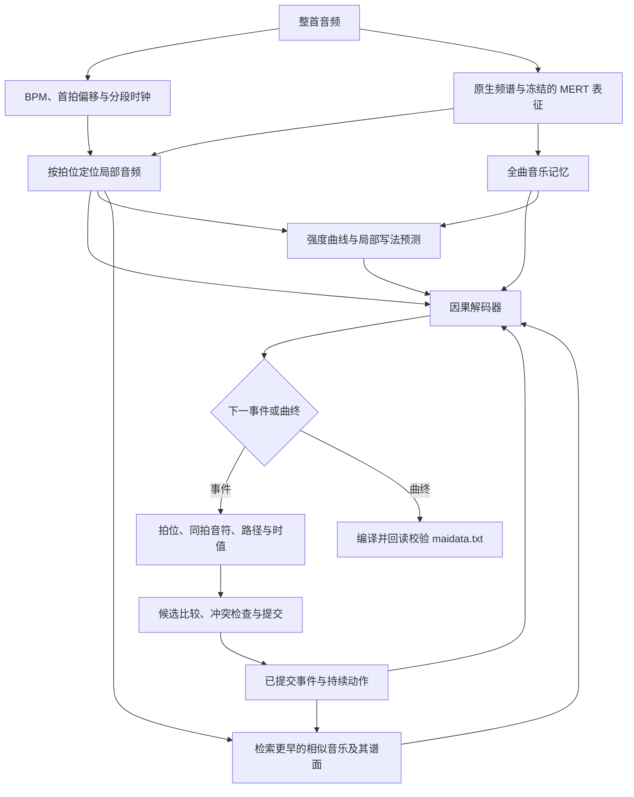
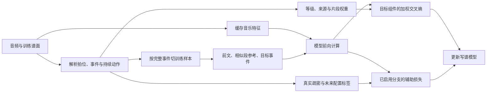

# ChroMAI Composer v2：模型架构、训练与连续事件生成

ChroMAI 的主线任务是从整首音频、谱面时钟和目标定数生成 Simai 谱面。Composer v2 把同一拍位上的一组音符作为一个事件。模型先选下一事件的拍位，再写这一拍的完整配置。事件提交后，下一次决策可以读取它的音符、时间和仍在持续的动作。

本文依据 2026 年 11 月 21 日的本地实现，描述 Composer v2 的连续事件路线。文中的默认值用于说明当前实现，已有检查点按各自保存的词表、结构和训练策略运行。对照对象是 Gemai Abierto 随附的 S8 生成器；涉及完整 Gemai 体系的实验时单独注明。

## 1 从音频到谱面

整首音频在生成前可读，谱面则按时间向前提交。模型可以提前听到即将出现的鼓组，参考前一遍副歌已经写出的配置；后一遍副歌最终会怎么写，在当下仍是未知量。曲线、局部写法预测和参考证据能用到哪一层，取决于检查点。

## 2 时间表示：时钟、细分与分段

**时钟决定某一拍对应音频的哪一秒。** 首拍偏移决定拍位零点，BPM 决定拍与秒之间的比例。变速曲使用分段 BPM，在变化点保持时间连续。生成器可使用手动或参考谱面提供的时钟，也可从音频估计节拍，再用全曲起音校准周期和相位。拍号变化涉及重音如何分组；即使 BPM 恒定，三拍和五拍也可以交替出现。

**事件时间由全曲整数拍和拍内精确分数构成。** 例如第 37 拍后的第一个 24 分落点写作 `37 + 1/6` 拍。整数部分用数字组件表达，`1/6` 是可跨整数拍复用的相位。同拍的 Tap 与 Slide 共用一次选时，后续组件分别表达类型、位置、修饰、路径和时值。下一次直接预测更远的拍位就能形成休止，无须逐格输出空拍。

| 音乐里的间隔 | 以四分音符为一拍 | 在每拍 48 tick 上 | Composer v2 的表示 |
| --- | --- | --- | --- |
| 12 分音符 | 1/3 拍 | 16 tick | 整数拍加对应的分数相位 |
| 16 分音符 | 1/4 拍 | 12 tick | 同上 |
| 24 分音符 | 1/6 拍 | 8 tick | 同上 |
| 一拍五等分 | 1/5 拍 | 9.6 tick，无法精确落在整数格上 | 词表覆盖相应相位时可精确表示 |

相位集合是有限的。新建词表可纳入训练谱中的精确相位，已有检查点的可用集合取决于它的词表；兼容微调可追加词项。生成结束后，编译器按局部事件间距选择 Simai 分割数，再回读核对事件。音频采样频率、模型相位词表和导出文本中的分割数，是三个不同的量。[事件编码](../../src/maichart/composer_v2/stream_codec.py) · [事件编译](../../src/maichart/generation/event_compile.py)

## 3 模型怎样读取音乐和前文

| 通路 | 表示与读取方式 | 对应的决策 |
| --- | --- | --- |
| 局部声学 | 每秒 100 帧，96 带 log-mel 加谱通量与能量；与冻结的 MERT 第 8 层表征（1024 维，约 75 帧/秒）按同一时钟对齐 | 哪个起音值得采，音色变化适合怎样的动作 |
| 全曲音乐记忆 | 沿音频时长等距汇总，最多 160 个区间。歌曲编码器处理这些区间，部分解码层按当前位置读取 | 相似音色出现在铺垫、展开还是收尾，前后段落有何差异 |
| 强度曲线 | 按约 2 秒区间分别估计每秒事件数与同拍额外音符数，再按查询时间插值；支持用户编辑 | 区分落点变密和多押变多，例如四个单押与两组双押 |
| 局部写法预测 | 从局部音乐、歌曲记忆与等级预测未来 0–2、2–4、4–8 拍的配置特征，包括环上延续、折返、Slide 形状、占用与释放等 | 给下一步的配置与部分选时决策提供有先后顺序的提示 |
| 谱面前文与远段参考 | 近期真实提交的事件直接进入前文；对齐参考按音乐语义与拍内起音比较较早段落，把参考配置移到当前拍位，并提供匹配证据 | 区分刚写完的动作怎样衔接，以及这一遍副歌应怎样回应上一遍 |

连续模型按整数拍锚点取局部音频。以默认前瞻参数为例，每个局部块覆盖锚点前 2 拍至后 6 拍（右端不含），以每拍 24 个位置插值，再经卷积与局部编码器压缩。独立起音读出另取原生 100 Hz 帧，可在已选整数拍内重新分配各相位的概率；前方多尺度音乐摘要则为选择整数拍提供依据。前者适合处理“进了这一拍，却把 24 分选成 16 分”，后者针对“整组起音入口就错过了”。

主解码器采用因果自注意力、带时间偏置的局部音频交叉注意力，以及部分层的歌曲交叉注意力。谱面组件共享输入嵌入与输出分类权重。当前新训练的基础配置为宽度 384、4 层局部音频编码器、2 层歌曲编码器和 8 层解码器；训练任务可以改变规模。冻结的 MERT 特征提取器单独计算和缓存。[音乐输入](../../src/maichart/composer_v2/audio.py) · [主模型](../../src/maichart/composer_v2/model.py) · [拍内读出](../../src/maichart/composer_v2/onset_readout.py) · [局部写法](../../src/maichart/composer_v2/local_writing.py)

## 4 训练：怎样把真人谱面变成监督

**主任务是条件续写。** 每条样本包含维持占用所需的较早事件、近期谱面、可用参考和目标事件。教师强制训练在每个目标位置给出此前的真实组件，预测下一个组件。主损失是按有效权重总和归一化的交叉熵；前文和参考只提供条件。普通切片结束不产生曲终标签，到达真实谱尾才监督 EOS。密集段的 16 个事件可能只占几拍，稀疏段则可能跨越很长的休止。

**辅助任务教的是写法的变化方向。** 相同数量的单点可以是扫键、交互或同键连打。局部写法监督观察事件的先后、圆环上的移动和释放位置，例如 `7、8、1、2` 仍是同向邻键推进。训练标签来自后续真人事件，送回解码器的写法条件来自模型对音乐的预测。强度曲线另用计数和有效时长学习两种事件率，训练时部分样本会使用平滑、扰动后的真实曲线提示，生成时使用预测或编辑曲线。两条通路的含义不同：曲线可以要求这一段更密，写法分支还要判断应如何展开。[强度曲线](../../src/maichart/composer_v2/intensity.py) · [动作描述](../../src/maichart/composer_v2/motion_writing.py)

**前文依赖和素材质量会改变有效监督。** 当前训练可缩短部分样本的谱面历史、调整延续和转折片段的学习权重。另有实验性微调，可把模型实际生成的前文与同曲真人后续配对，先核对接缝拍位、持续动作及可行性，再学习接得上的后续。训练来源可采用拟合定数，标注可分别调整采音与配置权重；缺少可靠标注的区间尤其要避免被当成已确认的休止。训练效率主要来自音乐特征缓存、按完整输入长度分桶，以及复用同曲计算。[训练样本](../../src/maichart/composer_v2/stream_data.py) · [生成前文实验](../../src/maichart/composer_v2/generated_prefix.py)

## 5 生成：试写多远，实际保留多少

1. **整理上下文。** 默认读取近期 16 拍；更早起始、仍需携带的持续动作另行编码。随着事件提交，解码器复用缓存，并按事件数、参考覆盖或组件预算刷新上下文。刷新后仍使用同一个全曲拍位。
2. **提出事件。** 模型在合法的后续拍位和 EOS 之间选择，再逐组件写完同拍配置。采音和配置可独立设置采样参数。近期配置强度与相似段呼应强度也可独立调整，默认均为 1；它们直接调整配置候选分数。实际选出的配置会成为后续历史，因而整首谱的后续采音也可能间接受影响。
3. **短段试写与提交。** 当前默认设置为 2 个候选、前看 4 拍、保留前 2 拍。配置比较模式沿用首份试写的拍点与同拍音符头数；混合模式可在固定拍点放开头数，联合模式也可重选拍点。这样可以比较同一处重音写成双押或滑条组合后的衔接。实际以完整事件提交，试写尾部可在后续重新决定。
4. **检查、恢复与导出。** 默认音乐选优比较已选落点的起音支持与重音对齐。持续动作占用和物理冲突另行检查；遇到冲突可重采、撤回或修复，耗尽预算时按策略停止或带诊断继续。EOS 表示整谱结束。可选的提前结束抑制会随距曲尾的时间减弱，仍允许正常长休止。成谱由事件和分段时钟编译为 `maidata.txt`。[短段搜索](../../src/maichart/composer_v2/phrase_search.py) · [音乐选优](../../src/maichart/composer_v2/music_rank.py) · [连续生成](../../src/maichart/composer_v2/stream_generate.py)

## 6 从 event_ctx 到 Composer v2：为什么放弃固定输出段

`event_ctx_v1` 已经针对段间衔接做过设计。典型布局是每次写 16 拍，带入前 8 拍的音符，音频向窗口两侧各扩 4 拍。训练与生成共用“前引上下文起点”作为复合序列的位置原点；生成时前引取自已写谱面。它还支持重叠推进，合并时重叠区由较早的窗口保留。这些设计解释了旧模型为何能接出连贯的常规配置。

按项目开发时的观察，放弃这条主线的主要原因，是非常规拍子和 12／24 分采音不够稳定。旧版已经尝试过针对性处理：训练时可提高细分音占比较高窗口的抽样次数，让模型更常遇到混合分音乐句。这个办法增加了样本出现频率，每次训练仍然要从整个块的位置词表里选落点。以下是从保留实现中能核对的机制。

| 观察 | 源码能确认的机制 | 对路线选择的意义 |
| --- | --- | --- |
| 12／24 分有时漏采或被邻近常用分音替代 | 旧位置词表本已包含分母 3、6 的拍位。它把整个块内相对位置当成一个词项，同一拍内相位在不同整数拍上对应不同输出类别 | 正确落点原本就可能在候选中。v2 改为整数拍与相位分别编码，并把当前拍的声学证据直接接入相位选择 |
| 非四拍组织的乐句容易在接缝处中断 | 固定段有独立目标和结束标记。前引与重叠可以传递已写内容，但跨界后仍要启动下一段；旧实现还保留了前引无法按检查点词表编码时退回空前引的路径 | v2 把计算刷新与音乐结束拆开，跨界的事件沿原时间线继续，持续动作单独保留 |
| 非常规细分对词表覆盖更敏感 | 旧词表在常规格点外补充训练中观察到的块内位置，并设分母上限；片段还受 token 预算约束 | v2 跨整数拍复用精确相位。能否稳定辨认少见节奏，仍取决于相位覆盖、音乐证据与训练样本 |

因此，固定分段能解释一部分接缝风险；旧版本究竟有多少次 24 分误选由接缝引起，现有材料没有给出可分离的比例。最有区分力的检查，是固定拍网，在同一乐句的段内与跨界位置分别看三个结果：正确拍位是否可选、模型给它多少概率、选优最后提交了什么。[旧位置词表](../../src/maichart/generation/event_model.py) · [旧训练窗口](../../src/maichart/training/event_ctx_dataset.py) · [旧生成与前引回退](../../src/maichart/generation/event_cli.py)

## 7 与 Gemai Abierto S8 的路线差别

两者都有因果写谱解码器、局部音频、全曲音乐记忆、相似段参考和多候选选择。决定实现差异的是三个单位：**拍内落点的精度、安排疏密的粒度，以及一次提交的谱面跨度**。

| 设计位置 | ChroMAI Composer v2 连续路线 | Gemai Abierto S8 |
| --- | --- | --- |
| 拍位与音频对齐 | 全曲整数拍加词表中的精确分数；按查询拍位取局部音频 | 每拍 48 tick。窗口内位置用相对窗口起点的 tick 表示，音频按拍网重采样 |
| 局部上下文 | 每个事件随当前拍位读取音乐；计算刷新后继续同一序列 | 前 16 拍谱面作为近期历史。局部音频覆盖前 16 拍、目标 16 拍及随后 4 拍，共 36 拍 |
| 全曲疏密安排 | 全曲音乐记忆预测连续的出音频率与额外物量，并可叠加按拍位读取的局部写法条件 | 独立规划器先为每个四拍单元选定一个音符数档位；写谱器在该单元开头接收 BDI，内部落点与配置由解码器决定 |
| 生成与结束 | 连续提交事件；短段试写可只保留前部。EOS 结束整谱 | 每 16 拍组织一个目标窗口，内部含四个四拍单元。模型预测 BARM 进入下一单元，调用方给出下一档 BDI；最后一单元的 EOS 结束当前窗口 |
| 候选与曲尾 | 默认滚动比较短段，可在曲中主动结束。过早 EOS 与长休止须分开诊断 | 发行版快速档默认每窗 6 个候选，选中后提交该窗。最后不足 16 拍仍按完整窗口解码，导出时剔除超出音频终点的起音 |
| 已发布方案的范围 | 同一模型族支持不同规模和训练组合；能力以检查点配置为准 | 发行写谱器 S8 约 2000 万参数，由约 1.6 亿参数的教师生成谱面进行序列级蒸馏。完整体系文档中的逐小节抄写标记不属于发行版 S8 |

### 同样是 16 拍，哪里会真正切开音乐？

假设全曲从第 0 拍开始，音乐按 **5/4** 分组，小节线在第 0、5、10、15、20 拍。一个从第 15 拍展开、到第 20 拍收束的扫键，在 Gemai 中跨过第 16 拍窗口边界。前一个窗口先提交第一拍的配置，后一个窗口能看到它，也能读取接下来的音乐，因而完全可以接完这组扫键。困难在于规划器的四拍统计和写谱器的交接点都落在这个音乐小节内部。相反，在对齐的 4/4 副歌里，每个四拍单元都能在开始处拿到明确的疏密安排，这是固定分段的实际收益。

Composer v2 写到第 16 拍时，下一事件仍可直接接续第 15 拍建立的走势。模型也可能恰好在附近刷新上下文或结束一次短段试写，但这里没有“必须把该段写完”的输出标记。相应地，它必须自己学会音乐在第 20 拍收束。精确拍位、全曲摘要和持续占用提供实现条件；判断重音分组、保留合理重复以及何时释放，仍是需要学习的能力。

**16／24 分混用又是另一种情况。** 假设从整拍起先写两个 16 分间隔，再接三个 24 分间隔。在 48 tick 网格上，落点依次是 0、12、24、32、40、48，全部精确。即使本段出现误选，也应先检查时钟、起音证据和配置前文的影响。对一拍五等分或七等分，才会直接遇到 48 tick 网格的量化误差。变拍也应按实际位置判断，例如 3/4 加 5/4 共 8 拍，两个循环恰好对齐 16 拍外边界，但内部四拍规划仍会跨过两种音乐小节的分界。

Gemai 提供了一种值得保留的评估方法。先给写谱器真实疏密安排，测它能否执行；再换成音频预测的安排，观察误差来自规划还是执行。ChroMAI 可以在相同的音乐、前文和候选拍点上分别检验疏密曲线、局部写法和候选选优。这样能区分“要求更密但模型没有执行”和“物量已经升高，配置仍只会重复”这两类听起来相似的问题。

**对照资料。** Gemai 的窗口几何与量化见 Abierto 发行目录下的 `release/gemai/mai/tokens.py`、`sequence.py`、`simai.py`；BDI、BARM、曲尾和候选提交见同目录的 `grammar.py`、`generate.py`。S8 的实际入口及规划器接线见 `release/gemai/tools/gen_v12.py` 和 `release/gemai/config.json`。蒸馏配方与完整体系实验取自发行文档《Gemai 原理与技术》第 7–10、14–16 节。以上比较针对表示和生成机制，未用两者生成同批曲目作质量排名。
