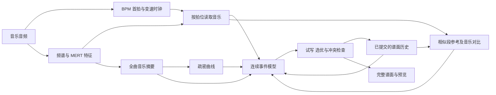

# ChroMAI 项目原理与技术

ChroMAI 是一个从音乐生成 maimai DX 谱面的项目。它学习音乐、拍位与音符配置之间的关系，输出可在 Simai 工具中查看和游玩的 `maidata.txt`，并提供训练、预览、素材审阅和片段反馈界面。

项目希望生成的谱面具有准确的采音、顺畅的配置、合理的留白，以及跟随音乐展开的结构感。当前主线采用 Composer v2 连续事件模型，已经能生成基本合理、部分片段表现不错的完整谱面。稳定写出整首都成熟的配置、准确理解复杂音色和安排有层次的呼应，仍是正在解决的问题。

本文介绍现有设计及其要克服的问题，并在最后说明后续方向。对应 2026 年 11 月 16 日的 [公开主线实现](https://github.com/baiqieji233/ChroMAI/tree/3ac23658744a798d6e3cc3782fc1edd51a664e08)。具体检查点启用了哪些能力，以它保存的模型配置为准。

## 1 写谱需要同时决定哪些事情

一段音乐可能同时有鼓点、旋律、持续音和装饰音。谱师需要选择跟随什么声音、取哪些拍点，再把它们组织成适合手部动作的配置。即使已经确定采音，同一串拍点也可以写成交互、扫键、双押、长按或滑条组合。

因此，ChroMAI 将问题理解为几个互相影响的决定。

| 决定 | 它影响什么 |
| --- | --- |
| 下一组音符什么时候出现 | 节奏、细分音、主动舍音和休止 |
| 同拍写哪些音符 | 键位、音符类型、多押、滑条路径与时长 |
| 当前配置怎样接前文 | 运动走势、持续占手、配置的展开与收束 |
| 当前段落怎样回应全曲 | 疏密起伏、重复音乐的呼应、相似段落的变化 |

目前，时间和配置由同一个因果序列模型共同生成。局部音乐、全曲摘要、前文参考和疏密曲线为它提供不同尺度的依据。模型每完成一个事件，就把该事件加入历史，继续向前写。



这种设计希望同时保留两种能力。音乐可以推动写法变化，已经建立的合理手法也能持续展开。有意留白、交互重复和段落呼应，都是需要从真实谱面中学习的编排选择。

## 2 从音乐时间到精确拍位

### 拍网与首拍

采音首先依赖一个可靠的时钟。即使模型选中了正确的音乐起音，BPM 或首拍偏移出错，也会让导出的谱面逐渐偏离音乐。

自动分析会利用节拍跟踪结果估计拍周期，再结合全曲起音证据校准 BPM 和相位。整数附近的 BPM 只有在声学拟合支持时才采用整数值。对于可能变速的歌曲，程序评估分段时钟，并保持变化点在音频时间上的连续性。用户也可以直接提供已确认的 BPM、首拍偏移或变速表。

倍频、半频和下拍对齐分别处理。界面中的四拍强拍对齐是可选设置，适合具有相应结构的歌曲。音乐中的实际拍位与谱面的时间表示，统一由 `TempoClock` 转换。

### 精确分数时间

连续事件使用绝对拍位，包含整数拍和拍内分数。例如，16 分音符间隔为 `1/4` 拍，24 分音符间隔为 `1/6` 拍，两者可以出现在同一句里。

时间词表包含常见拍内位置，还会在建立训练词表时加入真实训练谱出现的罕见相位。模型能够使用的相位由检查点词表确定。新增素材包含旧词表没有的位置时，需要通过兼容的词表扩展训练接入。

采用绝对拍位，是为了让每次落点都有独立坐标，减少相对时间偏差逐步累积的机会。采用分数，是为了保留非常规分音的准确位置。时间表示提供了表达能力，实际是否采准还取决于时钟和模型对音乐的判断。[时间编码](../../src/maichart/composer_v2/stream_codec.py) · [拍网检测](../../src/maichart/composer_v2/tempo.py)

## 3 为什么采用连续事件生成

### 一个事件是什么

一个事件表示同一时刻的一组音符。比如 `3/6h[4:1]` 包含一个 Tap 和一个 Hold，它们共用落点时间。

模型把事件拆成可以复用的组件。

```text
绝对拍位 → 拍内分数 → 音符类型 → 键位或触摸区 → 修饰与路径 → 时长 → 事件结束
```

多押可以继续写下一个音符，直到整个事件结束。类型、位置、滑条形状和时长组件在不同配置之间共享，帮助模型从已有组合学习新的组合。词嵌入还与输出分类权重共享，使“读到一个音符”和“写出一个音符”使用同一套基本表示。

### 计算切片与音乐边界

项目早期使用固定窗口时，曾遇到窗口边界与实际乐句、休止和结束判断相互影响的问题。复杂拍子和非常规分音使这种矛盾更明显。

当前训练仍需要切片，以控制显存和每批计算量。切片会保留完整事件，生成过程则在同一条时间线上连续推进。`[END_EVENT]` 表示当前事件完成，`[EOS]` 表示整张谱结束。整理上下文时，后续事件仍然接在已经提交的历史之后。

默认近期历史范围为 16 拍，同时保留仍在持续的 Hold 和 Slide。超出 token 预算时，程序按规则裁剪较旧内容，并保护必要的持续动作上下文。这让长按和滑条可以跨过计算切片继续存在。[事件组件](../../src/maichart/composer_v2/codec.py) · [训练切片与历史构造](../../src/maichart/composer_v2/stream_data.py)

## 4 模型怎样读取音乐

### 局部起音与音乐语义

如果只看少量能量和频带统计，模型容易知道“这里有变化”，却难以理解“这段声音怎样发展”。如果只看压缩后的音乐语义，又容易丢掉密集起音的时间细节。因此，当前模型同时使用两类特征。

| 输入 | 当前表示 | 主要用途 |
| --- | --- | --- |
| 原生声学 | 每秒 100 帧，96 带 log-mel，加起音变化和能量 | 读取局部音色变化与起音位置 |
| MERT 音乐表征 | 冻结的 MERT-v1-330M 第 8 层，1024 维，约每秒 75 帧 | 提供更丰富的音乐上下文 |

特征按音频秒数缓存，再依据谱面时钟插值到拍位。局部编码与拍内读出使用适合各自任务的采样密度。MERT 在准备阶段提取，常规训练读取缓存，降低重复运算成本。训练时也会随机关闭部分样本的 MERT 通路，让原生声学通路得到学习。

MERT 提供的是预训练音乐表示。鼓组、旋律和持续音在混合音频中的取舍，仍需要写谱模型结合训练谱学习。

### 全曲音乐记忆

只看眼前几拍，容易把一个正在铺垫的段落写得过满，也容易在高潮到来时继续沿用平淡写法。全曲编码器为模型提供更长的音乐背景。

当前全曲摘要最多 160 个时间区间，保存 MERT 和频谱均值，并补充频带变化、子区间起音强度等统计。加入变化量，是为了让模型区分“音色相近、但内部节奏和力度正在变化”的段落。部分解码层通过交叉注意力读取这份歌曲记忆，并使用相对拍位理解当前与远处音乐的关系。

完整歌曲在生成前已经可用，因此模型可以读取未来音频。未来谱面只作为训练目标，历史与参考中使用已经发生的谱面内容。[音频缓存与摘要](../../src/maichart/composer_v2/audio.py) · [模型音乐通路](../../src/maichart/composer_v2/model.py)

### 编码器与解码器怎样配合

局部音频先投影到模型宽度，加入拍位信息，再经过卷积下采样与 Transformer 编码。全曲摘要由另一组 Transformer 编码成歌曲记忆。

谱面解码器的每一层先读取已经写出的 token，再读取局部音频，最后通过前馈网络更新表示。部分解码层还读取全曲记忆。局部音频注意力具有可学习的前后时间衰减，使不同注意力头可以关注不同范围的音乐。等级与可选偏好也会参与各层计算。

谱面输入同时携带序列位置、拍位、拍内相位，以及历史、参考、目标等来源信息。这些位置特征让模型能够区分“同一个键位出现在什么时刻、属于哪一段内容”。

当前新训练默认宽度为 384，使用 4 层音频编码器、2 层歌曲编码器和 8 层解码器。宽度和深度可按训练规模调整。兼容微调新增音乐投影时采用零初始化，使模型先沿用原有能力，再通过训练学会读取新增信息。

## 5 如何改善细节采音

项目遇到过三类看起来相似、成因却不同的采音问题。

| 表现 | 需要检查的决定 | 当前设计 |
| --- | --- | --- |
| 一段明显的起音完全没进入谱面 | 下一事件应落在哪个整数拍附近 | 为选时提供前方多个尺度的音乐摘要 |
| 已经进入该段，但把 24 分写成了 16 分 | 整数拍内部的准确落点 | 独立拍内声学读出与拍位表示 |
| 开始采得合理，随后一直连打而不收束 | 何时继续、换写法或休止 | 历史、全曲上下文、疏密曲线和连续短段比较 |

前方入口证据覆盖 `0–1`、`1–2`、`2–4`、`4–8`、`8–16` 拍，复用已有音乐特征，为即将到来的音乐提供概况。

独立拍内读出则读取原生声学，在已选中的整数拍内比较不同相位。它调整相位之间的条件概率，并保持这一组相位的总概率质量。因此，提高起音参考强度主要改变拍内落点，无法直接补回一个已经错过的整数拍入口。

训练目标来自真实谱面，包含 16 分与 24 分混用，也包含谱师主动放弃的声音。音乐里出现一个声学峰，只说明那里有可参考的证据。模型还需要学习这个声音是否值得采、应当用怎样的配置来采。[拍内读出](../../src/maichart/composer_v2/onset_readout.py) · [前方音乐证据](../../src/maichart/composer_v2/music_evidence.py)

## 6 前文参考怎样帮助呼应

重复音乐通常需要一定的配置呼应，但相似音色也可能出现在节奏不同的段落。项目曾遇到参考覆盖不一致、低可信参考挤占近期历史，以及沿用前文后忽略当前音乐变化的问题。

现在的对齐参考会逐拍比较当前与更早的音乐，使用音乐语义和拍内起音模式寻找匹配，并把参考谱面移到当前时间轴上展示。参考保存完整音符组件，模型可以看到相应的修饰、滑条路径和时长。

可信度和每拍证据也会一起输入。低可信参考使用剩余上下文空间，近期真实历史获得优先保留。训练中还会丢弃参考或给出替代参考，帮助模型学习何时采用、何时忽略。

在此基础上，成对音乐输入同时提供参考位置与当前位置的音乐表示，以及起音模式的差异。例如，前一遍是均匀鼓点，后一遍增加了装饰音，模型可以同时看到前面的写法和这一遍的新音乐。

当前机制提供了判断呼应与变奏的依据，具体怎样复用仍由解码器学习。显式选择“保留节奏、改变位置”或“延续形状、加强收尾”，属于后续可验证的编排意图设计。[对齐参考](../../src/maichart/composer_v2/rhythm_structure.py) · [成对音乐特征](../../src/maichart/composer_v2/music_evidence.py)

## 7 强度曲线怎样参与疏密安排

### 为什么区分出音频率和同拍物量

一个整曲等级无法表达每一段都该怎样写。仅沿着最近的音符续写，又容易让密集段一直密集、平缓段一直平缓。强度曲线为模型增加局部可读、用户可编辑的疏密安排。

曲线内部使用两个量。

- **出音频率**衡量每秒有多少个不同落点。同一时刻的双押算一次。
- **同拍额外物量**衡量这些落点除第一颗音以外，还有多少颗音。

两者相加得到每秒音符数。每秒四个单押与每秒两次双押的总物量相同，但节奏和手感不同，这种区分保留了两者的差异。Slide 和 Hold 按头部事件计数，持续动作的负担另外通过历史与占用检查处理。

### 曲线怎样学习和使用

一个小预测头读取全曲音乐编码与目标等级，预测每个两秒区间的出音次数和额外物量。目标包含实际区间时长，尾部不足两秒时使用真实长度。真实谱面的空白区间以零计数参与监督，音乐响着时的主动留白也属于这些样本。

训练约一半样本使用自动预测曲线，另一半使用平滑、轻微扰动后的真实曲线。验证使用自动预测。解码器在每个位置读取当前及后面两秒、四秒的曲线，经投影后加入输入。

预测曲线通过计数目标学习，谱面损失到曲线数值的梯度被截断。这是为了让曲线始终保有“频率与物量”的含义，避免它在联合训练中变成难以解释的隐变量。歌曲编码器仍然同时接受谱面目标和曲线目标的训练。

当前曲线是一种学习条件。它的响应程度、峰谷压缩和短暂变化的表达能力，需要通过给定曲线后的实际成谱验证。两秒区间及训练时的平滑，也可能削弱非常短的爆发和收束。这是值得继续评估的设计取舍。[强度曲线实现](../../src/maichart/composer_v2/intensity.py) · [编辑器使用说明](COMPOSER_V2_INTENSITY_ZH.md)

## 8 模型训练究竟学什么

### 主目标与条件

正常样本使用真实前文，逐 token 预测真实谱面的下一步。损失按有效监督权重求平均，前文、填充和被排除的目标使用忽略或零权重。

```text
谱面损失 = 加权 token 交叉熵之和 / 有效权重之和
总训练目标 = 谱面损失 + 0.05 × 曲线损失
```

第二项只在启用强度曲线时存在，使用计数目标学习事件率与额外物量。日志分别报告选时、拍内相位和音符组件损失，便于判断模型究竟卡在哪里。

除了等级，模型还支持 Radar / Style 偏好。训练时这些条件从谱面统计得到，并随机遮盖部分或全部可选项。推理时未指定的条件使用显式“未知”标记，让模型学习自动选择的情形。当前条件描述的是密度、类型与配置倾向等统计特征，谱师身份和版本年代尚未作为主线条件接入。

### 节奏恢复与配置衔接

真实前文上的下一步预测良好，仍可能在自产前文中逐渐失控。为改善过密、过疏和偏相位之后的恢复，训练会对近期简单 Tap 前文做扰动，再监督真实的后续时间。

这类恢复样本屏蔽配置损失。原因是前文改变以后，原谱下一颗音符的绝对位置可能已经不顺手。强行把它当作唯一正确配置，会引入互相矛盾的学习目标。

因此，当前自动恢复主要覆盖节奏纠偏。配置衔接仍依赖正常真实谱训练，以及人工确认“从这段前文接入”的示范。系统性地学习自产配置之后的合理续接，是后续训练需要补足的能力。[损失函数](../../src/maichart/composer_v2/model.py) · [节奏恢复样本](../../src/maichart/composer_v2/stream_data.py)

### 数值稳定与训练规模

项目也遇到过损失数值正常、注意力梯度却不可靠的情况。最新从头训练会在每个注意力头的 Q/K 投影后做 RMS 归一化，约束内容分数的幅度。CUDA 低精度下带时间偏置的注意力还采用 FP32 计算与局部重算，控制数值误差和显存开销。已有检查点沿用训练时保存的策略。

模型宽度、音频编码层数、歌曲编码层数和解码层数均可调整，支持约 150M 量级的配置。冻结的 MERT 权重单独存放，不计入写谱模型的可训练参数量。扩大模型能增加表达容量，具体收益仍取决于数据覆盖、目标构造和实际训练量。[主模型](../../src/maichart/composer_v2/model.py) · [训练入口](../../src/maichart/composer_v2/train.py)

## 9 更多训练资料怎样变成有效监督

扩充自制谱可以增加音色、节奏和配置写法的覆盖，也会带来特殊谱、错误定数和局部质量不均的问题。一张谱里可能只有部分片段值得学习，因此当前数据体系支持整谱与片段两种粒度。

| 环节 | 作用 | 要克服的问题 |
| --- | --- | --- |
| 标称等级与难度槽筛选 | 可排除标称 0 或不需要的难度槽 | 特殊谱混入常规训练集 |
| 拟合定数 | 可使用 Chart;Gate 等估分结果筛选，并作为训练与验证的等级条件 | 不同谱师、版本的标称等级不一致 |
| 自动体检 | 检查解析、冲突与指定风险，记录或屏蔽相应范围 | 大量资料无法逐张完整人工检查 |
| 来源选择与权重 | 按目录决定自动体检是否生效，并调整来源贡献 | 可信精选资料与普通自制需要不同处理 |
| 采音与配置分项标注 | 同一片段可以只学采音、只学配置或两者都学 | 一个方面有问题时，另一个方面仍可能有价值 |
| 候选库与示范库 | 只学习显式确认的好段，未确认部分保留为上下文 | 将完整生成谱或待审素材全部视为正确答案 |

拟合定数给模型提供更一致的难度参考，其估分本身也需要人工抽查。自动体检的提示用于帮助复核，复杂星星、扫键和特殊处理会受到检测覆盖的影响。

片段屏蔽还需要维护监督含义。被排除的音符区间属于未知内容，不能把它转成“这里应该休止”的零计数标签。候选库提取前文参考时，也会核对引用范围是否获得相应确认。

当前系统提供来源与片段的筛选和加权入口。大规模预训练吸收写法、再以可靠素材微调，是可组织的训练流程。PU 质量评分器和自动课程配比仍属于可研究的方案。

主界面支持试听完整谱面、拖选范围、标记亮眼片段、确认前文接入，以及导出和导入片段包。每次训练还会记录素材审计，便于核对最终进入学习的内容。[候选库与审阅](COMPOSER_V2_CANDIDATE_POOL_ZH.md) · [标注操作](COMPOSER_V2_ANNOTATION_GUIDE_ZH.md)

## 10 生成时为什么需要试写和恢复

### 连续短段比较

单颗音符看起来合理，几拍连起来仍可能出现突兀跳跃、持续纵连或难以收尾的配置。短段试写让候选竞争一段连续内容，评价时包含已提交前文。

默认向前试写 4 拍、保留前 2 拍，再从已提交内容继续向前。试写尾部帮助评估后续，音乐仍可跨过这个计算范围持续展开。

| 方式 | 比较内容 |
| --- | --- |
| 先定节奏，再选配置 | 保留第一份候选的拍点和同拍音符数，比较不同配置 |
| 节奏与配置一起比较 | 比较不同的入口、拍内落点、音符数和配置 |
| 逐步生成 | 按事件直接推进，计算开销较小 |

采音和配置具有独立的温度、top-p 与随机采样流，方便在较稳的节奏上尝试更多配置变化。后续解码仍会读取实际选中的配置，因而不同写法也可能影响更远处的选时。

### 选优标准决定候选价值

默认评分结合动作舒适度和所选落点附近的声学支持，另外可选模型似然参与的策略。无音符或声学证据很弱的片段，在采音支持项中得到中性分数。

手感启发式仍可能偏爱保守动作，模型似然也可能偏爱常见写法。因此项目记录可选的候选概率、共同前文和评分分项，帮助分辨“模型没生成好候选”和“好候选被评分器淘汰”。增加候选数量会增加耗时，收益取决于候选差异与评价标准。[短段试写与评分](../../src/maichart/composer_v2/phrase_search.py) · [候选评估](COMPOSER_V2_QUALITY_EVALUATION_ZH.md)

### 冲突检查与历史一致性

文法约束处理音符组件顺序和可继续的语法，前向占用检查与 MiaCode 衍生检测处理持续动作、撞尾和接触冲突。

一旦后续被此前的 Hold 或 Slide 阻塞，生成器可在预算内重采、修复部分持续时值，或撤回相关事件后继续。历史发生变化时，会同步处理符号前缀、持续占用、待提交草稿和解码缓存，避免模型与检测器看到不同的前文。

预算耗尽后可选择停止、带冲突报告导出，或尝试降级、跳过失败位置。带报告导出的结果可能包含尚未解决的物理冲突，需要在预览和报告中复核。现有物理检查覆盖操作约束，人类对手顺和表达的判断仍通过实际试听、游玩和标注补充。[连续生成](../../src/maichart/composer_v2/stream_generate.py) · [持续动作修复](../../src/maichart/composer_v2/release_repair.py)

## 11 如何兼顾训练效率与模型能力

项目曾遇到 GPU 等待数据、重复编码相邻音频、长短样本混批造成大量填充，以及生成时频繁重复读取历史等问题。当前优化围绕实际重复工作展开。

| 方法 | 节省的开销 |
| --- | --- |
| MERT 与频谱缓存 | 每轮重复提取冻结音乐特征 |
| 按完整输入长度分桶 | 历史、参考和目标总长度差异带来的填充 |
| 音频帧去重、同曲数据组织和内存缓存 | 重复磁盘读取与输入投影 |
| 合并 QKV / KV 投影 | 小矩阵调用与调度开销 |
| 适用层的 Flash SDPA | 注意力中间结果的读写与计算 |
| 生成 KV 缓存与歌曲记忆缓存 | 逐 token 重算整个前缀和全曲编码 |

注意力的精度、时间偏置和当前算子支持共同决定实际执行路径。声称加速需要测量完整训练的有效监督吞吐及峰值显存，单个算子的速度无法直接代表整轮训练。

相邻两拍共享编码和改变每个训练切片的事件数也有可调入口。它们会改变局部上下文或样本组织，应同时比较相同监督量的速度和等时训练后的采音、配置效果。默认配置与已有检查点的训练合同分别处理。

检查点记录模型结构、词表、数据身份和训练状态。`resume` 用于延续原任务，`finetune` 用于在新阶段加载已有能力，`fresh` 建立新模型。推理文件保留生成所需权重与配置，完整文件额外保存优化器、缩放器和随机数状态，供准确恢复训练。[分桶](../../src/maichart/composer_v2/batching.py) · [训练资源设置](../../src/maichart/composer_v2/training_memory.py) · [检查点](../../src/maichart/composer_v2/checkpoint.py)

## 12 怎样判断谱面真的变好了

项目经历过损失下降但成谱仍然复读、单步概率合理但连续生成失控，以及物量统计接近目标却缺少音乐表达的情况。评测需要同时观察学习过程和完整成谱。

当前训练会记录验证损失，并据此保存自动 `best`。验证时区分拍内相位与其他选时损失，避免较容易的 token 掩盖薄弱部分。留出谱超出词表时会记录排除情况和实际覆盖，解释验证结果时需要一并查看。

生成质量评估关注几个具体问题。

- 漏掉的是出音入口、拍内位置，还是短段结束与收束。
- 16 分与 24 分混用时，模型是否根据音乐切换，并保留正常舍音。
- 高潮是否通过音符类型、动作走势与疏密变化展开，句尾是否有合理释放。
- 音乐重复时是否形成呼应，音乐发生变化时是否有对应调整。
- 候选已经合理时，选优与恢复是否改善了最终结果。

对照应固定音频、拍网、等级和其余生成参数，使用多个种子观察随机波动，再结合完整谱面试听与游玩。展示时提供同一位置的 A/B 切换和较长前后文，评价可以选择两者都好、都不好或无法判断。

目前常用的测试歌曲承担不同任务。《光谱行动》主要考察音色与配置的关系，《Kaleidoscope》考察重复旋律上的情绪递进，《Cataclysm Cry》考察混合声部和非常规拍子的压力情形。反复用于调试的歌曲属于开发样例，最终泛化质量还需要新留出歌曲检验。

下一步还需要单独测量曲线服从度。给定真实统计曲线、自动曲线和对照曲线后，比较实际写出的疏密，能够区分计划预测与计划执行的问题。

## 13 项目演进留下的经验

| 曾遇到的问题 | 调整思路 | 当前留下的经验 |
| --- | --- | --- |
| 固定生成边界干扰复杂节奏与结束判断 | 改为绝对拍位上的连续事件序列 | 计算切片、试写范围和谱面结束分别表达 |
| 时间、类型、位置等分支越拆越细，接线与归一化难以保持一致 | 让时间和音符组件回到统一因果序列 | 基础续写能力需要清楚、完整的学习路径 |
| 模型进入重复后音乐难以推动变化 | 加强音乐读取、参考对比，并检查候选与历史的作用 | 正常手法延续与失控循环需要分别诊断 |
| 休止和密度调整互相抵消，或只会靠近已有节奏 | 统一主序列决策，增加可解释的疏密条件与节奏恢复 | 真实休止和主动舍音必须进入目标 |
| 音频相似就沿用错误前文 | 增加逐拍证据、可信度和成对音乐差分 | 参考要包含适用范围及当前音乐变化 |
| 自动体检误伤复杂好段 | 增加人工覆盖、分项权重和只学确认片段 | 检测通过程度与谱面价值需要分别看待 |
| 微小 loss 改善难以反映体验 | 增加完整谱面比较、候选记录和人工反馈 | 自动指标解释局部性质，质量判断需要真实产出 |

## 14 后续最值得验证的方向

**让局部编排意图更容易被执行。** 先测现有曲线和参考的实际影响，再评估按音乐变化点或不同拍长区间提供更明确的局部计划。连续时间表示可以容纳这种计划，也可以保留跨区间展开的长配置。

**从分布中选择全曲安排。** 当前曲线预测给出一条连续数值方案。以后可以研究生成多条合理安排，再结合音乐依据与人工偏好选择，减少回归到平均写法以及偶然错误低谷的影响。

**明确呼应中的保留与变化。** 成对音乐已经提供变化证据，后续可以研究学习原创、延续、局部变化和收束等选择。评测要同时覆盖真正重复、仅音色相似和完全新段落。

**补足真实配置之后的续接训练。** 在人工确认或可靠修订的前文后，学习可以成立的下一段。特别需要覆盖持续占手、移动走势和句尾释放，避免把所有合法动作都当成好答案。

**扩大数据覆盖并校准评价。** 将拟合定数、来源覆盖、局部标注和实际学习份额结合起来，逐步引入更多普通自制。真实试听反馈积累到足够数量后，再研究偏好学习与学习型选优。
