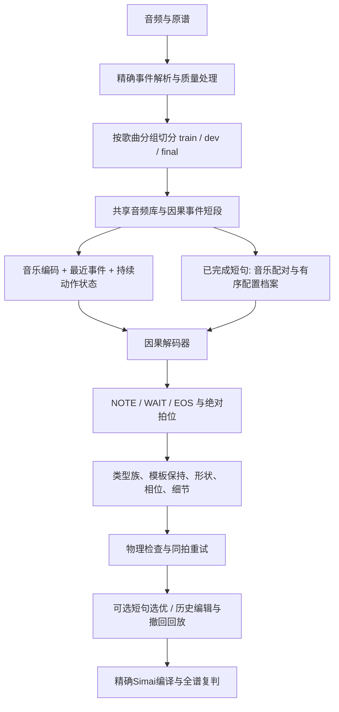

# Composer 全链路诊断报告

日期：2026-11-01（Asia/Shanghai）。审计基线：`0ff1f5a`，代码修复主体为 `252d8f7`。当前正式训练为 **v38 / event_set_stream_v1**。本轮仅审计、记录和执行隔离 CPU 最小探针，没有修改产品源码、训练参数、生产缓存或检查点，没有停止训练。

## 1. 给项目负责人的判断

当前路线具备继续开发的基础：模型确实读取音乐和历史，能学习完整同拍配置，具有休止输出、持续状态、短句记忆和错误历史恢复。没有发现足以说明“流式结构不可能创作好谱”的证据，也没有发现需要立即停止当前 v38 的非有限训练、未来谱面输入泄漏或普遍的时间序列化损坏。

但现在还不能把“loss 很快下降”当成“正在可靠地学会整段创作”。最主要的缺口不是再缺一个音符分类头，而是以下几件事没有形成闭环：

1. **短句记忆能记住一段，却没有按当前拍位读取参考段对应动作的直接通路。** 超过32事件的档案还会抽样，远段检索先用粗声学摘要筛选。
2. **训练主要奖励下一事件的正确答案。** 短句辅助约束的是压缩表示；真实自产历史的有效恢复监督相对稀少。对完整自生成段的手顺、音乐呼应和可玩性，没有经过校准的直接训练目标。
3. **类型计划与模板保持有两套优先级。** 音乐与短句刚决定类型概率，模板保持又可以把概率推回上一写法。这是概率模型中的真实作用关系，需要实验裁决，不是一个天然错误的归一化公式。
4. **当前正式任务关闭了自由生成抽检。** 教师强制验证无法发现“接着自己写就变坏”的全部情况；模型选择也缺少自动保留多个历史质量点的机制。
5. **数据的实际贡献需要重新解释。** 当前侧车标注全部为 excellent，主要是后训练数据加权，并没有提供“好/差整段配置”的区分监督。

建议保留当前训练作为完整基线。下一轮先修复本报告的确定实现缺陷，再用固定输入定位上述瓶颈的贡献；不要把所有建议一次叠加后只比较总loss。这里的“继续基线”不等于承诺50轮后一定达到目标。

## 2. 审计范围、方法与证据等级

建立了 `src` 下 **292 个 Python/JS/HTML/CSS 文件、94,437 行**的源码清单和 SHA256；Python文件做了 AST 解析。数量是库存与语法检查范围，**不表示94,437行都经过同等深度的人工作用验证**。

审计覆盖整个产品链路。当前正式路线进行调用链、张量/概率合同和状态转换检查；历史路线检查可达入口、共享依赖、关键编译合同和与当前模型的隔离。没有对全部旧模型、全部训练谱、所有BPM/语法组合做穷举运行。一次审计不能承诺找出全部潜在bug；本文列明所有本轮发现及尚缺的证据，避免以“全量”掩盖覆盖边界。

| 层级 | 本轮核查内容 | 未执行的高成本验证 |
|---|---|---|
| 原谱与时间 | maidata、note/Slide语法入口、清洗、精确拍位、变速、first、两种编译器 | 全语料roundtrip、每一种复合Slide穷举 |
| 数据与缓存 | 合并来源、质量侧车、自动切分、Form准备、stream bank、样本覆盖与权重 | 重建全量缓存、重新提取全量音频 |
| 当前模型 | 音频、时序、类型/形状/相位/细节、短句、状态、持续区间读取 | 冻结v38的GPU梯度/消融实验 |
| 训练 | loss、恢复、增强、累积、有限值检查、RNG、续训、验证 | 新训练、暂停对照、GPU profiler |
| 生成 | 采样、合法重试、短句候选、撤回回放、曲线、评分、终止、导出 | 新的整曲生成、人工听谱/试玩 |
| 应用与运维 | 主界面控件/API、任务、输出锁、报告、保存、依赖与CI | 新wheel安装、远程服务安全测试 |
| 历史路线 | event_ctx、chart_stream、song_form、旧Composer入口及共享编译 | 每个历史checkpoint的完整回归 |

证据分三类：**已复现**为隔离CPU例子或已有日志直接验证；**源码确认**为明确分支/公式/数据连接；**设计风险**为机制真实存在，但对v38质量的影响尚待干预验证。P1表示应优先处理的数据安全/可靠性或关键质量瓶颈；P2为条件性错误/重要评估偏差；P3为记录、维护或边缘体验。未发现当前需要紧急停训的P0。

完整模块笔记及原始证据见 [审计证据目录](../evidence/composer_full_audit_20261101/README.md)。历史修复文档只作为线索，当前源码与运行记录优先。

### 问题索引（31项，包含bug、设计缺口与条件风险，不是31个致命bug）

| 编号 | 优先级 | 问题 | 当前影响范围 |
|---|---|---|---|
| A01 | P1 | 拒绝训练前覆盖切分 | 误选忙目录/已有实验目录 |
| A02 | P1 | 续训指纹未绑定素材内容 | 同路径素材改变后resume |
| A03 | P2 | 曲末EOS搜索不推进 | 非默认短试写跨度 |
| A04 | P2 | 提交边界事件漏出主要评分 | 边界/超预算首步 |
| A05 | P3 | 旧尾段评分没有失效标记 | 多候选替换未提交尾段 |
| A06 | P2 | 总loss恢复项说明错误 | 主界面解释训练曲线 |
| A07 | P3 | 退出学习预算元数据不准确 | 实验可追溯性 |
| A08 | P1 | 非格点变速漏写 | 旧逐帧导出，非当前Composer |
| B01 | P1 | 闭环抽检关闭/历史点保留不足 | 当前v38与后续模型选择 |
| B02 | P2 | OOV与验证分母可比性 | 当前dev有1.29%动作OOV |
| B03 | P2 | 复杂语法选择性过滤 | 训练/验证实际数据覆盖 |
| B04 | P1 | excellent标签实为来源加权 | 当前质量监督含义 |
| B05 | P1 | 真实统计条件与默认生成条件差异 | 验证上限与实际使用 |
| B06 | P2 | 切分身份/抽检代表性边界 | 近重复音频及少量固定歌曲 |
| C01 | P1 | 缺拍位对齐的参考动作读取 | 整段呼应能力 |
| C02 | P1 | 跨段候选沿用出发段意图 | 长间隔/休止后首音 |
| C03 | P1 | 类型计划与模板保持竞争 | 类型切换与连续复读 |
| C04 | P1 | 几何持续状态未完整推进 | 持续动作结束附近的配置 |
| C05 | P1 | 短句辅助允许统计捷径 | 表示质量，待干预验证 |
| C06 | P1 | 多解/闭环整段监督不足 | 写法一致性与长期恢复 |
| C07 | P2 | 档案压缩与粗声学检索 | 长密集段、变奏再现 |
| C08 | P2 | 持续区间音频覆盖有限 | literal/TouchHold/复合Slide |
| D01 | P1 | 单候选无选优/评分未经校准 | 默认产物与多候选质量 |
| D02 | P2 | 搜索预算与音乐段界不同 | 跨句提交及尾段延续 |
| D03 | P1 | 硬合法不能保证手感 | 全部实际产物 |
| D04 | P2 | 拒绝采样偏置与曲线边界 | 高拒绝率、显式休止曲线 |
| E01 | P1 | GPU低利用率的内部开销待定位 | 当前训练效率 |
| E02 | P2 | 候选/多种子顺序重放成本 | 生成与验证速度 |
| E03 | P2 | 打包/环境/CI覆盖缺口 | 独立安装与跨平台 |
| E04 | P1* | 可信本机边界不适合直接公网化 | *仅不可信请求/文件场景 |
| E05 | P2 | 多架构与历史文档误配成本 | 使用与维护 |

## 3. 当前架构究竟在做什么

- v38运行参数：384宽、8层、8头、FF1536，约62.84M参数；batch32、累积2；历史128、展开16；BF16；学习率0.0002、预热100更新后恒定；50轮。**这是当前事实，不是上一轮v37的512宽/累积1/余弦设置。**
- 主训练样本不是一首歌，也不是一个音符，而是带历史的连续16个决策。WAIT通常前进2拍，EOS表示曲末。128事件不是固定秒长，也不等于全曲记忆。
- 全曲音频已知是任务允许的输入；未来原谱不能成为预测输入。有序目标仅用于loss，参考段只来自完成的前缀。
- 音符类型先验、保持/离开倾向与形状/相位/细节共同构成概率。强制把它解释为“音频独立决定类型，历史只决定位置”并不符合最终分布。
- 短句布局使用音频变化，从2/3/4/6/8拍候选跨度选择边界；保留两个近段与两个粗声学检索远段。每段最多32个档案事件，经GRU形成向量。主事件历史仍保留自己的顺序，不能说整个模型只剩一阶马尔可夫链。
- 默认单候选时，手感评分只记录；只有2/4候选才会据分数择优。多个候选目前顺序运行，共享单次整曲音频编码，不是GPU批量并行。

## 4. 已确认的实现及合同问题

### A01 / P1：拒绝新训练之前，旧数据切分可能已经被覆盖【已复现】

位置：`webui/event_set_api.py:71-79,177-189`；`composer/evaluation.py:161-195`；`stream_train.py:463-464`。

新建训练先执行 `split_manifest` 写入输出目录的 `data_split`，随后才预留任务/检查目录占用；子进程再判断是否已有 `composer_last.pt`。因此误选正在训练或已有检查点的目录，最终虽然拒绝新训练，旧切分仍可能被新请求重写。

隔离探针调用实际 `start_train`，仅替换split与任务保留器，得到顺序 `split_write → reserve_rejected`；拒绝后哨兵文件已从原内容变为新内容。没有访问生产输出目录。**这是拒绝路径仍有写入副作用的证明，不是当前v38已被改写的证明。**

修复方向：预留目录、检查已有实验和跨进程所有权应在第一次写切分之前完成；先写临时实验目录，校验后原子提交。仅将同进程task检查前移还不能覆盖第二个WebUI进程。代价低到中，测试必须覆盖忙目录、已有检查点、两个服务同时请求及失败清理。

### A02 / P1：续训指纹没有绑定实际素材内容【源码确认＋隔离函数复现】

位置：`stream_train.py:292-319,581-605`。

指纹包含manifest文本、词表和策略，却不包含其引用的音频/maidata内容或准备后样本内容。同路径文件变化、词表集合不变时，续训可能通过，保存的样本游标已不再指向原序列。准备缓存按内容更新不能弥补这个检查缺口。

合成数据对象保持manifest/codec/delta不变、改变内容字段，指纹完全相同。该探针只证明指纹缺少依赖；没有伪称已经实际替换生产音频并完成一次错误续训。

修复方向：复用准备缓存已计算的素材内容身份，保存有序chart/stream内容清单及版本；续训比较完整清单。避免整文件源码AST哈希导致无关编辑使全部缓存失效。旧点迁移须显式处理。当前v38为fresh，此漏洞不是它本轮loss变化的解释。

### A03 / P2：允许的短句跨度可导致曲末搜索不前进【已复现】

位置：`stream_sampling.py:53-60`；`stream_generate.py:287-290`；`stream_search.py:195-213,246-258,325-348`。

当试写跨度小于2拍，靠近曲末的EOS可使候选cursor直接到end，却没有新StreamStep。搜索认为候选完成，提交却仍停在同一start；当前target尚未等于end，外循环继续重复。CPU合成rollout完整调用搜索，第27次主动中断，最后9次均为 `start=17/2,target=9`。

默认试写8拍不触发该构造。修复应表达终止事件并检查提交后严格前进，不能只无限增大超时或强行补一个未采样WAIT。需覆盖EOS、长WAIT、尾部无合法NOTE和小跨度。

### A04 / P2：提交边界与评分边界不一致【已复现】

位置：`stream_search.py:56-64,231-233,325-328`；`stream_quality.py:290-304`。

提交采用 `step.end <= commit_end`，评分主要采用 `[start,target)`。当commit等于write，终点NOTE可提交却不计入该段密度/覆盖；为保证推进而提交超预算第一步也有相同风险。合成评分中，空段与仅在终点出现NOTE的分数均为0.40945674，移入段内后为0.69253468。软轨迹还会读实际候选，所以不能称所有评分项都漏看。

修复：统一候选实际覆盖范围、评分与提交口径，对超预算事件显式记账；不能简单两边都闭区间而重复统计边界音符。默认8/4预算影响较窄，多候选需要重点验收。

### A05 / P3：普通候选替换私有尾段后，旧评分记录未标失效【源码确认】

位置：`stream_search.py:251-265,325-342`。

前一轮分数覆盖整个试写段，实际仅提交前半。下一轮候选1/2/3可以重写未提交尾段，但旧记录只在历史修复/撤回时标失效。因此日志中的旧分数可能不再描述最终谱面。影响诊断，不等于当前候选选错；单候选默认不触发该分支。

修复：记录评分所对应的事件指纹与覆盖区间，普通尾部替换也标记失效；另提供最终谱离线分项评分。代价低。

### A06 / P2：WebUI对总loss是否包含恢复项的说明错误【源码与日志确认】

位置：`static/app.js:242`；`stream_train.py:260-266,695-698`。

界面说总loss不包含更新时额外反传的自产历史恢复项；训练器实际把加权恢复项累计到 `loss` 和 `recovery_loss`。这是用户解释训练曲线时会遇到的真实口径错误。不是反向传播多算了一次：指标记录与backward各有用途。

修复：分别显示主任务、恢复贡献、含恢复总目标；分清每批均值、每次恢复结果与累计计数。改变说明不需要重训。

### A07 / P3：训练recipe的“相同预算”与退出额外加权不符【源码确认】

位置：`stream_train.py:549`；`stream_model.py:1853-1857,1876`。

recipe记为 `same_budget_as_main_configuration`，代码却额外加0.5倍退出目标联合NLL。额外训练出口可以是合理策略，但必须如实记录，不能宣传成完全未增加权重。修复元数据/说明即可；是否改变目标权重另做实验。

### A08 / P1（历史路线）：逐帧导出遗漏非帧格点BPM变化【已复现】

位置：`generation/simai_compile.py` 的 `compile_predictions` 与逐帧BPM写入循环；详见数据附录的最小例子。

在beat1/8插入240 BPM变速，旧编译器IR保留变速、音符秒数按其计算，导出文本却是 `(120){16},,1,,E`，没有240 BPM。因而IR和文本不同步。**当前Composer走 `generation/event_compile.py`，同类变速和first例子精确回读通过，不受该旧路径缺陷直接影响。**

修复旧路径时，应在变速处切分时间格或明确拒绝不可表达的变速；不可静默忽略。测试必须比较文本回读与IR的全部时钟，而非只检查文件存在。

## 5. 数据、验证与实验管理问题

### B01 / P1：当前v38没有自由生成监测，且缺少多历史点保留【运行事实＋设计缺口】

当前命令的“每轮闭环生成抽检曲数”为0；教师强制dev仍开启。`stream_train.py:645-646` 只反复写last/inference两份文件，未实现按epoch或质量排序的多个不可变历史点。单文件原子保存是已有保护，不等于历史回退能力。

结果是训练可以在loss变好时自由生成变坏，而自动流程不会发现；等人工发现后，较好的中间权重可能已经被覆盖。建议后续启用固定小面板，同时保留最近若干点及质量候选点。不能只用最低总loss自动选“最佳谱面模型”。本轮按要求没有改变抽检或保存设置。

### B02 / P2：验证OOV掩码会影响loss的可比性【真实计数＋公式确认】

v38 dev有32,536步，其中420步动作OOV被mask，known_fraction约98.709%，可信目标32,116。OOV位置清空动作编码，但后续仍可看到NOTE类别的空内容历史。`stream_data.py:337-373,667-699`；主损失分母固定为B×展开步数，`stream_model.py:1675-1681`。

OOV更多时，被排除的目标会降低部分累计loss，同时污染邻近历史。这不是把训练loss整体公式改掉的理由，而是应该额外报告“有效目标条件损失、OOV邻近损失、覆盖率”。当前420步不等于已经严重失真；需要将指标按相同覆盖集合比较。全dev至少有一个可信目标的检查不能保证每个抽中batch都有足够监督。

### B03 / P2：实际训练分布与元数据合格分布不同【真实日志确认】

| 分区 | 元数据合格chart | 实际准备chart | 差额 |
|---|---:|---:|---:|
| train | 2747 | 2675 | 72 |
| dev | 62 | 59 | 3 |
| final | 74 | 本轮未准备 | 未知 |

train缺口中71张来自自制谱，dev缺口全部来自自制谱。对缺口做的有限解析探针发现不支持语法；其中官谱缺口为重复BPM拍。没有对75个缺口逐一归因。当前严格拒绝不支持的整谱，优于无声删除未知音符，但会选择性减少复杂写法的训练覆盖。

建议导出按来源、难度、原因的接受/拒绝清单。`event_usable_for_training`是历史标志，当前有11张标志false的训练谱被现行解析器正确接受，不能用旧元数据替代实际准备结果。

### B04 / P1：质量标签目前主要表示来源加权，不能证明“精品监督”【真实侧车统计】

合并侧车2851条记录全部是excellent，权重1.4或2.15；没有负例、排除区间或零权重。按path+slot匹配当前train/dev/final约1040/24/30条，未在本审计逐条重算哈希。全量官谱未标注项默认权重1。

这些标签确实接入训练，不是死控件。但“标签都excellent”不说明它们都经一致标准审核，也不说明自制谱必然更差；它表明当前模型受到的质量选择压力主要是人工来源权重。不能声称已做了好坏配置偏好学习。建议核对权重的原始意图、各来源有效学习质量占比，并为同等级整段配置建立少量可复核的质量样本。用户此前要求暂不实施人工偏好操作，本轮仅诊断。

### B05 / P1：训练/验证用真实全谱统计条件，手动生成用默认或请求条件【源码确认的任务边界】

`form/data.py:602-609`、`generation/event_quality.py:543-599` 从完整真谱计算密度、类型占比、重用等条件；每个训练窗口都收到它们。验证生成也采用真谱条件，手动新歌则依赖用户/默认向量。

这是合法的条件生成定义，不属于未来音符泄漏。但它意味着验证测的是“已知目标风格统计时能否生成”，不能直接代表只给音乐和等级的创作能力。建议同时保留两张面板：参考条件上限，以及真实用户默认条件。对全局条件做匹配/扰动诊断，判断模型是否把它当作强捷径。不要直接删除所有条件，损失用户已有控制能力。

### B06 / P2：歌曲身份与验证代表性仍有边界【设计缺口】

当前切分按歌曲ID、maidata路径和音频字节SHA联通，v38已有报告的三个音频SHA集合无交集。这不保证重新编码/不同音量的同一歌曲也能识别；未测近重复音频比例。教师验证分散到全体样本已修复，但生成面板仍取前几个不同音频来源（`stream_generate.py:462-470`），没有难度/来源/节奏类型分层。

建议保留可重复的分层小面板，并增加默认条件测试。只有发现近重复才增加解码音频指纹或近似检索，避免无依据全库重算。

## 6. 学习架构中真正值得优先推进的质量问题

### C01 / P1：没有直接的拍位对齐短句参考读取【源码确认的能力缺口】

`stream_phrase_model.py:41-77` 将有序序列压成句末向量，`173-225` 汇入意图；当前第1.5拍无法直接查询参考段第1.5拍的具体动作。序列编码器仍可能间接保存顺序，不能据此断言信息必然全丢或呼应0%必由此造成。

建议保留现有总体意图，另保存有限个相对拍位槽，按候选位置读取已完成参考。槽位可采用多尺度或事件邻域，避免一律8格抹掉三连音与不等长对答。明确“新写法”选项，呼应是否使用由音乐和上下文决定，不能强制相似音频照抄。

### C02 / P1：候选落点跨短句边界时仍使用游标所属段意图【源码确认】

`stream_generate.py:275-277,309-324` 在当前游标算一次hidden/phrase_output；之后不同候选重新读取音频，却沿用旧段intent。`stream_phrase_model.py:115-122` 的remaining也按游标计算。训练与生成都如此，因此不是二者不一致；问题是“要写进新段的事件仍受旧段意图组织”。长间隔、休止后首音尤其值得检查。

建议明确时间合同：选时读出发段与候选音频；动作读取落点所属段的意图、进展和参考，参考仍只允许来自已提交前缀。可以只为最终选中的落点重算小分支，不重复主干编码。新段的完整谱面答案绝不能在此进入输入。属于新学习阶段变更。

### C03 / P1：类型计划与模板保持会竞争【概率公式与CPU例子确认】

`stream_model.py:1318-1323` 先校准类型族概率，再对“上一模板/其他”二分重分配；生成在 `1337-1353` 先选保持/离开。隔离例子中A类型总概率0.2、B为0.8，保持残差ln9后变为A约0.5556、B约0.4444；总概率仍为1。残差0时v3保持原分布。

因此它可能削弱音乐推动类型切换的权力，但不是无条件架空、归一化错误或永久断梯度。最终类型监督已经按重分配后的边际计算。

建议比较两种完整合同：现有跨类型模板保持，和先选类型再做类内模板保持。记录音乐变化处、跨段首音、Touch连续段的类型切换概率和自由生成。不要只删一个采样门而不改训练分解。独立音频预算使用detach是有意隔离，直接去掉会改变0.25/0.75梯度预算。

### C04 / P1：几何分支的持续状态尚未完整推进到候选时刻【源码确认】

`stream_model.py:965-969` 将游标STATE50汇入hidden；`action_context_at:632-651` 在候选时刻更新音乐、按钮与Touch近期负荷，但未重算完整持续状态。`stream_actions.py:107-130` 只为类型修正推进remaining/until，并压成9维摘要。于是类型看到“Hold已结束”，几何hidden仍含出发时的占用信息。

这不是完全看不见位置，也不是已证明必出物理冲突。模型可能学会结合时间间隔推断，但增加了学习负担。建议用共享的已提交动作生命周期，在选定候选时刻生成空间/持续摘要。Slide不能只把剩余时间减掉就称作精确轨迹推进；需用原生分段路径与等待期。保持线性/有限槽计算，不给每个候选重跑全谱判定。

### C05 / P1：有序辅助目标允许统计捷径，尚无区分能力验收【机制风险】

有序编码含相对拍距、秒距、事件数量和完整atom；这些信息对手感有用，也可能让对比学习优先按时长/密度区分段落。批内仅一个唯一目标时匹配项精确为0。训练按歌曲集中采样，不应采信“每批主要靠不同BPM区分”的无条件解释。

尚无证据证明v38短句编码已塌缩。建议用同BPM、同长度、近密度但不同配置的配对探针；统计唯一目标数、相似度分布、参考置换影响。若需改进，优先采样匹配的困难负例/有限跨批记忆，并给相对运动结构增加监督。不能直接删掉秒尺度：相同拍距在不同BPM下手感不同。

### C06 / P1：多解表达与整段自由滚动监督仍弱【设计缺口】

静态意图预测提供稳定条件，但没有显式的短句多方案选择变量；同一音乐存在多种合理写法时，回归摘要可能变得模糊。主自回归交叉熵本身能够表达多模态，不能说它数学上只能求平均，也不能说模型没有历史。

恢复在每25次更新取2样本，一般只监督最终一个可信后续；截至18:45:42，74预算槽仅66有效监督，真实exit52，长槽18（9持久、9合成），WAIT/EOS目标4/2。这与主训练大量事件预测不是同等覆盖。

建议先按有效监督量监控恢复，再考虑短句起点选择并保持一个可学习模式，或用少量短段闭环续写约束。主干仍流式，控制额外展开长度和频率；不要全面展开到整曲反传或给所有正常重复加惩罚。

### C07 / P2：档案压缩和声学检索可能漏掉真正值得呼应的段【源码确认＋影响待测】

最多32档案事件、4参考；长段按序抽样，远段仅按32维粗声学均值余弦选前二（`stream_phrase.py:174-253,396-408`）。密集手顺的中间事件、加入新声部的第二遍音乐可能不在正确参考中。建议记录参考召回与32事件覆盖率，尝试多尺度摘要、时间结构描述和候选扩展后小规模重排。增加参考数量前先查是否检索错了。

### C08 / P2：持续区间音频不是全类型覆盖【源码确认】

`stream_duration.py:93-113` 只为支持的regular Hold/Slide细节建表，literal、TouchHold、复合多段Slide未覆盖该专门通路。它们仍有普通音乐hidden，不能说完全无音频。报告已有coverage字段，建议按真实生成频率而非词表候选数统计覆盖，再决定优先扩哪类。短Hold/快划的时值不一定对应尾音，不能强制结束点卡音频峰。

## 7. 生成与评价的质量上限

### D01 / P1：默认单候选没有手感选优；多候选评分也不等于精品判定

`stream_search.py:259-265,325-342` 默认只取一个合法候选。`stream_quality.py:285-390` 的分数是声学覆盖、密度、类型参考和软轨迹的启发式组合，没有经过人工质量校准。模型自己的密度计划不是当前评分唯一真值，不能重复报告旧的“只看plan”问题。

现有参考评分只看邻近前一跨度的5类音符占比、权重0.025，未用远段检索与拍位对齐配置（`stream_quality.py:350-382`）。因此高分不能证明镜像、对答、旋转呼应已经形成。

建议先做固定候选池的离线排序验收，再考虑默认2候选；把音乐取舍、真正的配置关系和物理舒适分项对照人工判断。保持“不呼应”可选，不按低熵/高多样性或少音符一票评优。

### D02 / P2：搜索时间预算与模型短句边界是两套时钟

搜索默认8拍试写/4拍提交，从实际已提交事件处推进；模型短句来自动态声学边界。这是滚动搜索预算，不等于固定4拍小节，不能把两者差异直接叫错拍bug。但可能在意图尚未兑现时更换私有尾段，且候选0保留尾部、其他候选重新写，计算量与先验不同。

建议实验混合策略：在预算范围内优先选择音乐边界提交，并比较“保留一个连续性候选＋若干重写候选”的真实收益。保留尾段是用户认可的连续性机制，不能为了形式对称直接删除。

### D03 / P1：硬合法、软手感、音乐质量必须分别验收

默认硬门禁与最终全谱复判已经一致。SlideHeadTap、部分静态TapOnSlide仍为report；无可执行硬冲突不等于无不适。软轨迹用50ms取样和有限beam尝试双手分配，允许交接，是近似评价，不是真实左右手标注。

用户提出“持续Hold锁手，另一侧高速交互”的问题需要活跃持续动作、候选运动及真实时间共同判断。Antigravity建议的相位期望手感代价值得小范围试验，但双押、换手、Slide状态不能简化成两个单键的转角；低于0.5%开销也尚无实测。优先用现有原生轨迹构造反事实对照，保护官谱合法技巧。

### D04 / P2：物理过滤改变生成分布，当前恢复覆盖不能保证完全抵消

最多三个起音、每起音八次完整动作的重试是有限搜索。高拒绝率时，接受结果可能偏向容易合法的类型/配置；采音位置也可能被改写。已有sampling_observation应按音乐段、类型和拒绝原因分析，而不是继续提高重试次数或调温度掩盖。

当前curve同时影响NOTE/WAIT和落点；WAIT固定2拍会影响短休止控制的精细度。绝对网格合成探针可以构造约1.99375拍的休止恰好遮掉全部候选，随后WAIT比休止尾部多走0.00525拍；相对delta路线的2拍候选仍在休止外，曲尾也有单独分支。这支持窄边界风险，**不支持“任意短休止都会跳过后续音乐”**，也未证明当前默认无外部曲线生成受影响。

## 8. 性能、部署与维护

### E01 / P1：低GPU利用率主要待查主计算路径，不能继续归因于建缓存

v37此前141次整卡采样平均30.8%，稍后12次训练进程主GPU引擎平均34.8%。这不是本轮对v38重新测得的利用率。v38在18:45:42累计 `compute_sec≈1884.54`、供数约2.93秒、预取等待0.559秒、约30.54窗口/秒；数据等待明显不是主要耗时。

当前BF16+dropout训练使用math attention是既往稳定性修复，不能盲目打开Flash。逐shape/slot细节GRU、持续区间读取、许多小算子、有限值检查及恢复都是需要分段profile的候选。`compute_sec`是主机墙钟，不能直接当GPU内核时间，也不能从静态代码确定各项占比。

建议后续在冻结副本做同batch、同有效目标数的分段测速：音频编码、decoder、形状/相位、细节/区间、辅助目标、backward、optimizer、恢复、同步。优先合并小操作与避免无贡献计算；比较输出和梯度再迁移。不要以GPU占用率单独作为优化目标。

### E02 / P2：多候选和多种子不是完全共享、并行执行

单次generate的全曲音频encode已共享；候选循环仍顺序，前缀/守卫/曲线状态要回放，decoder每步读整个有限历史窗口。不同验证seed又分别进入generate，重复音频编码。可优化，但不能把完整状态重放简单删掉导致回退脏状态。复杂度与native_calls、prefix长度应一起记录。

### E03 / P2：打包和依赖缺少当前工作环境的可复现保证

`pyproject.toml`只明确包含muri reference，未声明WebUI static；现有build/lib也无static目录。这是较强的漏打包证据，未在本轮构建新wheel。建议声明静态资源并在安装后访问首页验收。依赖范围大、CI主要Python3.10/Linux，当前实训为Windows/Python3.12/CUDA BF16；CI没有显式的前端Node套件步骤。应记录经过验证的环境组合，并加入静态资源、JS合同和可选CUDA小矩阵检查。不能把一次本地4410项通过当成所有部署环境通过。

### E04 / P1（对外部署条件）：WebUI属于可信本机工具边界

`server.py:174-180,275-330`允许指定host，接口没有统一身份认证/Origin校验；检查点读取含 `torch.load(weights_only=False)`（`stream_checkpoint.py:11-13`）。目前不提供“不可信检查点/远程用户”的安全隔离。只有在接收不可信请求或模型文件时才构成此威胁模型，不是当前音乐质量根因。

部署前应明确访问控制、路径权限、上传检查点信任与资源预算；不能在现有逻辑上直接承诺公共多用户安全。未发送攻击请求或加载不可信文件。

### E05 / P2：多条架构和历史文档仍增加误配成本

`chart_composer_v1`既可能指旧候选架构，也可能是当前event_set；event_ctx、song_form、chart_stream入口仍保留。当前schema隔离有效，但同名family、不同默认配置和大量历史报告容易被误用。建议“有效模型合同”作为唯一状态摘要，历史文档标注适用commit/profile，研究分支与稳定入口分层。此次报告不建议删除旧代码来制造表面简洁。

## 9. Antigravity意见的复核与取舍

通过Antigravity现有项目会话完成只读咨询，并使用Copy取得完整回复，原文保存在证据目录。没有把外部意见直接等同实测。

| 意见 | 本轮裁定 |
|---|---|
| 有序短句缺少拍位对齐读取 | 采纳为关键能力缺口，见C01 |
| 模板保持重分配类型族边际 | 公式与toy确认，见C03；不是必然或无条件架空 |
| 跨段候选仍读旧intent | 采纳，训练/生成同样如此，见C02 |
| 几何持续状态没有完整候选时刻推进 | 采纳；按钮/Touch负荷已有候选更新，见C04 |
| literal相位恒定，所以完全看不到真实键位 | 不成立：literal的mask实际上为全true，而非只有第0位true；`encode_sequences`同时读取完整atom embedding均值，真实方位仍可见；显式几何归纳偏置仍可增强 |
| 双塔已经塌缩，loss主要靠BPM捷径下降 | 保留捷径风险，未证明塌缩或主要因果；batch常为同歌，不能忽略 |
| 128维句末向量必然导致呼应0% | 保留压缩瓶颈；短训呼应指标不足以证明单一因果 |
| 直接去掉audio_logits.detach | 不作为确定修复；独立音频预算是有意设计，需重新核算梯度合同 |
| 先类型再类内模板保持 | 高价值对照方案，需要训练与采样一起改并重训校准 |
| 相位期望人体工学损失 | 潜力方案，先验证代价能正确区分手感，不能宣称天然正确或<0.5%耗时 |
| 对齐音乐边界、增加远段配置评分 | 值得做；保留预算弹性、新写法选择与连续性尾段 |

## 10. 后续实施顺序与验收

第一批应先处理A01/A02/A03/A04以及指标口径，形成可靠的实验底座。它们的验收不需要修改当前训练目标：拒绝请求无写入副作用；同路径素材变化可被检测；任何搜索分支提交后推进或明确结束；最终评分对应真实导出内容；日志总项等于分项的合同可核对。

第二批针对“正常谱”：固定若干歌曲覆盖休止、密集单点、双押、持续Hold占手、长Slide、多Touch、变BPM。记录实际强度、节奏相位、逐键快速连击、首提案→接受提案变化及所有物理提示。由人工确认明显错误，而非以少写音符获得高分。

第三批针对“完整写法”：优先对比C02/C04候选时刻合同，以及C03类型/模板层次。每次只改变一组耦合合同，先验证训练/推理输入一致，再做固定音频双种子与一个确定性样本。保留旧点，不把恢复权重、数据来源、模型宽度同时改掉。

第四批针对“高质量创作”：按拍位读取参考、同统计难负例、短句多解选择与有限闭环监督。评测除了“该呼应时能呼应”，还要有“音乐变化时能采用新写法”的反例；不能奖励机械复制。人工偏好数据的采集与使用另行批准，不在本轮执行。

性能优化贯穿各批，但以相同有效样本、相同目标、相同精度下的吞吐和质量为准；允许减少浪费，不允许把减少监督悄悄记作加速。

## 11. 本轮未当作新bug的问题

已验证存在严格完成前缀过滤；目标有序序列只进loss；全曲未来音频合法可见；目标起音条件化动作是概率分解；短句档案抽样不截断主谱；恢复/增强会重建状态；历史撤回从真实StreamStep回放；当前精确事件编译器回读时间；单次生成共享音频编码；epoch生成面板包RNG保护；类型独立音频CE仍在训练；已有跨进程输出锁、原子checkpoint与有限值保护。

这些保护减少了已知错误，但不能替代音乐性验收。当前最诚实的结论是：**实现基础已经具备，正常出谱仍有边界缺陷，高质量整段创作的学习与评价闭环尚未完成。** 本轮没有发现足以立即中止v38的致命证据，当前训练与原检查点保留。
