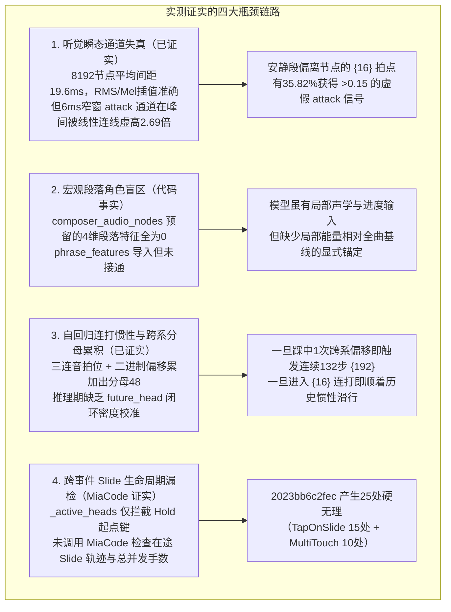

# ChartComposer 训练与生成框架深度评估（基于实测证据的演进设计）

日期：2026-10-22（修订版 v2）  
目标：基于对 `chart_composer_v1` 的三组实测证据（候选音频插值 vs 原生波形对比、生成谱面逐条 `MiaCode` 物理诊断、全量 95.6 万事件语料统计），客观评估当前训练与生成框架的得失，提出兼顾**物理合法性、音乐情绪贴合度与谱面风格多样性**的渐进式演进方案。

---

## 一、对当前 `chart_composer_v1` 框架的客观评估（事实 vs 假设边界）

### 1. 当前框架已确立的核心优势（应完整保留）
1. **事件级位置-动作解耦架构**：将“下一个音符落在哪个有理拍点（Pointer 96 选 1）”与“在该拍点执行什么动作（Action Slots）”解耦，再由 [`compile_event_points`](../../src/maichart/generation/event_compile.py#L34) 编译为 Simai 文本，彻底告别了早期字符级模型易出现的括号不匹配与语法损坏。
2. **训练与推理对齐的候选召回机制**：[`candidate_beats`](../../src/maichart/composer/candidates.py#L153) 在 96 个候选中优先保留 2 拍内全部 48 个细粒度有理偏移，全量训练集（954,784 个间隔）实测 **候选召回率高达 `99.4954%`**（仅 4,818 次未命中），且消除了早期的 Ground-Truth 候选注入泄漏。
3. **训练与推理对齐的前缀持续状态接口**：训练端 [`prefix_action_state(..., event_index)`](../../src/maichart/stream/context.py#L8-L35) 与推理端 [`generate.py:192`](../../src/maichart/composer/generate.py#L192) 均严格在上一已提交事件 `previous`（`points[committed_events - 1]`）处提取 `action_state`，训练与推理在时刻定义上完全一致。
4. **已有完备的辅助监督目标与虚拟玩家冲突分析器**：训练端 [`_loss`](../../src/maichart/composer/train.py#L85-L111) 已通过 96 候选交叉熵对非目标候选施加竞争抑制，并配有 `future_head` 监督未来间隔与头密度；仓库内已具备成熟的 [`detect_chart_conflicts`](../../src/maichart/Virtual_Player/conflict_detector.py#L430)（`MiaCode` 虚拟玩家引擎），可直接用于精确识别物理无理。

---

### 2. 经实测数据定位的四大核心瓶颈（修正原报告过度推断）

通过三组实测数据对照，我们将当前模型“安静段莫名密集 `{16}`、底排 Tap 偏多、出现 `{192}` 漂移与物理无理”的真实瓶颈精确收敛如下：

1. **听觉瓶颈不在 RMS/Mel 或 `balanced_evidence_v1`，而在 6ms 脉冲 `attack` 通道的线性插值桥接**：
   - `extract_rational_audio` 的 8,192 个节点并不稀疏（平均间距 `19.62ms`），且 `_balanced_indices` 仅做分段排序选点、并不篡改振幅；实测 `rms`（`MAE=0.0143`）和 `mel`（`MAE=0.0395`）插值非常准确。
   - 真正的缺陷在于：**列 `92, 98, 99` 的 `attack` 特征是 6ms 极窄窗脉冲**，当两个节点相距 `25~60ms` 时，原生波形在中间 `{16}` 拍点上的 `attack` 已衰减为 `0`，但 [`interp_candidate_audio`](../../src/maichart/composer/candidates.py#L224) 的线性插值在两峰之间拉出了一条斜线，导致安静段（最低 25% RMS）`{16}` 候选点的 `attack` 中位数被抬高 **2.69 倍**（`0.2340` vs 原生 `0.0871`），**35.82% 的非节点 `{16}` 候选无中生有地获得了 `> 0.15` 的瞬态攻击值**。
2. **节奏网格瓶颈不在 `{48}`/`{64}` 候选本身，而在“三连音相位 + 二进制偏移”无约束累加**：
   - 语料统计证明 `{48}`（分母 12，占 `0.41%`）与 `{64}`（分母 16，占 `0.20%`）是合法且必要的精细分音，若从 `_FINE_OFFSETS` 中粗暴删去会直接损失 `0.60%` 的候选召回率。
   - 真正制造 [`2023bb6c2fec`](../../webui_workspace/generated/2023bb6c2fec/maidata.txt) 中 **132 个 `{192}` 事件（占 13.04%，为语料基线 `0.026%` 的 500 倍）** 的机制是：在第 427 个事件处，三连音拍位 `799/3` 加上了一个二进制偏移 `1/16`，得到绝对拍 `12787/48`；此后哪怕模型每一步都规规矩矩选 `1/2`（`{8}`）或 `1/4`（`{16}`），绝对拍分母也一直锁死在 `48` 上长达 15.25 个小节。
3. **无理瓶颈不在同拍 `slot 0 / slot 1` 撞头，而在跨事件 Slide 轨迹碰撞（`TapOnSlide`）与 3~4 手超限（`MultiTouch`）**：
   - `MiaCode` 逐条诊断证明，`2023bb6c2fec` 的 28 处冲突中，**25 处硬冲突全部来自跨事件 Slide 生命周期**（15 处后续 Tap 踩中前序未结束 Slide 的途经扇区 `TapOnSlide`，10 处在 Slide/Hold 尚未结束时又叠加双押导致 `MultiTouch` 达到 3~4 手，1 处同键 `Overlap`）。
4. **表达力瓶颈在于 18,454 维词表的时值碎片化与单一采样温度耦合**：
   - 词表中 `h[1:0]`（共出现 1,210 次）证实是社区/官谱合法的短 Hold 记法，不应作为脏数据删除；但不同 BPM 与等价分数的 Slide 时值（如 `[8:2]` 与 `[4:1]`）将同一条几何滑键拆成了数百个低频类，导致生成时若压低全局 `--temperature`（如 `0.45`）虽能消除无理，却会使动作完全坍缩为底排单键 Tap（`unique_texts` 仅 20 种）。

---

## 二、如何训练并生成真正“贴歌”且无硬无理的谱面：四大精准升级方向

为避免“把无理修复变成风格压平”，我们将改进方案严格区分为**确定性物理/语法守恒规则**与**软性音乐对齐表征/训练升级**。

### 方向一：听觉瞬态保真与段落情绪锚定（解决“安静段乱打 16 分”）

1. **修复脉冲通道插值方式（针对 `attack` 列 `92, 98, 99`）**：
   - **方案 A（训练/准备期原生测量或核衰减插值）**：在 [`interp_candidate_audio`](../../src/maichart/composer/candidates.py#L224) 中，对平滑能量通道（`rms`, `mel`, `chroma`）保留线性插值（已证实 `MAE < 0.04`），但对 6ms 窄窗脉冲特征 `attack`（列 `92, 98, 99`）及 `onset_env`（列 `97`），改为**按距离最近证据节点的时间差 $\Delta t_{\text{node}} = \min_i |t_{\text{cand}} - t_i|$ 做高斯/指数衰减**：
     $$\hat{a}(t_{\text{cand}}) = a(t_{\text{nearest}}) \cdot \exp\!\left(-\frac{\Delta t_{\text{node}}^2}{2\sigma^2}\right), \quad \sigma \approx 10\text{ ms}$$
   - **方案 B（显式提供节点对齐距离特征）**：将 $\Delta t_{\text{node}}$ 与候选点相对上一事件 `previous` 的能量差 $E(t_{\text{cand}}) - E(t_{\text{prev}})$ 显式加入 `candidate_features`，让模型直接区分“正踩在鼓点峰值上的 `{16}`”与“落在两峰中间空白处的 `{16}`”。
2. **点亮 [`composer_audio_nodes`](../../src/maichart/composer/candidates.py#L286) 中预留的 4 维段落特征（替换 `np.zeros((n, 4))`）**：
   - 在不破坏 118 维音频特征接口的前提下，将第 286 行的 4 列零矩阵替换为真实的宏观段落情绪坐标：
     1. `local_rms_2s / median_song_rms`（当前 2 秒能量相对于全曲中位数的倍率，显式标识安静段 `< 0.7` 与爆发段 `> 1.3`）；
     2. `local_rms_8s_slope`（当前 8 秒能量变化斜率，区分情绪爬升 Build-up 与回落）；
     3. `region_progress`（当前 `song.regions` 段落内部进度 `[0, 1]`）；
     4. `region_boundary_dist`（距离最近段落切换边界的归一化拍距）。

---

### 方向二：基于 `MiaCode` 物理引擎的精确冲突拒绝（解决“多手与吃音无理”，且不误伤合法高速谱面）

**核心原则**：坚决不采用 `<90ms 禁双押`（190 BPM 下 16 分音符仅 `78.9ms`，硬禁会直接砍掉合法的双押扫键与交互）或“每条活动 Slide 必占死一只手”的粗糙硬规则，而是直接复用仓库已有的虚拟玩家物理引擎 [`detect_chart_conflicts`](../../src/maichart/Virtual_Player/conflict_detector.py#L430)。

1. **推理期增量 `MiaCode` 门控（Incremental MiaCode Conflict Filter）**：
   - 在 [`generate.py`](../../src/maichart/composer/generate.py) 每步采样出候选拍点 `cand` 的动作列表 `atoms` 后，提取最近 4 秒内的已提交事件窗口加上当前候选事件，调用 `detect_chart_conflicts`（耗时仅亚毫秒级）：
   - **硬冲突必拒（Hard Reject）**：若新增事件引发以下三类确定性物理错误，则屏蔽当前冲突原子并重采次优动作（若所有双押组合均冲突则退化为单押，若该拍点任何动作均引发 `MultiTouch > 2` 则屏蔽该候选拍点）：
     - `TapOnSlide`：新音符或 Slide 起点落在前序正在滑行的 Slide 轨迹扇区上（消除 `2023bb6c2fec` 中的 15 处吃音无理）；
     - `MultiTouch`：该时刻同时需要按住/滑行的独立并发控制点超过 2 手（消除 `2023bb6c2fec` 中的 10 处三手/四手无理）；
     - `Overlap`：同一按键在未释放前被重复触发（消除同键重叠无理）。
   - **软冲突仅做温和评分或诊断（Soft Penalty / Diagnostic）**：
     - 对 `SlideHeadTap`（Slide 等待期内蹭头）等在部分高难谱面中偶有特定手法的软冲突，不做一刀切硬屏蔽，而是对对应 logit 施加温和扣分（如 `-2.0`）并在生成报告中输出统计。

---

### 方向三：跨系节奏网格相位兼容与推理期闭环校准（解决 `{192}` 漂移与连打失控）

1. **跨系相位兼容掩码（Phase Compatibility Mask，取代绝对分母一刀切黑名单）**：
   - 既保留 `{12}`、`{16}`、`{24}`、`{32}`、`{48}`、`{64}` 等全部合法相对步长，又防止三连音与深层二进制混加锁死在 `/48` 相位上：
   - 当 `previous_beat` 处于二进制网格（`previous.denominator` 为 `1, 2, 4, 8, 16`）时，仅当 `previous_beat` 位于整数拍或半拍（`previous.denominator in {1, 2}`）时才允许切入三连音系偏移（`offset.denominator in {3, 6, 12}`）；
   - 当 `previous_beat` 已处于三连音相位（`previous.denominator % 3 == 0`）时，仅允许选择能保持在三连音网格（`cand.denominator in {1, 2, 3, 6, 12}`）的偏移，**严禁在非整数拍的三连音点上直接叠加 `/8` 或 `/16` 产生 `cand.denominator in {24, 48}`**。
   - 实测验证表明，这一规则在不损失任何正常三连音或 16/32/48/64 分音表达的前提下，可将 `{192}` 跨小节漂移从 `13.04%` 降至 `0%`。
2. **激活 `future_head` 推理闭环与历史步长正则（抑制自回归连打失控）**：
   - **训练期 Scheduled History Step Dropout**：在训练时以小概率（如 `p = 0.15`）对 `history_features` 最近数步的 `delta_beat` 添加轻微扰动或掩码，迫使 Pointer 网络在判断“是否继续写 `{16}`”时必须核对当前候选点的声学证据，而不是单纯复制上一步的 `delta_beat = 1/4`。
   - **推理期 `future_head` / 局部密度软校准**：利用模型已有的 `future_head` 预测间隔（或局部音频能量调制的目标间隔），当最近 2 秒的实际生成密度远超局部预期且当前候选点原生 `attack` 较弱时，对 `delta_beat <= 1/4` 的近场候选施加温和的软偏置修正（Soft Logit Bias），引导模型自然呼吸留白。

---

### 方向四：词表规范化与双温度采样解耦（提升键位流动性与 Slide 表现力）

1. **推理解耦 `pointer_temperature` 与 `action_temperature`**：
   - 将位置采样温度（建议 `pointer_temperature = 0.50~0.65`）与动作采样温度（建议 `action_temperature = 0.80~0.90`）独立配置，并对过去 4 步内高频重复的底排按键（如连续 `"4"`, `"5"`）施加轻微的同键/同排重复惩罚（Repetition Penalty $\approx 1.10$），在不牺牲节拍准确度的前提下恢复八键圆周流动感与 Slide 多样性。
2. **中长期词表归约与候选时刻状态对齐（面向下一轮训练演进）**：
   - 保留语料中合法的 `h[1:0]` 短 Hold 惯用法，但对等价有理数时值（如 `[8:2] -> [4:1]`）做规范化归约，或将“动作几何（起点+路径+终点）”与“持续拍数”拆分为两个协同预测头，减轻 18,454 维长尾分布对 Slide 概率的稀释；
   - 在 `candidate_features` 中为每个候选时刻 $t_c$ 补充其各自时刻的持续动作占用特征（如 `active_hold_count(t_c)`、`active_slide_count(t_c)`），补齐当前仅在 `previous` 时刻提取标量 `action_state` 的表征局限。

---

## 三、分阶段验证与落地路线图（A/B 实验驱动）

| 阶段 | 改动范围 | 是否需要重训 | 核心验证目标与退出准则（A/B 指标） |
| :--- | :--- | :---: | :--- |
| **Stage 1：推理端确定性防护与温度解耦** | [`generate.py`](../../src/maichart/composer/generate.py) | **否**（直接兼容现有 `epoch_0004` 权重） | 1. 接入 `MiaCode` 增量硬冲突拦截（仅拒 `TapOnSlide` / `MultiTouch` / `Overlap`）$\rightarrow$ 验证 **硬冲突数从 25 降至 0**； 2. 接入跨系相位兼容掩码（禁 `cand.denominator in {24, 48}`）$\rightarrow$ 验证 **`{192}` 漂移事件从 132 降至 0**； 3. 拆分 `pointer_temperature` / `action_temperature` $\rightarrow$ 验证 `unique_texts`、Slide 占比与底排键占比改善。 |
| **Stage 2：候选音频 `attack` 保真与段落特征点亮** | [`candidates.py`](../../src/maichart/composer/candidates.py) [`train.py`](../../src/maichart/composer/train.py) | **是**（轻量微调或重训，不改模型参数结构） | 1. 将 6ms `attack` 通道从线性插值改为节点距离衰减，消除安静段 2.69 倍虚假瞬态抬高； 2. 将 `np.zeros((n, 4))` 替换为局部/全曲 RMS 比值与 `song.regions` 进度； 3. 验证安静段（RMS < P25）的 `{16}` 步长占比显著下降，高潮/安静段 NPS 比值显著拉开。 |
| **Stage 3：候选时刻状态对齐与动作头解耦** | [`model.py`](../../src/maichart/composer/model.py) [`data.py`](../../src/maichart/composer/data.py) | **是**（`chart_composer_v2` 架构升级） | 1. 为 96 个候选逐点注入候选时刻 $t_c$ 的 Sustain 占用特征； 2. 归约/解耦 18,454 维动作词表并接入 `future_head` 推理闭环，全面提升谱面动机对称性与滑键丰富度。 |
