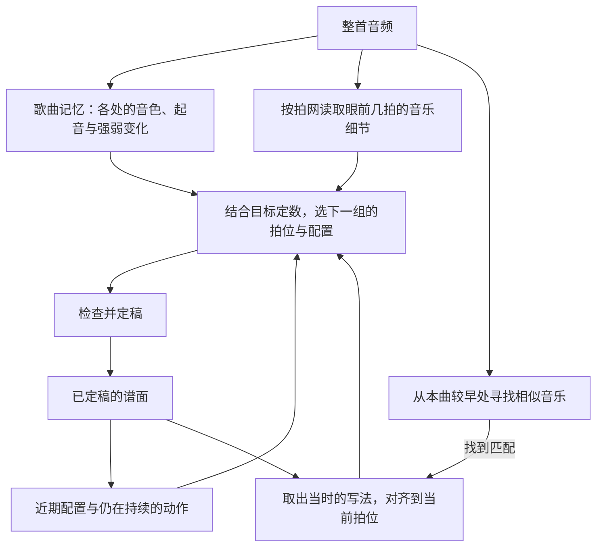
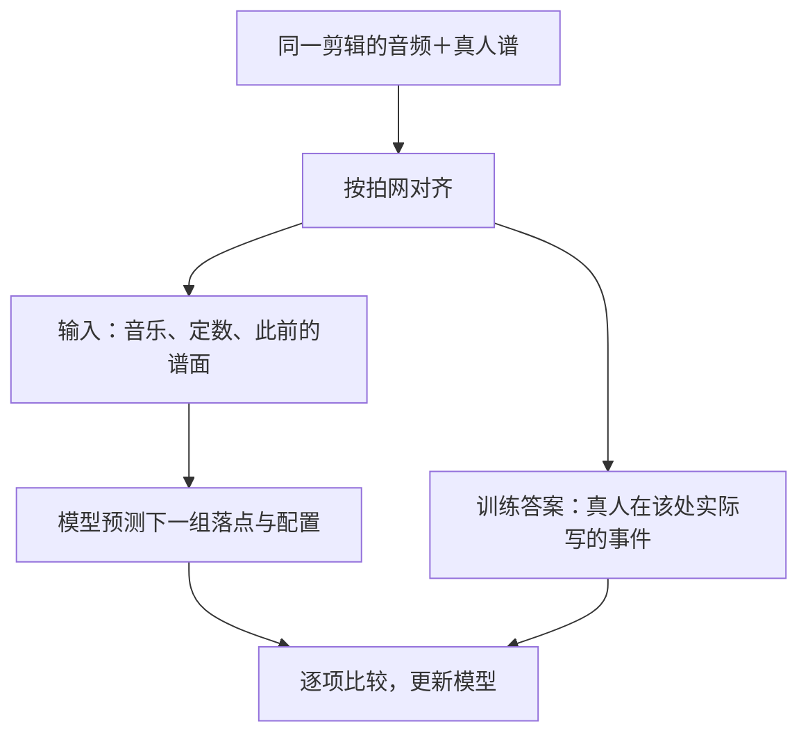

# ChroMAI 怎样学谱、怎样写谱

第二遍副歌沿用了第一遍的旋律，句尾却多了一串鼓花。要写好这一句，既要听出音乐改了哪里，也得记得第一遍怎样摆键、刚刚又把动作带到了哪里。**Composer v2 在落笔前可以读取整首歌曲；谱面的记忆则随生成逐步形成。** 第一遍副歌的写法，要等第一遍定稿之后，才可能成为第二遍的参考。

## 歌曲记忆：同一个声音，放在全曲哪里？

模型以两种尺度读音乐。**看眼前几拍时**，它按 BPM、首拍偏移和变速表把拍位换成音频时间。频谱保留各频段的能量变化，便于分辨鼓击的起音；预训练音乐编码器 **MERT** 提供随时间变化的音色特征。两者读取的是同一份混音。以四分音符为一拍，16 分间隔是 1/4 拍，24 分是 1/6 拍。谱面用整数拍加拍内分数记录落点；这些相位在检查点词表里时，一句内可以直接混用两种分音。

**看全曲时**，系统沿实际播放时间把音乐汇总成最多 160 个连续区间，保留先后位置。每个区间概括音色和频谱；支持细节输入的模型还读频段起伏，以及起音集中在区间的前部还是后部。歌曲编码器把这些区间放在一起处理，得到一份可以从不同拍位反复读取的**歌曲记忆**。区间边界按时间划分，可以落在乐句中间，生成中的扫键或 Slide 可以照常跨过去。

比如同一个长音出现两次：第一次在一段逐渐减薄的编曲末尾，第二次在鼓组重新进入前。局部音乐给出长音的质感，全曲记忆提供它前后怎样变化的线索。前者关系到如何表现这个声音，后者关系到这里该把上一组收住，还是给下一组留起手。具体选哪种处理，要从训练谱中学。

## 配置记忆：这一手怎样接，上一遍怎样写？

**近期配置**保留刚写过的实际事件。连续路线默认回看约 16 拍，具体长度取决于检查点和可容纳的谱面内容。面对同一个落点，前面是 `7,8,1,2` 这样的顺圈扫键，还是 `1,2,1,2` 这样的交互，会给下一键不同的衔接依据。如果一条 Hold 或 Slide 在更早的位置起手、到这里仍在持续，构造前文时还会单独带上它。这样即使起点已经超出近期范围，下一组配置仍有持续动作可参考。

**较早乐段的写法**通过音乐相似性取回。即使第一遍副歌已经超出近期范围，系统仍可在本曲较早的位置寻找相似音乐，从已写谱面取出对应配置，再把它平移到当前的拍位。支持**成对音乐参考**的检查点还会逐拍对照两处的音色与起音：旋律相近的几拍能支持呼应，鼓花新出现的那一拍则给出变化的依据。匹配较弱时，参考只能使用近期前文和持续动作之外的剩余空间。

回到开头的副歌，三条线索会在同一笔上相遇：**第一遍的谱面**给出可以沿用的外键动机，**刚写完的配置**提示这次从哪一侧接入更顺，**第二遍的音频**提供句尾新增的 24 分起音。一种成立的写法是保留动机，只在尾部接入鼓花；另一种是维持原来的采音，用更大的位移回应编曲加厚。这是同一组输入可以支持的两种构思，模型最终仍要逐个事件作出选择。

生成页上的两个控件对应这一区别：**「近期配置强度」**调节刚写过的键位、类型和路径对下一组配置的影响，**「配置呼应强度」**调节较早相似段的参考作用。两者默认都是 1，沿用模型学到的倾向。

## 训练：用真人前文，学习下一笔

谱面中的同拍音符共用一次选时。例如 `1/2` 是一个事件、两个键。训练时给模型歌曲记忆和这个事件之前的真人谱面，让它预测下一组何时出现，再预测类型、键位、修饰，以及 Hold 或 Slide 的时值与路径。模型给原谱写法的概率越低，相应的损失（loss）越大。较早相似段的参考同样取自当时已经出现的谱面；目标段的真人后续用来核对预测。

支持**局部写法学习**的检查点还会练习预测未来几拍的走势。比如两句都有八个 Tap，真人谱里一组沿外圈推进，另一组在两键之间往返。训练可以从后续事件提取推进、折返、持续或释放的特征，让模型学习这些差异与音乐的关系。素材标注也可以分别给采音和配置分配学习权重。训练按事件数切成片段，只有原谱确实结束的位置才作为曲终（EOS）学习。

## 生成：用自己的前文，连续写完整首

生成开始时，全曲音乐已经准备好，已写谱面还是空的。模型先选下一事件的整数拍与拍内位置，再写完这一拍的配置。直接选择较远的落点，就能留出有声休止。每次定稿都会改变接下来的谱面前文；等相似乐段再次出现，这一次的配置也可能被取回。

连续路线默认向前试写 **4 拍**，在相同拍位和同拍音符数下比较 **2 种配置**，通常先定稿前 **2 拍**，再从那里向前试写。比较时参考落点和重音的音乐证据，同时按已启用的规则检查撞尾等冲突。这里的 4 拍是本次试写的范围：一个从第 3 拍开始、到第 5 拍才释放的动作，定稿之后仍会带入后文。如此逐段推进，直到选出曲终标记，最后将事件写成 `maidata.txt`。

更详细的结构与参数可见[模型架构与连续事件生成](CHROMAI_COMPOSER_V2_ARCHITECTURE_AND_TIMING_ZH.md)和[成对音乐参考与配置衔接](COMPOSER_V2_PAIRED_MUSIC_ZH.md)。
