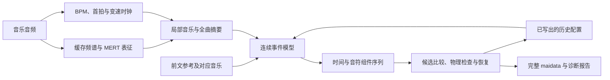

# ChroMAI · Composer v2 技术架构与目录说明

本文面向希望了解 **ChroMAI** 内部结构或参与二次开发的读者，介绍当前主路线 **Composer v2（`chart_composer_v2`）** 的生成链路、训练目标、缓存边界与主要代码目录。

不同训练输出目录名称仅作任务标识，模型实际结构与学习规则均以检查点内保存的配置为准。

## 1. 当前路线怎样写谱

模型逐个生成完整事件。一个事件包含落点时间和该时刻的一个或多个音符（例如同拍双押）。前面已经确定的事件成为后续输入，模型持续推进到全曲结束。



时间语言使用绝对拍位。常规路径先写整数拍，再写精确拍内分数，随后写音符种类、位置、滑条路径、时长等组件。时间和配置由同一条因果解码序列预测，输入词嵌入与输出分类权重共享。

`[END_EVENT]` 表示当前事件写完，`[EOS]` 表示整张谱结束。当前 `continuous_events_v1` 不在固定 16 拍处插入歌曲结束符。训练可以按完整事件切片，生成也会滑动整理上下文，这些是计算边界。

默认的短段试排先向前尝试 4 拍，再保留其中前 2 拍并继续写。它用于比较完整写法和衔接，音乐可以跨过试排边界继续展开。配置候选可保留既定拍点，联合候选还会比较不同节奏；具体按生成设置运行。[时间语言](../../src/maichart/composer_v2/stream_codec.py) · [连续生成](../../src/maichart/composer_v2/stream_generate.py) · [短段试排](../../src/maichart/composer_v2/phrase_search.py)

## 2. 模型能读取哪些音乐和历史

### 音频与时钟

- 原生频谱每秒 100 帧，每帧为 96 个频带，加起音变化和能量两个量。
- MERT 使用冻结的 `MERT-v1-330M` 第 8 层表征，时间步长约每秒 75 帧。它在准备阶段提取，常规训练从缓存读取。
- `TempoClock` 根据首拍偏移和变 BPM 表，把谱面拍位换成音频秒数。训练采用谱面标注的时钟，生成可以采用用户指定或音频检测所得的时钟。
- 拍内原始声学、局部音乐和全曲摘要各有用途。把低分辨率的全曲摘要做大，不能自动替代局部起音证据。

按秒存储音频特征后，可以用不同的 BPM、偏移或变速表查询同一份特征。更改时钟时需要重新构造对应输入，而音频文件和提取算法完全一致时，基础频谱与 MERT 特征仍可复用。[音频准备与读取](../../src/maichart/composer_v2/audio.py) · [时钟](../../src/maichart/tempo_clock.py) · [自动节拍检测](../../src/maichart/composer_v2/tempo.py)

### 局部、全曲与参考

当前默认新任务使用宽度 384、8 层解码器、4 层音频编码器和 2 层歌曲编码器。全曲摘要最多 160 个位置，保留时间位置、音乐均值和部分段内变化。解码器读取局部音乐，并在隔层读取歌曲记忆。已有检查点可能采用其他层数或较早的输入版本。

历史输入包括近期已写事件和跨越当前位置的持续动作。参考输入从本曲更早的音乐片段寻找候选，再读取对应的前文写法。训练读取真实前文，生成读取已提交的前文。`song_paired_v2` 把参考位置和当前位置的音乐一起提供给模型，使它有条件学习“音乐相似的部分延续，发生变化的部分调整”。它还为下一事件的时间选择补充前方音乐概况。

音频允许查看后方内容，因为完整歌曲在生成开始时已知。未来谱面答案只能作为训练目标，不能提前进入历史或参考。维护输入时应分别核对这两条时间范围。

旧模型在兼容的微调路径上增加音乐输入时，新投影采用零初始化，以保留初始输出行为。新分支的有效使用仍依赖后续训练。[主模型](../../src/maichart/composer_v2/model.py) · [共享输入构造](../../src/maichart/composer_v2/stream_data.py) · [成对音乐特征](../../src/maichart/composer_v2/music_evidence.py)

### 独立起音参考的作用范围

`onset_readout.py` 从 100 Hz 原生声学中比较已经选中整数拍内的落点。它调整拍内相位的条件分数，并保持该组总概率质量。因此，入口没有选到、拍内位置错了、采进去后长期不收束，需要分别排查。

前方入口证据来自 `music_evidence.py` 等输入，整段取舍还受主模型、历史、参考、强度曲线和选优影响。`timing_metrics.py` 负责离线度量，它本身不参与生成选时。[拍内读出](../../src/maichart/composer_v2/onset_readout.py) · [离线采音度量](../../src/maichart/composer_v2/timing_metrics.py)

## 3. 当前训练实际在学习什么

正常训练以真实前文为条件，逐 token 预测真实谱面的后续时间与组件。输入前缀和填充位置使用忽略标签，目标区域计算交叉熵。目标权重还包含整谱和片段质量权重，以及采音、配置的分项学习选择。

主目标可以写为

```text
token_loss = Σ(有效 token 的交叉熵 × 学习权重) / Σ学习权重
训练目标 = token_loss + 0.05 × curve_loss    # 启用强度曲线时
```

训练另外报告 `time_loss`、`phase_loss` 和 `component_loss`。日志中的 `loss` 与 `objective_loss` 有不同用途，维护评测时要核对实际字段和统计范围。`best` 通常按开发验证损失选择，缺验证时使用训练损失。它衡量拟合，完整生成还需要采音、配置、休止、重复和实际手感的检查。[损失函数](../../src/maichart/composer_v2/model.py) · [训练与指标汇总](../../src/maichart/composer_v2/train.py)

**注意力稳定性约束（`qk_rms_v1`）**：从头训练默认使用 `attention_normalization=qk_rms_v1`，在每个注意力头的 Q/K 投影后做无可学习缩放的 RMS 归一化，计算平方和时使用 FP32。内容打分的绝对值因此限制在 `sqrt(head_dim)` 内；位置偏置另计。CUDA 低精度局部／相对位置注意力保留 FP32 math 反向路径，并把归一化和注意力一起重算以控制显存。没有该配置的旧检查点按 `off` 加载，严格续训和微调继承父检查点策略，不会在加载时悄悄改变函数。

配置了可用开发集时，训练在定期保存检查点和轮次结束时验证，使用同一批固定片段、质量权重和条件策略，并按验证 token CE 更新 `best`。中途验证先等待一个预取批次完成，避免与共享音频缓存并发读写，随后保存并恢复训练随机数状态。`validation_nonphase_time_loss` 排除 `F:` 拍内相位 token，保留数字拍位与时间控制符；它与 `validation_phase_loss` 分开显示，避免两类预测的变化相互遮盖。早停仍按完整轮计数，轮内验证改善也计入该轮。

当前节奏恢复训练会构造过密、过疏或偏相位的前文，让模型学习接回真实的后续节奏。`_recovery_item` 会屏蔽配置标签，只保留选时监督。这说明它主要解决节奏偏差。正常样本仍然训练配置续写，但这与在偏离原谱的自产配置之后学会接续，是两个覆盖范围不同的任务。想增强后一种能力，需要构造可信的配置目标，并评估能否在真实连续生成中获益。

目前已有人工确认的接入训练入口。用户确认一段连同前文的衔接后，可以使该段的第一步采音也参与学习。未确认片段保留为上下文，目标只使用确认范围。这样的监督来源比把任意自产前文强接到唯一原谱答案更明确。[恢复样本](../../src/maichart/composer_v2/stream_data.py) · [前文扰动](../../src/maichart/composer_v2/timing_recovery.py) · [示范整理](../../src/maichart/training/reviewed_generation.py)

## 4. 训练资料怎样成为有效监督

数据路径大致为

```text
素材清单 → 难度与等级范围 → 解析与语法检查 → 音频范围核对
        → 人工／自动质量标注 → 词表与完整事件切片 → batch → 损失
```

这些步骤会产生不同的损失或排除行为。

| 环节 | 当前作用 | 排查时关注什么 |
| --- | --- | --- |
| 等级和难度槽 | 选择训练范围，拒绝无法解释的等级 | 缺失元数据是否让有效素材流失 |
| 解析与语法 | 保证一个训练目标可以完整、明确地解释 | 方言、重复起点、未知语法及解析器覆盖 |
| 音频范围 | 对起点已到达或超出音频结尾的谱进行整谱拒绝 | 音频版本、首拍、变速、结尾尾音和文件长度 |
| 词表 | 从头建立，微调可追加兼容组件，严格续训继承 | 能否完整编码；不支持的目标会报错 |
| 普通素材标注 | 调整整谱及局部的有效权重 | 实际剩余的采音和配置监督量 |
| 候选库、示范库 | 只学习明确确认的范围 | 入口是否确认，未确认参考是否被正确排除 |
| 自动体检 | 按配置排错、降权或适度加强好段 | 检测依据、覆盖范围、误判和人工覆盖语义 |

自动体检和手顺评分包含启发式判断。正常休止、合理重复、混合分音与少物量编排都应纳入验收。把更多资料作为上下文，同时只监督确认好的部分，可以增加资料利用率，但学习效果需要后续训练检验。

每次训练会写 `dataset_audit.json`。拒绝日志只是审计的一部分，等级范围的跳过、整谱权重为零及局部监督掩码需要一起统计。不同目录中的重复素材有时用于有意加权，分析时应同时保留原条目数和按内容去重后的数量。[数据集入口](../../src/maichart/composer_v2/data.py) · [质量标注](../../src/maichart/training/quality_annotations.py) · [多来源组合](../../src/maichart/training/dataset_catalog.py) · [自动体检](../../src/maichart/composer_v2/auto_quality_audit.py)

## 5. 生成侧如何影响最终成谱

同一个检查点的实际产出，还取决于当前时钟、条件、温度、候选策略、物理检查和恢复过程。

- 文法约束决定当前可继续哪些时间或音符 token。
- 前向占用检查、MiaCode 检测、撞尾及 Touch 可达规则会改变可接受的后续动作。
- 短段试写比较一段配置。默认手感评分、左右手评分和模型似然选优，是可选择的策略。
- 恢复可以重采、处理部分 Hold 释放冲突、撤回相关事件并重建状态。对既有历史的修改需要同步到符号前缀、持续状态和模型缓存。
- 预算耗尽后的行为由策略决定。连续模型的默认报告模式可以保留带冲突候选继续导出，因此应查看 `accepted_with_conflicts_count` 和冲突报告。
- 可选的生成后精修会尝试重写局部片段，并检查后续衔接。

检查一次失败时，应追踪它在原始提议、物理检查、候选选优、恢复和最终导出中的变化。`rollback` 或 `conflict_admitted` 表示相应恢复分支被执行，单凭日志名无法定位到声学缓存或模型某一层。

`probability_audit.py` 与 `candidate_audit.py` 已提供候选记录和离线选优分析。需要检查评分是否偏向保守、是否筛掉合理留白或重复时，应记录候选池和获选结果。[生成入口](../../src/maichart/composer_v2/generate.py) · [候选记录](../../src/maichart/composer_v2/probability_audit.py) · [选优分析](../../src/maichart/composer_v2/candidate_audit.py) · [恢复](../../src/maichart/composer_v2/release_repair.py)

## 6. 缓存应按层检查

| 缓存或状态 | 内容与识别方式 | 更改相关代码后的维护要求 |
| --- | --- | --- |
| `cache/chart_composer_v2/audio_v1/` | 音频 SHA256、音频后端、模型版本、采样率、频谱参数和 MERT 提取参数共同确定目录 | 提取语义变化时更新身份版本；对可疑单曲另建缓存比较 |
| 音频目录内的 `summary_160_v2.npz` | 全曲摘要，绑定底层特征文件签名并核对形状、类型、有限值 | 摘要含义变化时升级其版本 |
| `cache/chart_composer_v2/parsed_charts/` | 谱面字节摘要、难度槽、解析缓存版本、原生检测参考版本、方言策略 | 解析、语法接受范围、持续标记含义变化时更新版本 |
| MERT 模型缓存 | 冻结预训练权重；默认模型仓库版本固定，本地模型以文件摘要识别 | 核对模型来源和提取层；与谱面 batch 分开处理 |
| 进程内音频块、全曲记忆、解码 KV | 避免反复读取、编码或计算前缀 | 核对训练／推理模式切换、设备切换、历史撤回后的失效和重建 |

`collate_stream` 与 `collate_composer_v2` 整理本次内存里的样本，不负责生成 MERT 磁盘缓存。`uploads` 和 `training_monitor` 存有许多文件，也不能单独证明模型读取了错误特征。

缓存仍依赖维护者正确更新语义版本。当前谱面缓存命中后复用已经解析、检查过的事件与持续标记，解析规则变化却未升级版本，确实可能保留旧处理结果。音频缓存也没有把所有库版本和提取实现代码自动纳入身份。因此有必要做有针对性的缓存对照，检查具体是哪一层失效。

全量清理会触发音频重新提取，并失去原缓存这个对照对象。更有效的验证是保留可疑缓存，用一个新的小目录重建同一首音频，比较身份、帧时间、特征数值、实际拍位查询结果，以及固定前缀下的模型输出。[音频缓存](../../src/maichart/composer_v2/audio.py) · [谱面缓存](../../src/maichart/composer_v2/chart_cache.py) · [文件摘要复用](../../src/maichart/form/cache_support.py)

## 7. 主要技术目录

### 当前主路线

| 路径 | 负责内容 | 建议从哪里读起 |
| --- | --- | --- |
| `src/maichart/composer_v2/` | 当前模型、数据、训练、连续生成和诊断 | `model.py`、`train.py`、`stream_data.py`、`stream_generate.py` |
| 其中 `codec.py`、`stream_codec.py`、`chart_dialect.py` | 音符组件、精确时间、谱面方言规范化 | 一颗音如何编码和写回 |
| 其中 `audio.py`、`music_evidence.py`、`rhythm_structure.py` | 音频特征、成对参考、拍内与逐拍证据 | 目标时刻究竟读到了哪些音乐 |
| 其中 `tempo.py`、`tempo_fit.py`、`tempo_map_fit.py` | 自动 BPM、偏移、变速拟合 | 先核对物理秒数与拍位的对应 |
| 其中 `conditions.py`、`intensity.py` | Radar／Style 条件和可学习强度曲线 | 未指定条件、标注统计和生成控制的关系 |
| 其中 `phrase_search.py`、`hand_flow.py`、`self_refine.py` | 试写、手顺评价和局部精修 | 比较了哪些候选、为什么选中它 |
| 其中 `forward_feasibility.py`、`release_repair.py`、`tail_guard.py`、`retry_sampling.py` | 提前检查、释放修复、撞尾及失败重试 | 检查前后历史与模型状态是否一致 |
| 其中 `checkpoint.py`、`defaults.py`、各 `*_policy.py` | 权重、输入规则、默认值及兼容约定 | 判断某检查点实际支持的能力 |
| 其中 `evaluate.py`、`timing_metrics.py`、`probability_audit.py`、`candidate_audit.py` | 离线拟合、细节采音和候选选优分析 | 区分漏入口、拍内错位和持续写法失控 |

### 共享基础与主界面

| 路径 | 负责内容 |
| --- | --- |
| `src/maichart/maidata.py`、`event_timing.py`、`tempo_clock.py` | Simai 文档、带时间的事件和变速时钟 |
| `src/maichart/generation/` | 谱面解析质量、原生冲突、持续状态与输出相关公共能力 |
| `src/maichart/generation/muri/` | 原生检测参考、运动与触摸几何等 |
| `src/maichart/training/` | 素材清单组合、质量标注、候选库、片段包和示范整理 |
| `src/maichart/webui/server.py` | HTTP 服务、任务进程、进度、日志与文件入口 |
| `src/maichart/webui/composer_v2_api.py` | 主界面请求到 Composer v2 命令和配置的转换 |
| `src/maichart/webui/quality_api.py`、`candidate_api.py`、`dataset_api.py` | 素材目录、标注、候选库、来源组合 |
| `src/maichart/webui/static/` | 主界面。`index.html` 放控件，`app.js` 组装请求和状态；`workspace.js` 管工作区与摘要；`chart_preview.js`、`candidate_feedback.js` 和 `v2_intensity.js` 管预览、审阅和曲线 |
| `START_WEBUI.bat`、`pyproject.toml`、启动检查相关脚本 | 环境准备、依赖与命令入口。`chromai-webui` 与 `maichart-gui` 均指向 `maichart.webui.server:main` |

### 历史实现与运行资料

| 路径 | 如何理解 |
| --- | --- |
| `src/maichart/training/train_event_ctx.py`、`generation/event_ctx.py` | 早期带上下文的事件序列路线，可参考其连续动作表达 |
| `src/maichart/form/` | 历史全曲规划路线，同时仍提供主路线复用的波形、缓存等公共能力 |
| `src/maichart/stream/` | 较早的流式路线 |
| `src/maichart/composer/` | 前代 Composer 与多个历史架构；当前 v2 仍复用其中部分守卫和组件函数 |
| `checkpoints/` | 模型、优化器、配置、数据划分、训练审计（本地运行产物，默认忽略） |
| `cache/` | 音频、谱面解析、预训练权重及其他缓存（本地运行产物，默认忽略） |
| `webui_workspace/` | 上传、准备好的数据集、生成结果、任务日志、候选库及本地预览资源（默认忽略） |
| `docs/explanations/` | 随项目提供的解释与使用说明 |

本地训练权重、音频特征缓存、工作区数据及内部开发／实验脚本等均通过 `.gitignore` 排除在公开仓库之外。目录名体现了历史演进，是否仍在使用应以当前 import 和入口为准（尤其是 `composer` 和 `form`，其中部分能力仍被 v2 调用）。

## 8. 架构演进摘要

| 阶段 | 主要解决的问题 | 对当前路线留下的经验 |
| --- | --- | --- |
| 早期事件模型与 `event_ctx` | 让模型利用前文写出连贯的常规配置 | 完整序列、前文和音乐一起解码的价值值得保留；固定输出边界对非常规节奏的影响需要控制 |
| `song_form` | 为全曲强弱、段落和局部生成提供规划 | 全曲信息有价值，规划目标的数值与局部执行必须一致；规划 loss 的下降需要用最终谱面核对 |
| 前代流式 Composer | 避开固定段落边界，显式建模事件、配置和占用 | 一个分支拟合良好不代表整条生成链一致，需要统一事件与状态协调 |
| 配置因子、短句与恢复学习 | 解决完整动作组合难学、自产前文不稳定 | 应区分节奏纠错、合法但不同的写法续接和真实配置示范；避免把错误前文强行对应唯一原谱答案 |
| Composer v2 | 借鉴成熟序列模型，把时间和音符组件放回统一解码过程，加入 MERT 和歌曲记忆 | 组件共享使不同音符能复用位置、类型等信息；训练输入和生成输入尽量使用同一构造入口 |
| v2 连续事件时间语言 | 解决固定 16 拍结束符、整数拍漂移及非常规分音表示 | 绝对拍与精确分数持续推进；计算窗口、试写窗口与音乐结束分开表达 |
| 细节采音与成对音乐 | 区分 16／24 混用，减少低可信参考压过当前音乐 | 入口、拍内相位和整段收束各有职责；参考应同时提供音乐依据与前文写法 |
| 当前质量反馈和选优 | 扩大可用素材、保留优质片段，提高完整成谱的稳定性 | 记录候选概率和过滤结果，人工确认真实好段，自动体检与人工决定保持可追踪的对应关系 |

这一演进并不提供各阶段等数据、等算力的横向优劣结论。当前 v2 仍需要通过完整生成验证音乐取舍和长配置能力。

## 9. 下一次质量排查应先获得什么证据

1. **固定真实失败样例。** 保存检查点、音频、时钟、条件、生成策略和实际输出，定位具体拍位。
2. **统计实际监督覆盖。** 合并 `dataset_audit.json`、难度范围、人工与自动权重，比较 Hold／Slide、Touch、混合分音和变速谱的保留情况。先确认这些内容实际进入了训练。
3. **核对音乐入口。** 区分整数拍入口错过、拍内相位错误、以及已经进入后不收束。BPM 和偏移先核对，随后检查相关音频查询。
4. **比较相同前缀的训练与生成输出。** 先核对完整前向与增量缓存，再观察真实前文换成自产前文后的变化。由此区分输入错位、缓存状态和连续生成误差。
5. **追踪候选到成谱的变化。** 检查候选是否已有合理方案，以及物理过滤和选优是否把它筛掉。回退次数按事件数、冲突类型和失败位置解读。
6. **只重建需要验证的缓存。** 保留旧缓存作对照。若定位到解析缓存或某个提取版本，再讨论该范围的失效与迁移。
