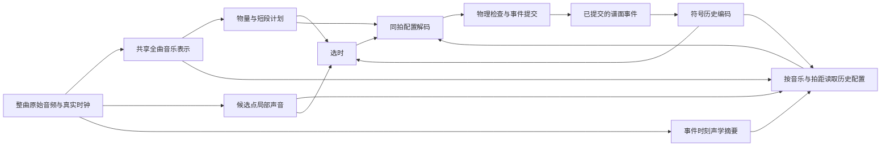

# 全曲音乐与历史配对：架构和改动交接

日期：2026-10-29。当前新增策略为 `song_paired_v3`，在主界面显示为“全曲音乐与历史配对（新版）”。原 `audio_grounded_v3` 主架构和 `chart_composer_v1` 家族名保留。**架构已经接通，但新版仍需正式训练和完整歌曲验收；不能把下面的测试记录当成音乐质量已经提高的证明。**

## 这次要解决什么

原模型可以读最近128个事件，却主要通过纯符号历史判断下一步怎么写。单独的8个音频配对锚点提供了一些帮助，但与主要历史通路分离。全曲规划虽然遍历整首歌，输出给配置的主要是密度、类型等统计，对不同音乐内容及其发展关系的表达有限。

本轮借鉴 `event_ctx` 的三个长处：局部声音和有顺序的全曲声音共同提供背景；实际已写前缀参与续写；短段内的多个目标共享音乐信息。没有恢复字符级长序列解码，也没有给歌曲强行贴主歌、副歌标签。

另一个事实需要纠正：前期讨论曾将旧 Planner 按主模型384维估算。实际旧 Planner 使用 `lens_width`，本机配置为64维。这次是信息组织方式的改造，不能宣传为“把384维规划器压成96维所以必然提速”。

## 当前架构怎样工作

可以把模型分成三个层次。

**第一层：听整首音乐，也听眼前细节。** 音频缓存仍保存实际声音、节拍与时间信息。新 `SongContext` 使用既有 PlanGrid 的计算窗口和准确拍/秒时钟，产生96维的连续音乐表示。局部卷积处理邻近变化，全曲注意力比较远近内容，融合时保留局部表示、全曲读取结果及两者差异。四拍只是计算单元；模型没有“这一格必须是一个小节”的规则。

长歌不会被硬截尾。全曲交互最多使用256个汇总键，按每首歌自己的有效长度压缩，避免同批另一首长歌的 padding 改变当前歌曲的表示。候选点按实际时间插值读取，不能把整首音频仅压成一个平均向量。

同一份音乐表示输出原来的6项物量计划和9项短段计划。第9项是从 `event_ctx` 复用的细分节奏占比，使用既有 `fine_note_ratio` 定义，包括原有的小容差。两套标签的窗口及单位并不完全相同，因此保留原有监督口径；合并的是音频编码，不是随意相加或删掉损失。原有曲线斜率监督继续使用，没有再叠一份 delta loss。

**第二层：把过去写过的配置与当时的声音对应起来。** 最近128个事件各自带有准确时刻的104维声学摘要，以及其所在位置的全曲音乐表示。训练时，整首谱面的事件摘要一次提取，然后切片；生成与恢复时，查询实际提交事件的时间，并使用有上限的原始声学缓存。未来谱面不进入这些输入。

已有历史编码器继续组织符号前缀。配置侧改用当前细节声音、全曲背景和相对拍距去读取配对历史，再把当前与历史音乐的差异、乘积关系及历史配置一起送入小型投影。这里没有“音乐一变就必须换配置”的硬门控，也没有固定音乐/符号75%与25%的配比。

为了保护原有采音能力，旧历史注意力继续参与选时；其输出在新版配置融合处被扣除，避免旧的纯符号读取和新的音乐配对读取重复注入。最近事件的尾部表示、局部几何、持续状态仍保留。新的全曲直接投影从零初始化开始学习。规划器本身已替换，因此迁移后整套输出不保证与旧模型相同。

**第三层：写当前配置并提交。** 选时仍在已有候选拍点上进行。配置头保留类型/真实起始位置分组和细节选择，保留同拍与跨拍几何、Slide/Hold 生命周期、Touch稳定采样、局部未来证据和动机档案。接受事件后，历史、占用状态与档案同步更新。对称、交互和常规配置仍从真实谱面学习，没有新增强制换区或固定对称规则。

## 连续短句训练实际实现到哪一步

新增“训练样本组织”：`phrase_groups_v1`。每首歌按真实拍位组成连续目标组，每组最多8个目标，跨度不超过16拍，然后打乱分组。每轮仍恰好访问原来的每个样本一次，保留歌曲局部性和原始批次容量。

**每个目标仍独立读取自己的已提交前缀。** 多目标共享全曲音频底座、事件声学表等计算；没有跨目标复用双向历史编码结果。这样避免将未来音符提前编码进过去。真正的“因果历史编码一次，服务整段所有目标”尚未实现，不能把本次分组采样描述成那种缓存算法。

旧检查点缺少此设置时按 `independent_events_v1` 解释。resume 必须继承原采样策略；fresh 的新版默认使用连续组，finetune 可明确选择连续组。改变样本组织可能改变梯度相关性，仍需比较训练效率和完整生成效果，不能仅凭目标相邻就断言配置更连贯。

## 为什么开销可以控制

- 同源音频、同一准确时间网格共享原始 PlanGrid 音频、mask和clock；不同难度的标签与权重独立保留。共享缓存按时间网格与完整TempoClock区分，每个声学上下文最多4份。
- 每次训练前向中，全曲编码按唯一音源/网格执行；难度条件在后面的小预测头读取。额外提供紧凑的唯一歌曲张量，避免反复执行完整编码。部分兼容标签与输入仍按样本组织，尚有小量传输可继续精简。
- 可训练状态只在当前前向内共享，不能跨参数更新缓存。生成时权重固定，全曲状态在循环外计算一次；恢复采样的缓存限制在当前恢复调用内。
- 删除新版中独立的8锚点注意力和独立phrase音频MLP。原策略仍有兼容实现，供旧检查点正确生成；它们不在新版前向中重复执行。
- 保留此前的CPU批量查询、原始声学缓存和供数调度优化。

## 主要文件与接口

| 文件 | 责任 |
| --- | --- |
| `composer/song_context.py` | 96维全曲编码、长歌汇总、条件后置读出 |
| `composer/quality_context.py` | 音乐寻址、相对拍距、配置与音乐差异融合、生命周期及gap读出 |
| `composer/grounded_model.py` | 接入统一底座，区分选时与配置的历史读取，推理缓存入口 |
| `composer/quality_inputs.py`、`data.py`、`planning.py` | 精确历史音频、共享原始歌曲表、9维标签、批内唯一音源索引 |
| `composer/sampling.py`、`train.py` | 连续目标分组、旧采样继承、训练和恢复 |
| `composer/generate.py`、`recovery.py`、`curve.py` | 实际生成前缀、一次编码全曲、恢复及曲线预测 |
| `composer/checkpoint.py`、`model.py`、`objectives.py` | 策略、输入合同、迁移报告和训练配方 |
| `composer/diagnose.py` | 改变前缀时同步重建配对音频，避免诊断工具自己制造错位 |

关键输入包括 `quality_history_audio`、`quality_history_clock`、历史及短段到PlanGrid的插值索引。`song_audio/song_mask/song_clock` 是唯一歌曲表，`song_inverse` 映射回样本。它们全部来自已知音频与实际已提交事件。训练标签不用于生成的音乐表示。

## 检查点与使用方式

v23原始完整点和推理点已额外保存在 `checkpoints/prism_composer_v23/archive/before_song_paired_20261029/`，原文件不覆盖。本轮开始时训练已经终止。

主界面新训练建议明确选择“全曲音乐与历史配对（新版）”，使用全新输出目录。fresh 自动选新版和连续短句采样。若要保留v23已有的采音、常规配置与动作因子作为初始化，使用 finetune、新目录，并明确选择新版及连续短句采样；不能通过resume把旧结构变成新结构。

迁移只复制形状一致且语义允许复用的权重，输出复制、丢弃、新初始化清单。全曲和配对新层仍需学习。旧 checkpoint 在原策略下仍可生成，便于与新版做固定音频/条件/种子对照。独立测试目录内的短程检查点仅作验证用途。

操作起点：CPU算子线程2、样本准备线程1、预取2。其余尺寸、batch与累积按显存选择，不能把旧完整点静默塞进新结构续训。新结构的学习率需要通过短程训练选择，不把几次更新的loss下降当成正式推荐依据。

## 验证与剩余问题

全部实现完成后执行统一验证：**1114项Python测试通过、1项跳过，62项界面测试通过**。覆盖新旧检查点合同、同源共享、不同条件标签隔离、历史配对、随机遮挡、空历史、变BPM、长歌填充不变性、连续分组完整性和恢复/诊断接口。

固定10首真实官谱，以同一v23检查点作旧版基线和新版初始化，batch96、历史128事件、候选96、33动作槽，CUDA BF16，预热6批后测24批：

| 指标 | cooperative_v2 | song_paired_v3 |
| --- | ---: | ---: |
| 流水线样本/秒 | 405.6 | 409.6 |
| 参数量 | 37,925,720 | 38,006,665 |
| GPU峰值 | 4.071 GiB | 4.166 GiB |

吞吐在短测波动范围内基本持平；参数增加80,945，约0.21%；峰值增加约97MiB。这里包含供数、传输、前向、loss和反向，不含优化器、恢复和保存，不代表完整epoch速度。基准使用同一组固定目标以隔离架构成本，未将新分组采样的收益混入比较。新旧结构的loss口径多了细分节奏通道，初始化也不同，不用两者loss高低证明质量改善。

另外完成：

- 真实数据4次主更新和1次恢复更新，梯度有限；完整保存与重载后的权重逐项一致。
- 新检查点实际曲线预测成功；同一音频和条件下用种子0、1各生成最多64个事件，验证空历史起步、逐步提交和生成缓存。它们是接口验收，不是完整歌曲质量对照。
- 使用完整训练清单、原v23作为显式初始化，通过实际CLI执行新版与连续短句分组：12批、2次优化器更新、2次恢复调用；每次恢复均接受2条样本并参与配置监督，保存训练点和推理点成功。
- 原v23第5轮/3030次更新的完整点和推理点均与额外备份SHA256一致。正式长训未重启，测试点仅在scratch目录。

可复查脚本与日志在 `.scratch/composer_song_pair_rework_20261029/`，稳定摘要见[验证证据](../evidence/COMPOSER_SONG_PAIRED_REWORK_20261029.json)。

尚需正式验收的是：完整歌曲的配置呼应、变奏、对称/常规配置稳定性、Touch比例、物量与残留冲突；以及在高密度、变BPM、长歌和重复段混音改变时是否仍稳定。不能用闭源项目的成功替代本项目的验证，但这些成功说明流式生成路线本身并不排斥结构感。
